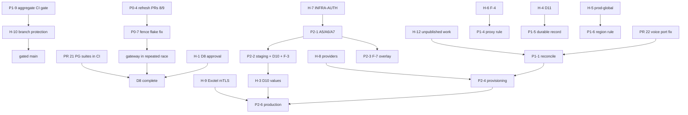

# Phase 15 — Project-Wide Readiness Audit and Execution Plan

**Dates:** 2026-10-17 to 2026-10-18.

**Scope:**
- a read-only audit of `main`, CI and the outstanding blockers;
- small fixes that need no credentials, deployment or external approval
  (§6);
- an inventory of unpublished work and a plan to reconcile it (§9).

**Evidence labels** (as in `docs/telephony/P1-4x`):
- **[V] verified:** observed in this audit through git, the GitHub API, CI logs
  or a local run;
- **[I] inferred:** reasoned from verified evidence; not observed directly;
- **[U] unavailable:** the evidence does not exist in the repository, or could
  not be obtained.

**Status: the audit is complete; PHASE 15 IS NOT CLOSED.** The closure blockers are listed in §10.11.8. Fourteen PRs are merged in Phase 15 (#17, #18, #19, #20, #22, #8, #21, #23, #24, #26, #28, #32, #31, #29), including the D8 CI items and the `ci-gate` aggregate check (§10, §10.9). **D8 is provisionally accepted by the owner, and is not closed** (§10.12). Final sign-off requires a green scheduled nightly on the exact current `main` commit, followed by the owner's explicit confirmation. Open, review-ready, not authorized for merge: #25, #27 (this record), #30, #33 and #34 (§10.11).

| PR | Change | State |
|---|---|---|
| #17 | Lint: the 15 single-finding modules | **merged** as `731934b` |
| #18 | Gateway startup test: two ports reserved together | **merged** as `a51504a` |
| #19 | Lint: `repository`, `telemetry`, `audiobridge` | **merged** as `d443bea` |
| #21 | D8: gateway real-PostgreSQL suites in CI | **merged** as `1e3b40d` |
| #22 | Voice tests: two ports reserved together (the flake that turned hardening red once on `a51504a`) | **merged** as `fce4e22` |
| #8 (owner's) | Gateway in the repeated race job, with a fence-test flake fix | **merged** as `7b59d25` (refreshed head `a44a41d`) |
| #20, #23 | This audit and its follow-up | **merged** as `9ec0ff6`, `1736d7f` |
| #24 | Lint: media-relay (35 → 0) | **merged** as `5f062bb` |
| #25 | Outbox: doc comments, and `MarkFailed` failures reported (12 → 0) | **open** at `dfd6e57`; not authorized for merge (§10.7) |
| #26 | `ci-gate`: an always-running aggregate check | **merged** as `806e75c`. The security-fix head was `6900db2`; the earlier heads `d8544ec` and `ec6fd57` had reproduced bypasses (§10.6, §10.7). |
| #28 | Lint: platform (16 → 1) | **merged** as `63a80a2` (§10.7) |
| #29 | `gateway-postgres`: print each failing test's complete output | **merged** as `3e38aa5` (§10.9) |
| #30 | `evalstore` `store_test.go` lint (27 → 11) | **open** at `ef34dce`; review-ready (§10.8.3) |
| #31 | Fence freshness test race (deterministically reproduced) | **merged** as `9184071` (§10.9) |
| #32 | `ci-gate` waits for jobs still running in a "completed" run | **merged** as `daed070` (§10.9) |
| #33 | `runtime` docs and test shadows (42 → 25) | **open** at `41e1dee` (the comment fix on top of `c8c3ed8`); review-ready (§10.11.3) |
| #34 | Lint: `telephony` test shadows (41 → 31) and `evalsubjects` session docs (26 → 20) | **open** at `5e0eaf5`; review-ready (§10.11.5) |

- **Lint:** the repository is **not lint-clean**. 21 golangci-lint jobs fail on
  `main`, with 933 findings (recounted from the logs in §10.10.6; §4 has the
  original count of 22 jobs and 983 findings).
- **Readiness:** staging is **NO-GO**, and Exotel AgentStream production media
  is **NO-GO** (§3.12–§3.13).

> **Phase-number collision [V].** "Phase 15" is already used by unpublished work.
> - **Where:** the owner's local `main` (`46d7b51`, `06e276d`) and the remote
>   branch `ci/telephony-integration/p118`.
> - **What it contains:** `docs/phase15/{DEPENDENCY_MAP,RESPONSE_FAILURE_SEMANTICS,SPEECH_COMPLETE_AUDIT}.md`,
>   `docs/phase16/` (13 files) and ADRs 0018–0023.
> - **Also untracked in the primary worktree:** `docs/phase17/` (7 files),
>   `docs/phase18/` (14) and `docs/phase19/` (10).
> - **None of it is on `main`.**
> - **This file:** uses a distinct name, so no path collides.
> - **Open:** the numbering is an owner decision (H-12 in §5.2).

---

## 1. Verified current state [V]

### 1.1 `main` and its CI

| Item | Evidence |
|---|---|
| `origin/main` | `d443bea1bffabdabf546a49362da640ee31fd718`, "chore(lint): … (#19)" |
| CI on `d443bea` | Backend Foundation 39058283525 **pass**; hardening 39058283518 **pass** (6/6 jobs); pr-go 39058283548: 115 jobs pass, **22 golangci-lint jobs fail**, no other failure |
| Hardening allowlist | `.github/workflows/hardening.yml:93` lists `services/go/voice` (17 entries) |
| Coverage floor | `hardening.yml:239`: `floor=60`. No workflow file changed in Phase 15, so the floor and every gate are unchanged. |
| Branch protection | **none.** `GET /branches/main/protection` returns 404, "Branch not protected" (§3.15). |
| Repository visibility | **public**, so standard GitHub-hosted runner minutes are free |

**The one red run in Phase 15 [V]:**
- hardening 39056746543 on `a51504a` (after #18) failed in "Race detector
  (repeated)" with the T9 port collision in §3.16;
- `a51504a` changed nothing hardening tests: `git diff 731934b a51504a`
  touches only the gateway, which is not in `AI_MODULES`;
- re-running the failed jobs passed;
- PR #22 fixes the cause.

### 1.2 Merged PRs

| PR | Head | Merge commit (squash) | Post-merge CI on `main` |
|---|---|---|---|
| #16 (Phase 14 T9 fix) | `33ca2e0` | `800861a` | hardening 39049073209 pass |
| #14 (Phase 14 T13) | `dc80b7e` | `ef2cb7e` | hardening 39050923782 pass (`services/go/voice 80.6%`) |
| #15 (Phase 14 report) | `f673234` | `567dec7` | Backend Foundation 39051981863, hardening 39051981887 pass |
| **#17** (Phase 15) | `4f4f905` | **`731934b`** (2026-10-17T17:59:03Z) | pr-go 39056107802: 112 pass, 25 lint fail, exactly the PR's own set; hardening 39056107780 pass; Backend Foundation 39056107850 pass |
| **#18** (Phase 15) | `c0c0b79` | **`a51504a`** (18:07:50Z) | pr-go 39056746542: 112 pass, 25 lint fail (unchanged); Backend Foundation 39056746587 pass; hardening 39056746543 **failed once, then passed on re-run** (§1.1) |
| **#19** (Phase 15) | `bea5ac3` | **`d443bea`** (18:29:00Z) | pr-go 39058283548: 115 pass, 22 lint fail (exactly the 3 targeted jobs fixed); hardening 39058283518 pass; Backend Foundation 39058283525 pass |

Each merge was pinned with `--match-head-commit`. Each resulting tree matches
its PR head on the PR's files.

### 1.3 Phase 14 report claims checked against evidence

| Claim in `docs/phase14/FINAL_REPORT.md` | Finding |
|---|---|
| Phase 14 COMPLETE; PR #16 → `800861a`, #14 → `ef2cb7e` | **confirmed** |
| Post-merge hardening 39050923782 passed with `services/go/voice` at 80.6% | **confirmed** |
| 40 lint jobs, 1,022 findings, none new | **confirmed** on `ef2cb7e` |
| No provider can be constructed (§9) | **confirmed on `main`.** The unpublished `06e276d` wires a whisper-cli recogniser (§9). |
| T9: "original failure output not retained"; latency-budget mechanism demonstrated; its role in the original failure inferred | **still accurate as written, but superseded in part.** A T9 failure was **retained** in Phase 15 (§3.16). It shows a **different, concrete cause**: a port collision in the test helper. The original unexplained failure could have been either mechanism [I]. PR #16's fix stands, since its mechanism was demonstrated; PR #22 removes the second. |
| §10 blocker list | **partly stale:** D8 has moved (§3.1) |

The Phase 14 report is the historical closure record and is **not edited**.
This section is the correction.

### 1.4 Working trees, branches and committed-content equivalence

- **Primary worktree** (`C:\Users\abhik\OneDrive\Desktop\Calling Agent`):
  - branch `telephony/p1-fence-rds-iam` at `ad4a734`;
  - 415 status entries (205 untracked paths; 360 untracked files when
    expanded), status hash `d4fb9c4206dc2168`. It was unchanged before and
    after every Phase 15 merge.
  - `infra/k8s/base/deployment.yaml` is ` D` (deleted, not restored).
- **#17's overlap with uncommitted edits:** #17 touched 15 files that also
  carry uncommitted edits in the primary worktree. Their SHA-256 hashes were
  recorded before the merge and were byte-identical after it.
- **The primary branch's commits are content-equivalent to `main`'s [V],**
  pair by pair (`git patch-id --stable` is identical, compared at file level
  too):

  | Primary branch | On `main` (via merge `89564e5`) |
  |---|---|
  | `0b6172a` | `75957b3` |
  | `105c2e5` | `0b1a83c` |
  | `3f3e1aa` | `a6e92fe` |
  | `8cbfeda` | `9545660` |
  | `ad4a734` | `cfcc910` |

  - `ad4a734` and `cfcc910` have **byte-identical content** on all 43 paths
    the chain touches.
  - `main` adds exactly one later commit on those paths, `ed99b89` ("fix test
    races and update x/text", 8 files).
  - So nothing the primary branch **committed** is missing from `main`.
- **Worktrees:** 18.
  - The 12 that existed before Phase 15 are all preserved. Three of them
    (`calling-agent-evalsubjects`, `-f11`, `-pr`) hold uncommitted work, whose
    status hashes were unchanged throughout.
  - Six were created for Phase 15: `calling-agent-phase15-lint`,
    `-phase15-ports`, `-phase15-lint2`, `-phase15-audit`, `-phase15-d8pg` and
    `-phase15-voiceports`.
- **Preservation branches (local, non-destructive):**
  - `preserve/unpublished-phase15-16-06e276d` → `06e276d`;
  - `preserve/unpublished-p118-2727df7` → `2727df7`.
- **Open PRs not touched:** #7, #8, #9 and dependabot #2–#5.
  - #8 and #9 merge with `main` without conflict, but their CI is **stale**:
    their bases predate #10–#13.

## 2. Where the blocker identifiers are defined

| ID | Defined in | On `main`? |
|---|---|---|
| D8, D9, D10 | P1-24 §6 (`P1-24_ARCHITECTURE_DECISIONS_REPORT.md:271-273`); restated in P1-27:49-51 and P1-36:26-28 | **No.** Those files are untracked in the primary worktree. `main` has only the statuses (P1-40:17, P1-41:7, :293). |
| D11 | P1-26:89, :178; P1-27:52; P1-36:29 | **No** (untracked) |
| INFRA-AUTH (A7), A5–A9 | P1-36 §3 (untracked); P1-41 §2.2, §4, §6 | P1-41 is on `main` |
| `prod-global` | P1-40:37, :84; ADR-0008:162-163; `docs/architecture/deployment.md:161` | yes |
| F-3, F-4, F-7 | P1-41 §3.3 (`P1-41_INFRA_AUTH_READINESS_AUDIT.md:116-120`) | yes |
| Exotel mTLS NO-GO | ADR-0004 (`0004-media-transport.md:163`); `EXOTEL_CONTRACT_CHECKLIST.md:46` and `EXOTEL_EVIDENCE_REVIEW.md:66` (untracked) | ADR yes; evidence docs no |

**Identifier collision [V].** Untracked Phase 18 documents reuse "D9" and "D11"
for **different** items:
- `docs/phase18/PHASE18_D9_ADAPTIVE_JITTER_FIX.md`: an adaptive-jitter stall;
- `docs/phase18/PHASE18_D11_AUTH_MIDDLEWARE_BLOCKER.md`: an auth-middleware
  blocker.

In this audit, D8–D11 always mean the **telephony** decisions of P1-24 and
P1-26.

**Inventory of the authoritative untracked documents [V]:**
- **39 files** under `docs/telephony/`: P1-10…P1-39, P1-49, P1-51…P1-53,
  `EXOTEL_CONTRACT_CHECKLIST.md`, `EXOTEL_EVIDENCE_REVIEW.md` and
  `CARRIER_MEDIA_STREAMING_CONTRACT.md`.
- **31 files** under `docs/phase17`–`docs/phase19`.
- Names, line counts and SHA-256 hashes were recorded locally at audit time.
- All were read only, never modified.

**Missing from `main` [U]:** a reader of `main` cannot learn what D8–D11 mean.
**Smallest resolution:** the owner commits these documents, or a decision
register summarising them (P1-8).

## 3. Blocker inventory

Each entry gives the requirement, the evidence, its dependencies, its risk, the
smallest safe resolution, acceptance criteria, and whether it can be completed
locally.

### 3.1 D8: CI and `-race` evidence for the gateway — **CI items merged and verified on `main`; not closed (§10.2)**

- **Requirement:** P1-36:26 ("Isolated CI push for `-race` evidence"). Its
  current components are in P1-45:147 and P1-44:185: "`-race` never run;
  real-PG suites not in CI; gateway not in nightly race; lint unknown; Go 1.25
  untested".

| Component | Status | Evidence |
|---|---|---|
| `-race` on the gateway in CI | **met** | pr-go runs `go test -race -count=1` for it (`pr-go.yml:129`); its job passes on every Phase 15 `main` |
| Lint for the gateway | **met** | `golangci-lint (services/go/telephony-gateway)` passes |
| Real-PG suites in CI | **met:** #21 merged | `gateway-postgres` 39094929971 on `main` `1e3b40d`: 127 pass, 0 fail, 0 skip |
| Gateway in the repeated race job | **met:** #8 merged | hardening 39094284808 on `main` `7b59d25`: 18 repeated-race logs, including the gateway (4 packages `ok`) |
| Go 1.25 | **evidenced historically; ongoing testing is an owner decision** | pr-go 38774455177 (2026-10-15, `89564e5`) built and tested the gateway under **go1.25.14** with `-race`: 4 packages `ok`. Gateway and `platform` production code is unchanged since. CI moved to 1.26.x in #12 (§10.2). |

- **PR #21** (`b6b5e7f`, branch `phase15/d8-gateway-postgres-ci`):
  - **What it adds:**
    - `.github/workflows/gateway-postgres.yml`;
    - `tools/scripts/gateway-postgres-tests.sh`, following the pattern of the
      unpublished P1-18 gate (`2727df7`).
  - **How the job works:**
    - `postgres:17.2-alpine`, pinned by digest `7e5df973…c96`;
    - a throwaway container: loopback, random port, `--pull never`, always
      removed;
    - a random one-off password, masked, and checked absent from the output;
    - the whole gateway suite under `-race`;
    - **any skipped test fails the job.**
  - **No secret** and no external endpoint is involved.
  - **Local evidence** (go1.26.9 linux/amd64, `-race`, real PostgreSQL 17.2;
    two runs):
    - **127 pass, 0 fail, 0 skip, 0 data races** each;
    - the script itself on the Windows host: 127 pass, 0 skip;
    - negative controls: a missing image exits 1; with the DSN hidden, 15 tests
      skip and the run exits 1.
  - **CI [V]:** run 39056609470, job "telephony-gateway (real PostgreSQL,
    -race)" **passed**: gcc 13.3, image digest `7e5df973…c96`, PostgreSQL 17.2,
    4 packages `ok`, **127 pass, 0 fail, 0 skip**. This is the first time the
    gateway's real-PostgreSQL suites have run in CI. Backend Foundation passes.
    pr-go and hardening are not triggered by this PR's paths.
  - **Follow-up (2026-10-18) [V]:** #21's CI ran against `731934b`, before #18
    changed the gateway's `buildinfo_test.go`. So #21 was also merged locally
    with `main` `9ec0ff6`, a detached worktree that was never pushed, and run
    again:
    - two Linux `-race` runs against throwaway PostgreSQL 17.2: **127 pass, 0
      fail, 0 skip, 0 data races, no password in output** each;
    - the script itself on the host: 127 pass, 0 skip, exit 0;
    - no container or network left behind.
- **Repeated race, measured on `main`'s gateway code** (go1.26.9, `-race`):
  - `-count=5 -shuffle=on`, three runs: **1 failed**
    (`TestFence_AStuckConfirmationExpiresOwnershipByTheClock`, "timed out
    waiting for the hung confirmation");
  - that test alone, `-count=900`: **5 failures**. That matches PR #8's own
    measurement of 4 in 900, and PR #8 contains an event-driven fix.
  - **Consequence:** adding the gateway to the repeated race job **before** that
    fix would make hardening flaky. PR #8 must be refreshed with `main` and
    re-run first.
- **PR #8 refresh (follow-up, 2026-10-18) [V]:**
  - **Preserved:** the original head `3067dfe` as the local branch
    `preserve/pr8-ci-d8-gateway-race-3067dfe`. The `calling-agent-pr`
    worktree, with its 20 uncommitted paths, was not touched.
  - **Refreshed:** `main` `9ec0ff6` merged in a new worktree with a normal
    merge commit, `a44a41d` (parents `3067dfe`, `9ec0ff6`). It was pushed as a
    fast-forward (`3067dfe..a44a41d`). No rebase, no force-push.
    - `hardening.yml` merged without conflict.
    - **The PR's net diff against `main` is still its 2 original files.**
  - **The fix (test-only):** before making `Holds` hang, the test now waits
    for the fence's sleep request and hands it back.
    - **Why it is correct:** `sleeping` has a buffer of one. Receiving the
      request proves the second confirmation has finished, and handing it back
      cannot block.
    - **Unchanged:** every assertion (`holdsHit == 3`, ownership before and
      after the validity window) and all production code.
  - **The workflow change:**
    - `RACE_EXTRA_MODULES` adds the gateway to the **repeated** race pass
      only, kept out of `AI_MODULES`, so no coverage floor or benchmark claim
      changes;
    - a per-module failure-kind summary runs **after** the existing data-race
      check, so race detection keeps precedence;
    - the single race pass is unchanged.
  - **Local** (go1.26.9 linux/amd64, `-race`):
    - the stuck-confirmation test, three runs of `-count=900`: **2,700/2,700
      pass**, against 5 failures in 900 on `main`'s code in the same
      environment;
    - the gateway, five `-count=5 -shuffle=on` runs: **5/5 pass** (560 pass, 0
      fail, 75 skip each), against 1 failing run in 3 on `main`'s code. The
      skips are the 15 real-PG tests × 5, which this job cannot run; #21 runs
      them.
    - gofmt, gofumpt, vet and gateway lint are clean.
  - **CI on `a44a41d`:**
    - hardening 39091418247: **6/6 pass**. Its repeated race job ran **18**
      module logs including `services_go_telephony-gateway.log` (4 packages
      `ok`); the single job ran 17, without the gateway. No race log has a
      failure or a data race.
    - Backend Foundation 39091418244: pass.
    - pr-go 39091418240: 115 pass, and the 22 failures are exactly `main`'s
      baseline lint set.
  - **Interaction with #21:** independent files. Together they close both
    remaining D8 CI items.
- **Dependencies:** review of #21; the owner's refresh of #8; the owner's D8
  sign-off on CI scope.
- **Acceptance:**
  - `gateway-postgres` passes on `main` with 0 skips;
  - the repeated race job lists the gateway and passes after #8.
- **Local?** Done locally; CI proof is in the PRs.

### 3.2 D9: may a later "Option A" edit the user-dirty `context.go` and `harness.go`? — **unresolved**

- **Requirement:** P1-24:272; P1-36:27 records it as "only relevant with D2
  (outbound)".
- **Evidence:** `packages/go/conversation/context.go` and `harness.go` are
  still ` M` in the primary worktree [V].
- **Dependencies:** an owner decision, and D2.
- **Risk:** low while D2 is not pursued.
- **Smallest resolution:** the owner answers "D9: wait" or "D9: may edit", or
  commits the two files.
- **Acceptance:** the decision is recorded in a committed document.
- **Local?** No; it is a decision about the owner's own uncommitted work.

### 3.3 D10: fence timing values — **unresolved**

- **Requirement:** heartbeat interval and timeout, and the derived grace
  window (P1-24:273; P1-41 §5). They must come from **staging measurements**
  E1–E9, never be guessed.
- **Evidence:** `services/go/telephony-gateway/internal/app/fence.go:41,44`
  declares the variables. P1-30B:141 says no gateway can become ready until
  they are set.
- **Dependencies:** INFRA-AUTH, A5–A9 and a staging run, so an AWS account and
  **spending**.
- **Risk:** guessing values could permit two owners.
- **Smallest resolution:** run the P1-42 runbook in an authorized staging
  environment.
- **Acceptance:** the P1-41 §5 pass criteria: zero overlap intervals, and a
  hand-over gap ≥ 0 at p99.9.
- **Local?** **No.**

### 3.4 D11: a durable record for `reject_unconfirmed` offers — **deferred**

- **Requirement:** P1-26:89, :178. Today the evidence for an unconfirmed
  reject lives only in the result, log, metric and event, so it is lost if the
  log is lost.
- **Dependencies:** an owner decision on the schema or migration.
- **Risk:** medium for auditability; none for call handling.
- **Smallest resolution:** after the decision, a table or outbox record with a
  migration, tested against disposable PostgreSQL. #21's pattern makes that
  testable in CI.
- **Acceptance:** a forced `reject_unconfirmed` leaves a durable row that
  survives a restart; the migration applies and rolls back.
- **Local?** Yes, **after** the decision.

### 3.5 `prod-global` region policy — **unresolved**

- **Requirement:**
  - `prod-global` also runs as `ENVIRONMENT=production`, so the code applies
    `prod-in`'s region list (`ap-south-1`, `ap-south-2`) to it;
  - a distinct policy needs a new decision, such as a deployment-identity
    variable (P1-40:37, :84).
- **Evidence:** `internal/app/iam.go:59-64` states this. ADR-0008:162-163 and
  `deployment.md:161` show `prod-global` is a scaffold only.
- **Dependencies:** an architecture or owner decision.
- **Risk:** none while `prod-global` has no deployment; a wrong-region
  identity once it does.
- **Smallest resolution:** decide the identifier and region list, then
  enforce it in `checkIAMEnvironment`.
- **Acceptance:** tests show a `prod-global` identity is refused outside its
  list, and `prod-in` is unchanged.
- **Local?** Yes, **after** the decision.

### 3.6 INFRA-AUTH (A7) and A5, A6, A8, A9 — **unapproved**

- **Requirement:** P1-41 §2.2, §4 and §6:
  - a separate staging account;
  - EKS with OIDC, IRSA and `rds-db:connect`;
  - Aurora with IAM authentication;
  - VPC endpoints, CloudTrail and ESO;
  - the SEP evidence items.
- **Evidence:** every `infra/terraform/envs/*` directory is empty and untracked
  (P1-41:18).
- **Dependencies:** an AWS account, operator principals, a budget owner,
  **spending**, and the owner's approval of A5–A9.
- **Risk:** high if done wrongly: account separation, cost and data.
- **Smallest resolution:** the owner approves A5 (manifests) and A6 (IaC)
  first. A6 can be written and reviewed before anything is applied.
- **Acceptance:** P1-41 §4.1's eight SEP evidence items; a budget alert in
  place before A7.
- **Local?** **No.** Only authoring the IaC is local, and it is unapproved.

### 3.7 F-3: STS credential early-refresh window — **open, low**

- **Evidence:** P1-41:116. `ExpiryWindow` appears nowhere in the gateway
  (`git grep` on `main`: 0 matches), so the SDK default of 0 applies [V].
- **Dependencies:** D10, with staging measurement E7.
- **Risk:** at worst a fail-closed re-dial blip.
- **Smallest resolution:** decide under D10; **no value is proposed**.
- **Acceptance:** an owner-chosen value, with a test that refresh happens
  that long before expiry.
- **Local?** The code is local; the value is not.

### 3.8 F-4: `HTTPS_PROXY` policy for STS — **open, owner decision**

- **Evidence:** P1-41:117. The gateway on `main` has no proxy handling
  (`git grep` finds no `HTTPS_PROXY`, `NO_PROXY` or `ProxyFromEnvironment`)
  [V].
- **Options:** (a) refuse startup in IAM mode; (b) ignore proxies for STS;
  (c) accept and document. P1-41 recommends (a).
- **Dependencies:** an owner choice only.
- **Risk:** low: TLS to STS stays verified.
- **Smallest resolution (option a):** a static check beside the existing
  static-key rule, which names the variable and never its value.
- **Acceptance:**
  - IAM mode refuses startup when `HTTPS_PROXY`, `HTTP_PROXY`, `NO_PROXY` or
    their lowercase forms are set, naming only the variable;
  - password mode is unaffected;
  - a mutation check shows the rule is load-bearing.
- **Local?** **Yes, once chosen.** It is not implemented here, because it is a
  policy choice.

### 3.9 F-7: the gateway manifest shape differs from the staging design — **open**

- **Evidence:**
  - P1-41:120: `replicas: 2` with RollingUpdate, against the A/B `Recreate`
    design (P1-39 O-1).
  - The gateway manifest `infra/k8s/base/services/telephony-gateway.yaml` is
    **untracked** owner work, with `replicas: 2` at line 58 and
    `type: RollingUpdate` at line 69 [V].
  - On `main`, the tracked `infra/k8s/base/deployment.yaml:7` also says
    `replicas: 2`. The primary worktree deletes that file, and the deletion is
    preserved.
- **Dependencies:** A5, the staging overlay.
- **Risk:** the staging test could not reproduce the designed topology.
- **Smallest resolution:** a staging overlay under A5. The base manifest is
  not changed.
- **Acceptance:** the overlay renders two single-replica `Recreate`
  workloads with anti-affinity.
- **Local?** The authoring is; the approval is not. Whether `deployment.yaml`
  stays on `main` is the owner's call.

### 3.10 The golangci-lint baseline — **open; engineering**

See §4. **Local?** Yes: mechanical classes now, judgment classes per finding.

### 3.11 Provider provisioning — **blocked, external**

- **Requirement:**
  - ADR-0017 §8 and Phase 14 §9: a `voice.Pipeline` needs providers;
  - every shipped provider shells out to an external binary or model.
- **Evidence:** the unpublished Phase 16 T8 audit (`46d7b51`,
  `docs/phase16/PROVIDER_READINESS_AUDIT.md`):
  - Ollama has zero models;
  - Piper is absent;
  - whisper `tiny` is cached locally;
  - no cloud provider exists.
- **Dependencies:** model downloads, choices of local or cloud per stage and of
  licence, and for cloud providers **credentials and spend**.
- **Smallest resolution:** the owner chooses the per-stage providers, then the
  unpublished Phase 16 work is reconciled (§9).
- **Acceptance:** a pipeline built from provisioned providers passes the voice
  end-to-end tests offline.
- **Local?** Not without downloads, which are not authorized.

### 3.12 Staging — **NO-GO**

- **Evidence:** P1-41:7 and P1-50:151.
- **Depends on:** §3.3, §3.6, §3.9 and the SEP evidence.
- **Local?** **No.**

### 3.13 Exotel AgentStream production media — **NO-GO**

- **Requirement:** ADR-0004 (`0004-media-transport.md:163`): "Carrier leg
  WebSocket must be WSS with mutual authentication."
- **Evidence:** the untracked `EXOTEL_CONTRACT_CHECKLIST.md:46`, under C2,
  records "no evidence Exotel supports" client-certificate mTLS.
  `EXOTEL_EVIDENCE_REVIEW.md:66` (Q2) is the question to ask.
- **Dependencies:** a **written carrier answer**: external, no credentials.
- **Smallest resolution:** obtain the answer to Q2. If it is "no", the owner
  decides whether to amend ADR-0004 or choose another carrier.
- **Acceptance:** a documented yes, with a CA chain or pin and a rotation
  notice; or a superseding ADR.
- **Local?** **No.**

### 3.14 Unpublished work — **open, owner work** (see §9 for the plan)

### 3.15 No branch protection on `main` — **open, repository admin**

- **Current state [V]:** `main` is unprotected. Merges need no passing check
  and no review, and CODEOWNERS teams are unresolved.
- **Not changed here:** no repository-admin authority was granted, and no
  branch-protection policy exists in the repository documentation.
- **Recommended policy:**
  1. **Require a pull request** before merging into `main`, with at least one
     approval once CODEOWNERS teams exist. Block force-pushes and deletion.
  2. **Require status checks**, with the branch up to date. These checks run on
     every pull request into `main`:
     - Backend Foundation (`ci.yml` has no path filter):
       **`Build & Test Backend Foundation`**.
     - **Path-filtered workflows.** `pr-go` and `hardening` run only when Go
       paths change, and `gateway-postgres` (after #21) only when gateway or
       platform paths change. A required check that never starts blocks the
       PR. So require them through an **aggregate job** that always runs and
       passes when the underlying workflow was not needed. That job does not
       exist yet; it is follow-up CI work, P1-9.
     - **Not lint:** keep the golangci-lint jobs advisory until the baseline
       reaches zero. Requiring them now would block every Go PR, and
       excluding findings would weaken the gate.
  3. Require conversation resolution.
- **Acceptance:** `GET /branches/main/protection` lists the agreed checks.
- **Local?** **No.** The admin applies it.

### 3.16 Port-collision flakes in service tests — **gateway fixed (#18); voice fix open (#22)**

- **Captured failure [V]:** hardening 39056746543, "Race detector (repeated)",
  `services_go_voice.log`, on `main` `a51504a`:

  ```
  --- FAIL: TestT9_FreshRunningServiceSignatureIsStable (2.31s)
      determinism_test.go:481: config invalid: … HTTP_PORT and HEALTH_PORT must differ, both are 34669
  ```

- **Cause [V]:** the voice test helper `freePort` released each listener
  before the next reservation, so `runningServiceWith` and the T13 SIGTERM
  test could get the same port twice. The T9 fresh-service test starts 20
  services per run (20 pairs), so it was the likeliest to hit it.
  - #18 fixed the same pattern in the gateway. There, a throwaway probe of
    20,000 pairs of the old pattern on Linux gave 1 duplicate.
- **PR #22** (`cd27dbe`):
  - **change:** `freePorts(t, n)` holds every listener until all n are known;
  - **local:** 77/77 under `-race`; the T9 fresh-service test 40/40; T13 10/10;
    two `-count=5 -shuffle=on` runs pass; coverage 80.6%, unchanged; lint
    findings identical to `main`;
  - **CI [V]:** hardening passes (race single and repeated, coverage, release
    gate), `services/go/voice` passes, and Backend Foundation passes. The 22
    failing checks are exactly `main` `d443bea`'s baseline golangci-lint jobs.
- **Follow-up (2026-10-18) [V]:** #22 merged locally with `main` `9ec0ff6`
  (detached, never pushed), go1.26.9, `-race`:
  - `TestT9_FreshRunningServiceSignatureIsStable` ×100: **100/100**;
  - the T9 stall regression test ×10 and all `TestT9_*` ×5: pass (60/60);
  - `TestT13_*` ×20: 60/60;
  - three `-count=5 -shuffle=on` module runs: pass;
  - vet clean.

  #22 changes only `_test.go` files, and no assertion. There is no dedicated
  deterministic regression test: the guarantee (distinct ports within a call)
  is structural, and the old pattern collided about once in 20,000 pairs, too
  rarely for a test to catch it reliably.
- **Relation to Phase 14:** see §1.3.
- **Acceptance:** #22 merged; hardening's repeated race job stays green on
  `main` across scheduled runs.

## 4. CI and lint baseline [V]

**On `main` `d443bea`:** 22 golangci-lint jobs fail with **983 findings**.
- 21 of the 22 modules have findings identical to the `ef2cb7e` baseline.
- The 22nd, `persistence`, differs only by its revive rule label, which
  alternates between `exported` and `var-naming` for the same two identifiers
  in unchanged code.

| State | Failing lint jobs | Findings |
|---|---|---|
| `main` `ef2cb7e` (Phase 14) | 40 | 1,022 |
| after #17 (`731934b`) | 25 | 1,006 |
| after #19 (`d443bea`) | **22** | **983** |

**Newly introduced findings in Phase 15: none.** After each merge, the failing
set on `main` equalled the PR's own failing set.

**By linter (983):**

| Linter | Findings |
|---|---|
| gocritic | 248 |
| revive | 193 |
| godot | 155 |
| errcheck | 123 |
| govet | 95 |
| gosec | 43 |
| errorlint | 43 |
| gocyclo | 39 |
| contextcheck | 16 |
| unused | 11 |
| other (8 linters) | 17 |

**By module:**
- `packages/go/voice` 170
- `audiointel` 114
- `evaluation` 105
- `toolruntime` 82
- `speech` 47
- `integrations` 45
- `runtime` 42
- `telephony` 41
- `governance` 41
- `services/go/identity` 38
- `media` 36
- `services/go/media-relay` 35
- `services/go/voice` 29
- `evalstore` 27
- `evalsubjects` 26
- `memory` 20
- `persistence` 20
- `platform` 16
- `conversation` 15
- `outbox` 12
- `middleware` 11
- `redis` 11

### 4.1 Remaining findings and a plan for small PRs [V]

**Where they are:** 817 of the 983 findings are in non-test files, 166 in
`_test.go`.

**By rule:**

| Rule | Findings | Behaviour risk |
|---|---|---|
| gocritic `rangeValCopy` | 160 | low, but changes aliasing if a loop body mutates its copy; review each |
| revive `exported` | 182 | none (doc comments) |
| revive `package-comments` | 7 | none |
| revive `var-naming` | 4 | **exported API renames** (`integrations`: fields `ApiKey`, `AuthId`). Renaming can change behaviour, such as JSON names without tags, so it needs a decision. |
| godot | 155 | none (151 "capital letter", 4 "end in a period") |
| govet `shadow` | 95 | low; rename or reuse |
| errcheck | 123 | **all in non-test code**: each needs handling or a justified ignore |
| errorlint | 43 | low to medium: `==` and type assertions become `errors.Is` and `errors.As`, which also match wrapped errors |
| gosec G115 (integer conversion) | 41 | medium: needs bounds reasoning per site |
| gocritic `builtinShadow` | 42 | low (renames) |
| other gocritic | 46 | low |
| gocyclo, nestif | 44 | refactor or justified `nolint`, per function |
| contextcheck | 16 | design (cancellation boundaries) |
| other (gosec G404/G304, unused, staticcheck, unconvert, nilerr, ineffassign, rowserrcheck, makezero, copyloopvar) | 25 | mixed |

**Recommended PR groups, smallest and safest first.** Each is one module or a
few. "Jobs → green" counts lint jobs the group would clear completely.

| Group | Modules | Findings | Jobs → green | Change |
|---|---|---|---|---|
| L1 | `redis` (11); `integrations` doc comments (41) | 52 | **1** (`redis`) | revive doc comments only. `integrations` stays red until its 4 `var-naming` renames are decided (L7). |
| L2 | `middleware` (10 + 1 errcheck), `outbox` (11 + 1 errcheck) | 23 | **2** | doc comments plus 2 errcheck decisions |
| L3 | `media-relay` | 35 | **1** | 32 doc comments, 2 errorlint, 1 godot |
| L4 | `identity` | 38 | **1** | 27 doc comments, 9 errcheck, 1 errorlint, 1 godot |
| L5 | `audiointel` godot only | 83 | 0 | comment-only (the job stays red: 31 others remain) |
| L6 | godot only in `packages/go/voice` (32), `runtime` (7), `services/go/voice` (7), `platform` (5), `media` (4) | 55 | 0 | comment-only |
| L7 | `integrations` `var-naming` (4); `persistence` (20) | 24 | 2 | **needs naming decisions first.** `integrations`: rename `ApiKey`/`AuthId`, checking serialisation. `persistence`: its `SqlUnitOfWork`/`NewSqlUnitOfWork` finding alternates between revive `exported` and `var-naming` from run to run, so both a doc comment **and** the naming decision are needed; plus 3 errcheck and 1 rowserrcheck. |
| L8+ | govet `shadow` per module, test files first; then errorlint; then errcheck, G115, `rangeValCopy`, gocyclo and contextcheck | ~673 | — | one module per PR, with that module's tests under `-race` |

**Rules for every group:**
- no formatting outside the flagged lines;
- no `nolint` without a one-line reason tied to the specific finding;
- no rule disabled in `.golangci.yml`;
- the module's tests run under `-race`;
- the failing-job set is compared against `main` before and after.

## 5. Phase 15 plan

### 5.1 Priorities

**P0: correctness, CI reliability and security, verifiable locally**

| ID | Item | State |
|---|---|---|
| P0-1 | Clear the single-finding lint jobs (15 modules) | **done:** #17 → `731934b` |
| P0-2 | Gateway startup-test port collision | **done:** #18 → `a51504a` |
| P0-3 | Clear the `repository`, `telemetry` and `audiobridge` lint jobs | **done:** #19 → `d443bea` |
| P0-4 | Bring PRs #8 and #9 up to date with `main` and re-run CI | #8 **done** (`a44a41d`); #9 not refreshed (out of scope) |
| P0-5 | Branch protection (§3.15) | repository admin |
| P0-6 | Voice service-test port collision, which made hardening red once | **PR #22**, open |
| P0-7 | Gateway fence-test flake, 5 in 900 (§3.1) | PR #8 refreshed (`a44a41d`), CI-verified, awaiting review |

**P1: engineering blockers that need no production access**

| ID | Item | Prerequisite |
|---|---|---|
| P1-1 | Reconcile the unpublished work (§9) | owner decision (H-12) |
| P1-2 | D8: PG suites in CI (**#21**), then the gateway in the repeated race job (#8) | review; P0-4/P0-7 |
| P1-3 | Remaining lint, module by module: mechanical classes first (godot, revive docs, errorlint, shadow), then the judgment classes (gocritic, errcheck, gosec, contextcheck, gocyclo), each fixed or given a justified `nolint` (P1-49 §3.1) | none |
| P1-4 | F-4 option (a) (§3.8) | owner choice |
| P1-5 | D11 durable record (§3.4) | owner decision |
| P1-6 | `prod-global` region enforcement (§3.5) | owner decision |
| P1-7 | Whether the gateway joins hardening's coverage floor (its `cmd/server` coverage is 6.7% in pr-go) | owner decision |
| P1-8 | Commit the D8–D11 and Exotel source documents (§2) | owner |
| P1-9 | An always-running aggregate CI gate job, so path-filtered workflows can be required checks | **PR #26**, open (§10.4) |

**P2: needs external prerequisites (accounts, spend, carriers, models)**

| ID | Item | Prerequisite |
|---|---|---|
| P2-1 | INFRA-AUTH: A5, then A6, then A7 (§3.6) | AWS account, budget, approvals |
| P2-2 | Staging run and D10 measurements; F-3 (§3.3, §3.7) | P2-1, A8, A9 |
| P2-3 | F-7 staging overlay (§3.9) | A5 |
| P2-4 | Provider provisioning (§3.11) | model downloads or cloud credentials |
| P2-5 | Exotel mTLS answer (§3.13) | carrier |
| P2-6 | Any production deployment | all of the above |

### 5.2 Genuine human approvals vs ordinary engineering

**Human approvals (owner, admin or external):**
- **H-1** D8 CI scope: #21; the refresh of #8
- **H-2** D9
- **H-3** D10 values, from staging data
- **H-4** D11
- **H-5** `prod-global` policy
- **H-6** F-4 option
- **H-7** INFRA-AUTH and A5–A9, with spend
- **H-8** provider choices and downloads
- **H-9** the Exotel answer (external)
- **H-10** branch protection (admin)
- **H-11** merging #20, #21 and #22, and the fate of #7, #8 and #9
- **H-12** the unpublished work (§9) and the phase numbering

**Ordinary engineering (normal PR review only):**
- the remaining lint batches (P1-3);
- test flake fixes like #18 and #22;
- the aggregate CI gate (P1-9);
- doc corrections;
- the code for P1-4, P1-5 and P1-6 once their decisions are recorded.

### 5.3 Dependency graph



## 6. Changes made in Phase 15

All local runs used Docker `golang:1.26.9-bookworm`, linux/amd64, with
golangci-lint v1.64.8, the version CI uses. Each change carries a secret scan
of its diff (clean).

| PR | Branch / head | Scope | Result |
|---|---|---|---|
| [#17](https://github.com/123Anujyadav/aegis-voice-agent/pull/17) | `phase15/lint-trivial-baseline` / `4f4f905` | 15 files: comments + 2 test lines | merged as `731934b` (§1.2) |
| [#18](https://github.com/123Anujyadav/aegis-voice-agent/pull/18) | `phase15/gateway-startup-distinct-ports` / `c0c0b79` | 1 test file | merged as `a51504a` |
| [#19](https://github.com/123Anujyadav/aegis-voice-agent/pull/19) | `phase15/lint-doc-comments` / `bea5ac3` | 4 files: comments + `err` reuse in a test | merged as `d443bea` |
| [#20](https://github.com/123Anujyadav/aegis-voice-agent/pull/20) | `docs/phase15-readiness-audit` | this file | this report's own PR; it describes `main` as of `d443bea` |
| [#21](https://github.com/123Anujyadav/aegis-voice-agent/pull/21) | `phase15/d8-gateway-postgres-ci` / `b6b5e7f` | 1 workflow, 1 script | open (§3.1) |
| [#22](https://github.com/123Anujyadav/aegis-voice-agent/pull/22) | `phase15/voice-test-distinct-ports` / `cd27dbe` | 2 test files | open (§3.16) |

**Considered and not implemented:**

| Item | Why not |
|---|---|
| F-4 option (a) | policy choice (H-6) |
| PR #8 / #9 refresh | the owner's PRs |
| The gateway in the repeated race job without #8's fix | it would make hardening flaky (5 in 900, §3.1) |
| Merging or reconciling `06e276d` | semantic conflicts and unreviewed owner work (§9, H-12) |
| Publishing `46d7b51` (docs) alone | it applies cleanly, but its reports and ADRs describe code that exists only in `06e276d`. On `main` they would describe behaviour that is not there. |
| Publishing `2727df7` alone | it applies cleanly, but it is 9,213 lines of unreviewed telephony programme code. 8 of its 36 files have since changed in the owner's working tree, so the commit is not the current version. |
| Lint judgment classes | per-finding review needed; batched as P1-3 |
| Branch protection | admin setting (H-10) |

## 7. NO-GO boundaries and external prerequisites

**Not done in Phase 15, and still not authorized:**
- deployment;
- any staging or production change;
- publicly exposed services;
- live carrier calls;
- AWS calls;
- model downloads;
- provider provisioning;
- spending;
- credential requests.

No secret was requested or used.
- **Fetches:** the Go module fetches were the repository's pinned
  dependencies, through the checksum-verified Go proxy.
- **Database:** the PostgreSQL image was already present locally; nothing was
  pulled.
- **Test passwords:** each was random, generated per run, and destroyed with
  its container.

**External prerequisites, in order:**
1. an AWS staging account and a budget owner (A6/A7);
2. the SEP evidence;
3. EKS OIDC and IRSA, and an Aurora user with `rds_iam`;
4. staging measurements for D10;
5. Exotel's written answer on client-certificate mTLS;
6. provider and model choices.

**The protected file:** `infra/k8s/base/deployment.yaml` stays deleted in the
primary worktree. It was not restored.

## 8. Next actions

1. **Owner:** answer the D8 decision request (§10.10.2).
2. **Owner:** review #25, #30 and #33 (verdicts in §10.10.3). Decide the outbox
   `FAILED`-entry policy (§10.9.7) and the lint-policy items (§10.9.5). Decide
   the `speech` items under the freeze (§10.10.5).
3. **Owner:** decide H-12, the unpublished work (§9).
4. **Admin:** branch protection and review rules; the exact configuration is in §10.8.4.
5. **Owner:** answer H-6 (F-4), H-4 (D11) and H-5 (`prod-global`).
6. **Engineering:** continue the P1-3 lint batches in the 21 remaining modules,
   only in files with no overlap with the owner's uncommitted work (§10.6).
7. **External, when authorized:** INFRA-AUTH (A5 → A6 → A7), then the staging
   D10 run; the Exotel Q2 answer.

## 9. Unpublished work: inventory and reconciliation plan

### 9.1 Inventory [V]

| Commit | Where | What | Size | vs `main` `d443bea` |
|---|---|---|---|---|
| `46d7b51` (2026-08-23) | local `main`; `origin/ci/telephony-integration/p118` | docs(phase16): Phase 15/16 audits, ADRs 0018–0023, a speech fixture, `.gitattributes` `*.raw` rule; "no production or test code" | 26 files, +3,842 | applies cleanly |
| `06e276d` (2026-08-23) | same | feat(phase16): `Pipeline.Speak`, barge-in forwarded to the conversation, `EventResponseAbandoned` (a Phase 15 T4 frozen amendment), acoustic gate skipping unmeasured confidence (Phase 16 T14), an internal `CallDriver`, whisper-cli as a development-class provider | 32 files, +10,368/−52 | **4 conflicts**, 4 more files changed on both sides |
| `2727df7` (2026-10-14) | `origin/ci/telephony-integration/p118` only | ci(telephony): the P1-18 integration gate. Callback ingestion and admission, `telephonystore` and `telephonyredis`, the throwaway-container runner and workflow; `go.work` gains 2 modules. | 36 files, +9,213 | applies cleanly; **8 of its files differ** from the owner's current working copies, and 28 are identical |

**Coherence:**
- `46d7b51` and `06e276d` are one feature set: the Phase 15/16 voice
  lifecycle, with the docs describing the code.
- `2727df7` is a separate programme, the Phase 19 / P1-18 telephony gate.

The untracked `docs/phase17`–`phase19` (31 files) show further phases exist
only as uncommitted work.

### 9.2 Both sides preserved

- **Local preservation branches:** `preserve/unpublished-phase15-16-06e276d`
  and `preserve/unpublished-p118-2727df7`. The commits are also on
  `origin/ci/telephony-integration/p118`.
- **Per conflicted file:** base (`beb46df`), `main`, unpublished, and the
  conflicted merge result were copied locally at audit time.

### 9.3 File-by-file: files changed on both sides

| File | `main` change | Merge | Resolution recommended |
|---|---|---|---|
| `packages/go/voice/pipeline.go` | P1-92 (`c294fc6`): `floor` mutex serialising floor decisions; generation read under the lock; `failSynthesis(generation, …)`; `sessionEnding()`; `noteTransition` | **7 conflicts** | **Semantic. Do not guess.** `06e276d` turns the speak path into error-returning `Speak(req)` with `abandon()` + `failTurn()` (EventResponseAbandoned), request-abort handling, and `sttSendClosed`. Hunk 1 (struct fields) is keep-both. Hunks 2–7 need a redesign: keep P1-92's lock discipline and generation capture, and route the unpublished side's abandon and abort outcomes through them. Then re-run P1-92's barge-in race tests (`-race -count=…`) and the Phase 15 T4 tests. |
| `packages/go/voice/bargein.go` | P1-92: `Interrupt` = `take()` under the floor lock, then counters and event | 1 conflict | Keep P1-92's split. Put `06e276d`'s `Planner.Handle(EventInterrupt …)` in `Interrupt` **after** `take()` succeeds, so it runs outside the floor lock: `take` must not wait on anything the turn goroutine holds. Verify `Handle` cannot block on the turn goroutine. |
| `packages/go/voice/pipeline_test.go` | P1-92: fake STT `afterAudio` gate | 2 conflicts | Keep both: `main`'s `afterAudio` and `06e276d`'s `strictSend`/`closeSendErr`, and combine their `Write` logic. Mechanical, but it must be tested. |
| `services/go/voice/cmd/server/main.go` | PR #16: `buildService(…, opts ...voiceintel.Option)` | 1 conflict | Keep `06e276d`'s `...serviceOption`. Add a `serviceOption` that carries `voiceintel` options (for example `withIntelligence(opts ...voiceintel.Option)`), and port T9's `deterministicService` / `runningServiceWith` to it. The frozen engine clock must still be injected through the production path. Re-run T9 (including `TestT9_RealStalls…`), T12 and T13. |
| `packages/go/conversation/engine.go` | gofumpt only (`8941669`) | auto | Review only. The frozen-module amendment in `06e276d` needs its recorded approval. |
| `packages/go/voice/fsm.go` | gofumpt only | auto | review only |
| `packages/go/voice/providers/whispercli/whispercli_test.go` | gofumpt only | auto | review only |
| `packages/go/voice/security_test.go` | gofumpt only | auto | review only |

The other 50 files in `06e276d` are new to `main`: 19 under
`services/go/voice`, 12 under `packages/go/voice`, 3 under
`packages/go/conversation`, and docs.

### 9.4 Branch and PR strategy (for the owner, after H-12)

1. **PR A (voice lifecycle):** a branch from `main` that merges
   `preserve/unpublished-phase15-16-06e276d` (both commits, so the docs stay
   with the code they describe). It resolves §9.3 as recommended.
   - **Evidence it must re-run:** P1-92's barge-in race suites; T9, T12 and
     T13; `-race -count=5 -shuffle=on`; lint compared with the baseline.
   - **Also:** reconcile ADR numbering (0018–0023 are free on `main`) and the
     docs/phase15 name collision.
2. **PR B (telephony gate):** decide whether the **current working copies** or
   `2727df7` are authoritative (8 files differ), then publish one of them.
   - Adding `telephonystore` and `telephonyredis` to `go.work` brings them into
     pr-go, whose lint baseline they would join. Measure that first.
   - #21's gateway job and P1-18's gate share the same pinned image and
     pattern, so they can later be unified.
3. **Untracked Phase 17–19 work:** inventory and commit it under the owner's
   own review. This audit does not touch it.

**Acceptance:** each PR shows only baseline lint failures, the race suites
named above pass repeatedly, and no preserved branch is deleted until its PR
merges.

## 10. Phase 15 closure record (2026-10-18)

### 10.1 Authorized merges [V]

The owner authorized exactly #21, #22, #8 and #23. Each was re-verified first:
- its head was unchanged from the reviewed SHA;
- it was mergeable, with an unchanged file list;
- its checks showed no non-lint failure.

Each was squash-merged with `--match-head-commit`. `main`'s CI was checked after
each merge before the next one.

| Order | PR | Head | Merge commit | CI on `main` after the merge |
|---|---|---|---|---|
| 1 | #22 | `cd27dbe` | `fce4e22` | Backend Foundation 39093315803 pass; hardening 39093315747 6/6 pass; pr-go 39093315743: 115 pass, 22 lint fail (exactly the baseline) |
| 2 | #8 | `a44a41d` | `7b59d25` | Backend Foundation 39094284761 pass; hardening 39094284808 6/6 pass; pr-go 39094284802: 115 pass, 22 lint fail (baseline). The repeated race job ran the gateway; the single job did not. |
| 3 | #21 | `b6b5e7f` | `1e3b40d` | `gateway-postgres` 39094929971 pass (127/0/0); Backend Foundation 39094929991 pass; hardening 39094929986 6/6 pass. pr-go was not triggered by these paths. |
| 4 | #23 | `3cee988` | `1736d7f` | Backend Foundation 39095491601 pass; hardening 39095491498 6/6 pass (docs only, so pr-go was not triggered) |

**New failures: none.** After each merge, `main`'s tree equalled the PR head on
the PR's files.

### 10.2 D8 / H-1 acceptance [V]

**Source of truth:** P1-36:26 (untracked) defines D8 as an approval: "Isolated
CI push for `-race` evidence". Its components:
- P1-45:147: "`-race` never run; real-PG suites not in CI; gateway not in
  nightly race; lint unknown; **Go 1.25 untested**";
- P1-44:185, the same without the last two;
- P1-50:151, the latest record on `main`: "D8 (nightly race, PG-in-CI: P1-49
  §3)".

| Criterion | Satisfied? | Evidence |
|---|---|---|
| `-race` runs on the gateway in CI | **yes** | pr-go runs it under `go test -race` on every gateway change. `gateway-postgres` and the repeated race job also use `-race`. |
| Real-PG suites in CI | **yes** | `gateway-postgres` 39094929971 on `main`: 127 pass, 0 fail, **0 skip**. Any skip fails the job. |
| Gateway in the nightly race | **yes by configuration; no scheduled run observed yet** | `hardening.yml` runs on `schedule: cron "0 3 * * *"` with the same race matrix. The gateway is in its repeated job (`RACE_EXTRA_MODULES`), shown on the push run 39094284808. The first scheduled run after `7b59d25` had not happened at the time of writing. |
| Lint | **yes, for the gateway** | `golangci-lint (services/go/telephony-gateway)` passes |
| Go 1.25 | **evidenced for the current production code; not re-run since; owner decision** | **Correction:** an earlier version of this row said nothing had compiled or tested the gateway with a 1.25 toolchain. That was wrong. **What the criterion meant:** P1-44 OBS-4/:187, P1-45 §3/:154 and P1-46:116/:137 recorded that local verification used go1.26.5 while CI pinned **1.25.x**, so "Go 1.25 untested" meant *compile and test under CI's 1.25 toolchain*, with the first pr-go run as the expected evidence. **That evidence exists:** pr-go 38774455177 (push of `89564e5`, 2026-10-15) ran `go test -race -count=1` on the gateway with **go1.25.14**, and all 4 packages passed. **Since then:** `git diff 89564e5 main` shows **no gateway or `platform` production-code change**, only two test files (#18, #8); #12 moved CI to 1.26.x because go1.25 has unfixed stdlib vulnerabilities (that same run's govulncheck failed). **Not evidenced on 1.25:** those two test edits, and the real-PG suites, which have only run on 1.26. `go 1.25.0` is the module's declared minimum (the `go` directive in 21 `go.mod` files and `go.work`); no document makes it a runtime-support promise. Whether the criterion counts as met by that run, needs a fresh 1.25 run, or should be restated for 1.26 is the **owner's decision**. It is not decided here, and the minimum is not changed. |
| Owner approval (D8 is defined as one) | **not recorded** | Authorizing #21 and #8 to merge is not a recorded D8 sign-off. H-1 remains with the owner. |

**D8 is therefore NOT marked complete.** Four technical criteria are met, the
nightly one has no scheduled run yet, the Go 1.25 criterion has historical
evidence but needs the owner's ruling, and the sign-off is not recorded.

### 10.3 Lint PRs (not merged; outside the authorization) [V]

| Batch | Result |
|---|---|
| `redis` (11 revive) | **not opened.** The owner's uncommitted rewrite of `packages/go/redis/redis.go` (+252/−14) already documents every exported declaration, so a PR from `main` would duplicate it and conflict. |
| `middleware` (10 revive, 1 errcheck) | **not opened.** The owner's uncommitted rewrite of `middleware.go` (+84/−37) would conflict, and the errcheck (`json.Encoder.Encode`) needs a handling decision. |
| `outbox` | **#25** (`0849606`): 11 doc comments; 12 → 1 finding. The remaining `_ = p.store.MarkFailed(...)` needs an **owner decision** (analysis in §10.6). CI: 22 lint jobs fail, the baseline set at the time, with none new. |
| `media-relay` | **#24** (`7739884`): 32 doc comments, 2 test comparisons → `errors.Is`, 1 godot rewording byte-identical to the owner's edit. **35 → 0**, and the job is green in CI (21 lint jobs fail, none new). Found and not fixed (a behaviour change): `RouteFrame`'s gap message reports the wrong "expected" number. |
| `identity` (38) | **not opened.** The owner's uncommitted rewrite of `identity.go` (+1,527/−70) already makes the `rand.Read` failure fatal and changes the flagged code. `main`'s `generateAccessToken` emits an **unsigned** token (`"Bearer_JWT." + hex(json)`), which the owner's untracked Phase 18 D11 report records as an auth-design blocker. Not decided here. |

**Lint on `main` `5f062bb` (after #24) [V]:** 21 failing jobs, **948 findings**,
counted from the 21 job logs. **Current:** see §10.7 (`main` `63a80a2`: 21
jobs, 933 findings).

### 10.4 Aggregate check: PR #26 (`ci-gate`; first version `d8544ec`, see §10.6) [V]

- **Trigger:** every `pull_request`, with no path filter.
- **What it does:**
  - reads each workflow's own `pull_request` branch and path filters from the
    checkout, failing closed on syntax it cannot evaluate;
  - waits for the expected runs on the PR head;
  - passes only if every job passed, with one exception: a `golangci-lint` job
    that also fails on `main`'s latest completed run is advisory. That ratchet
    means the baseline can only shrink.
- **Footprint:** read-only token; `gh` and the Python standard library only.
  No existing workflow changes.
- **Validation:**
  - 25 offline unit tests against the real workflow files, also run inside
    the job;
  - read-only live dry runs: #23, #22, #24 and #21 PASS; stale #9 FAIL, on a
    real test failure and on lint jobs that now pass on `main`;
  - the job's own run on #26 (workflow-only: only `ci.yml` expected): **PASS**,
    alongside Backend Foundation.
- **Making it a required check** is the repository admin's decision (§3.15).
  It was not done.

### 10.5 Second authorized round [V]

The owner authorized merging only #24 and #26, at their reviewed heads.

| PR | Head | Result | CI on `main` |
|---|---|---|---|
| #24 | `7739884` | **merged** as `5f062bb` | Backend Foundation 39096846419 pass; hardening 39096846456 6/6 pass; pr-go 39096846468: 116 pass, 21 lint fail. The only change from the previous baseline is `golangci-lint (services/go/media-relay)`, now passing. |
| #26 | `d8544ec` | **not merged.** Review found two defects (§10.6). The fix is a new head, `ec6fd57`, outside the authorization. | — |

### 10.6 Findings from this round [V]

**#26 review, the defects in `d8544ec`:**
1. **The PR controlled its own verdict.** The job ran `tools/ci/ci_gate.py`,
   and read the other workflows' path filters, from the PR checkout. A PR could
   make the gate pass by editing the script, or by narrowing another
   workflow's `paths`.
2. **The lint exception could mask new findings.** It was per job, so new
   findings in a module whose lint job already failed on `main` passed.

**The attempted fix, `ec6fd57`. Superseded: a later review found two more bypasses in it (§10.7).**
- **Trusted verdict:** the verdict comes from the gate and filters at the PR's
  **base** commit. The PR's own copy is only unit-tested, which can fail the
  job but never pass it. Bootstrap: while the base has no gate, the PR's copy
  is used, with a warning.
- **Finding-level lint comparison:** both job logs are compared, counted per
  (file, linter). A higher count, a new pair, or a failed job with no
  parseable finding blocks.
- **Hardening:**
  - logs are fetched with `gh --allow-escape-sequences`, because gh refuses
    ANSI output; the codes are stripped;
  - `gh` calls are retried, then fail closed;
  - repository and PR number reach the script through `env`.
- **Evidence:**
  - 46 unit tests, including end-to-end simulations;
  - 2 mutation checks, each caught;
  - the parser reproduces `main`'s counts exactly (948);
  - live dry runs: #25, #27 and #21 PASS; stale #22 and #9 FAIL, for the right
    reasons;
  - the job's own bootstrap run on `ec6fd57`: 46 tests OK, **PASS**.
- **Residual:** a PR editing `ci-gate.yml` itself is trusted only through
  review. Requiring review for `.github/**` and `tools/ci/**` is recommended.

**#25, the `outbox` `MarkFailed` discard:**
- **Correction:** the discard is **not documented** anywhere; "deliberate" was
  an inference.
- **When `MarkFailed` succeeds**, the entry becomes `FAILED`.
  `PostgresOutboxStore.FetchPending` selects only `PENDING`, so the entry is
  **never retried**, and nothing on `main` requeues it.
- **Only when `MarkFailed` fails** does the entry stay `PENDING` and get
  re-published, with the error lost.
- `ProcessBatch` has no callers on `main`.
- **Options:**
  - (A) `errors.Join` the errors into the returned value. This is the smallest
    fix; it changes the contract.
  - (B) inject a logger or metric;
  - (C) a justified `nolint`, which is suppression.
- **Separate design gap:** there is no retry or dead-letter path for `FAILED`
  entries.
- **All of these need an owner decision.** #25's description was corrected,
  and its code is unchanged.

**The next lint batch:** #28 (`8871a49`), `platform` 16 → 4.
- **Changes:** 5 godot, and 7 `httpNoBody` in a test.
- **Left for decisions:** gocyclo ×2, errcheck ×1 and contextcheck ×1.
- **Overlap:** none; its files equal `main` in the owner's working tree.
- **Overlap check across all 21 modules:** only `outbox`, `platform`,
  `memory`, `evalstore`, `governance`, `runtime`, `toolruntime` and
  `audiointel` have findings solely in files the owner has not modified.

### 10.7 Third authorized round (2026-10-18) [V]

The owner authorized merging only #26, at exactly `6900db2`, and #28, after
review and passing checks.

#### 10.7.1 Merges and post-merge CI

| PR | Reviewed head | Merge commit | CI on `main` |
|---|---|---|---|
| #26 | `6900db2` | `806e75c` (05:23:44Z) | Backend Foundation 39100396787 pass; hardening 39100396783 6/6 pass. `ci-gate` runs on pull requests only. |
| #28 | `f6216bc` | `63a80a2` (05:41:22Z) | Backend Foundation 39101412503 pass; hardening 39101412427 6/6 pass; pr-go 39101412466: 116 pass, 21 lint jobs fail (baseline). `gateway-postgres` 39101412491 **failed on attempt 1** (one fence test) and **passed on attempt 2** (127/0/0); see §10.7.3. |

**The 11 merged Phase 15 PRs, from the merge records:**

| PR | Merge commit |
|---|---|
| #17 | `731934b` |
| #18 | `a51504a` |
| #19 | `d443bea` |
| #20 | `9ec0ff6` |
| #22 | `fce4e22` |
| #8 | `7b59d25` |
| #21 | `1e3b40d` |
| #23 | `1736d7f` |
| #24 | `5f062bb` |
| #26 | `806e75c` |
| #28 | `63a80a2` |

The nine before this round were counted correctly at `d13ac33`.

#### 10.7.2 #26 security review: the gate that merged

**Two further bypasses in `ec6fd57`**, both reproduced or confirmed, and fixed
in `6900db2`:
1. **The PR's own code ran before the verdict, in the same workspace.**
   - **How:** the PR's gate tests ran before the verdict step, so a PR test
     could overwrite `trusted/tools/ci/ci_gate.py`.
   - **Reproduced locally:** the trusted file's hash changed, and the verdict
     printed `PASS (tampered)` and exited 0.
   - **Fix:** only checkouts precede the verdict, and the PR's tests run last.
2. **`pull_request.base.sha` is stale.** GitHub does not keep it current: #25
   recorded `fce4e22` while `main` was `5f062bb`. Every PR opened before the
   gate merged would have run its own copy through bootstrap.
   - **Fix:** the trusted checkout is `github.base_ref`, the current base
     branch tip.

**Defence in depth:** the report is printed between `::stop-commands::`
markers.

**Evidence at `6900db2`:**
- 53 unit tests, including structural guards on `ci-gate.yml`: `base_ref`;
  only checkouts before the verdict; an early PR checkout only for bootstrap;
  read-only permissions; no `${{ }}` in `run:`; no persisted credentials.
- 5 mutation checks, each caught.
- **Simulation of the fixed order:** the verdict failed for #9 before a
  malicious PR test tampered with the file, and the job still failed.
- **Live dry runs:** #27 and #28 PASS; #25 FAIL, correctly, because it was stale
  against #24.
- **The gate's first trusted (non-bootstrap) run on a PR,** #28: filters read
  from `trusted/`, 21 baseline lint jobs compared finding by finding, PASS.

**Non-blocking observations:**
- Runs are matched by head SHA, not by PR number. That adds no power, since a
  PR author already controls the workflow files that produce those runs.
- The step summary renders PR-controlled names as Markdown, which is cosmetic.

**Residual (unchanged):** GitHub runs a PR's own version of a workflow file, so
a PR editing `ci-gate.yml` or `pr-go.yml` is trusted only through review
(§10.7.6).

#### 10.7.3 #28, and the `gateway-postgres` flake

- **#28 (`f6216bc`):** `platform` 16 → **1**.
  - **Comments and tests:** godot ×5; `httpNoBody` ×7. Go 1.26.9 builds
    identical requests for `nil` and `http.NoBody`, checked empirically.
  - **contextcheck:** `shutdown` derives its budget from `Run`'s context with
    `context.WithTimeout(context.WithoutCancel(ctx), ShutdownTimeout)`. That is
    the same timeout and the same independence from `Run`'s cancellation, and
    the context's values are now kept. A new test pins it; both of its
    mutations fail it.
  - **gocyclo:** `populate` and `assign` split by verbatim moves into
    `populateField` and `assignStringSlice`.
  - **Left for a decision:** the documented `writeJSON` encode discard.
- **The flake:** `TestPostgresFence_ATerminatedOwnerSessionHandsOverWithoutOverlap`
  failed once on `main` `63a80a2` (10.47 s). It is **not a regression from
  #28**:
  - the same code passed on #28's head;
  - it passed 30/30 locally under `-race` with real PostgreSQL on both
    `63a80a2` and the pre-#28 `1e3b40d`;
  - the CI rerun passed.
- **Cause unknown:** the job printed only the last 80 lines, so the message was
  lost. **#29** (`e98b134`) makes the script use `go test -json` and print each
  failing test's complete output. It was validated with an injected failure,
  hidden-DSN skips and a missing image. **Open:** root-cause the flake at its
  next occurrence.

#### 10.7.4 #25: outbox `MarkFailed` (`dfd6e57`; not merged)

- **Implemented, option A:** a `MarkFailed` failure is `errors.Join`ed with the
  publish error that caused it, processing continues, and `ProcessBatch`
  returns the joined error alongside the count.
  - **Unchanged:** the success path, a fetch failure, and a `MarkPublished`
    failure (not counted, not reported).
  - **Callers:** `ProcessBatch` has **no callers on `main`**.
- **Tests:** the new `outbox_test.go` has 6 tests, 30/30 under `-race`, with
  93.8% coverage. Restoring the discard fails 2 of them.
- **Lint and CI:** lint 12 → **0**. CI: 20 lint jobs fail (`main`'s 21 minus
  `outbox`); `ci-gate` PASS.
- **Architecture decision required (ADR-0009): not taken.**
  - **Current state:** entries marked `FAILED` are terminal.
    `PostgresOutboxStore.FetchPending` reads `status = 'PENDING'` only, nothing
    requeues a `FAILED` entry, and `retry_count` is written but never read.
  - **ADR-0009 says** dead-letter topics "must be monitored", and `eventbus`
    defines `DeadLetterTopic()`, but the outbox uses neither.
  - **To decide:**
    - (1) whether `FAILED` entries are retried, and with what bound and
      backoff;
    - (2) whether exhausted entries are published to the topic's `.dlq`;
    - (3) what alerts on `FAILED` and DLQ depth.

#### 10.7.5 D8: three separate questions, and the owner decision request

| Question | Evidence | Status |
|---|---|---|
| **A. Go 1.25 (historical)** | pr-go 38774455177 (push of `89564e5`, 2026-10-15): `go version go1.25.14 linux/amd64`, `go test -race -count=1` on the gateway, 4 packages `ok`. Since then (`git diff 89564e5 63a80a2`): **gateway** production code is **unchanged**. **`platform`** production code **changed in #28**: the `config.go` refactor, the `server.go` shutdown context, and comment rewording in `health.go` and `logging.go`. Those changes have run only on Go 1.26. | **evidenced historically, for the code as of `89564e5`.** It does not prove current behaviour. |
| **A′. Go 1.26 (current)** | pr-go 39101412466 on `63a80a2`: gateway tests, lint and govulncheck pass under go1.26.9. Hardening repeated race passes with the gateway on `7b59d25`, `1e3b40d`, `1736d7f`, `5f062bb`, `806e75c` and `63a80a2`. `gateway-postgres`: 127/0/0 on `1e3b40d` and on the `63a80a2` rerun; one flaky failure on `63a80a2` attempt 1. | **current CI evidence on 1.26** |
| **B. Nightly scheduled race** | The last scheduled hardening runs (10-15 on `beb46df`, 10-16 on `89564e5`, 10-17 on `1f58266`) all **failed**, before #8 and #13. The 10-17 run failed on a speech barge-in flake that #13 later fixed. **No scheduled run has occurred since #8 merged** (checked 2026-10-18 ~06:00Z; the cron is `0 3 * * *`, and runs start late, about 07:30Z). | **pending a scheduled run.** No manual run was dispatched: the push-triggered hardening runs on `main` already run the same matrix, and a manual run is not a scheduled run. |
| **C. Owner sign-off** | none recorded | **pending** |

**Decision request for the owner:**
1. **Go 1.25.** Does run 38774455177 satisfy "Go 1.25 untested" (P1-45:147)?
   - **(a) Yes, as historical evidence.** This is the recommendation: it
     matches the criterion's meaning, "compile and test under CI's 1.25.x"
     (P1-44 OBS-4, P1-45:154).
   - **(b) No: require a fresh 1.25 run**, which needs a CI change to add a
     1.25 job.
   - **(c) Restate the criterion for 1.26**, the CI policy since #12.

   Consequence: (a) closes it now; (b) adds a CI job; (c) is a criterion
   change only the owner can make. **Neither the declared minimum nor the
   criterion is changed here.**
2. **Nightly.** Wait for the first scheduled hardening run on current `main`
   (recommended), or accept the push-triggered runs as equivalent.
3. **Sign-off.** After 1 and 2, approve D8 explicitly. **Until then D8 stays
   open.**

#### 10.7.6 Review policy for `.github/**` and `tools/ci/**` (recommendation; not applied)

- **The gap:** `main` has **no branch protection** (API 404).
- **Why review matters:** GitHub runs a PR's own workflow files, so `ci-gate`'s
  verdict and every other check is only as trustworthy as review of
  `.github/workflows/**` and `tools/ci/**`.
- **Why CODEOWNERS cannot enforce it today:**
  - it assigns `/.github/workflows/` to `@callscreen/platform` and
    `@callscreen/security`, but **those teams do not exist**: the repository is
    user-owned and has **one collaborator** (`123Anujyadav`, admin);
  - `tools/ci/` has no specific entry.
- **Proposed rules:**
  1. add `/tools/ci/  @123Anujyadav` and point `/.github/` and
     `/.github/workflows/` at real accounts;
  2. a branch-protection rule (or ruleset) on `main`: require a pull request;
     require the `ci-gate` and `Build & Test Backend Foundation` checks; block
     force-pushes and deletion;
  3. "require review from code owners" **only once a second reviewer exists**.
     GitHub does not let a PR's author approve it, so with one collaborator it
     would block every merge, or require admin bypass on each one.
- **Permissions:** the account has admin rights, so it *could* apply this.
  **Not applied:** settings changes are not authorized.

#### 10.7.7 Lint baseline, and `SqlUnitOfWork`

- **`main` `63a80a2` [V], counted from the 21 job logs:** 21 failing jobs, **933
  findings**. That is 948 − 15 from #28.

  | Module | Findings |
  |---|---|
  | `voice` | 170 |
  | `audiointel` | 114 |
  | `evaluation` | 105 |
  | `toolruntime` | 82 |
  | `speech` | 47 |
  | `integrations` | 45 |
  | `runtime` | 42 |
  | `telephony` | 41 |
  | `governance` | 41 |
  | `identity` | 38 |
  | `media` | 36 |
  | `services/go/voice` | 29 |
  | `evalstore` | 27 |
  | `evalsubjects` | 26 |
  | `memory` | 20 |
  | `persistence` | 20 |
  | `conversation` | 15 |
  | `outbox` | 12 |
  | `redis` | 11 |
  | `middleware` | 11 |
  | `platform` | 1 |

  With #25: 20 jobs, 921.
- **`SqlUnitOfWork`:**
  - **The evidence:** `.golangci.yml` enables revive `var-naming`, which is
    repository policy. Every other SQL identifier uses the initialism in
    capitals (`upsertSQL`, `SQLSTATE`). It has no callers outside
    `persistence.go`.
  - **The fix it implies:** rename to `SQLUnitOfWork`/`NewSQLUnitOfWork`, plus
    a doc comment (the finding alternates between both labels).
  - **Blocked:** `persistence.go` has uncommitted owner edits that still use
    `Sql…`, so a rename on `main` would collide. Do it when that work lands.

#### 10.7.8 Blocker register

| Item | Owner / dependency | Next action | Readiness |
|---|---|---|---|
| D8 | owner (§10.7.5) | answer the decision request | open |
| Outbox `FAILED` policy | architecture (ADR-0009) | decide retry, DLQ and alerting | — |
| `writeJSON` encode discard | owner | approve a justified `nolint`, or add a logger | lint 1 finding |
| Fence flake | engineering, after #29 | capture the message at its next occurrence, then root-cause it | — |
| `SqlUnitOfWork`; `integrations` `ApiKey`/`AuthId` renames | owner work in progress; naming decision | rename after the owner's persistence work lands | — |
| Unpublished `46d7b51`/`06e276d` (voice) | owner (H-12) | semantic reconciliation of `pipeline.go` per §9.3 | — |
| Unpublished `2727df7` (P1-18) | owner | decide between the working copies and the commit (8 files differ) | — |
| D9, D10, D11, `prod-global`, F-3, F-4, F-7 | owner / architecture; staging for D10 and F-3 | decisions per §3 | staging **NO-GO** |
| D9/D11 identifier collision (Phase 18 docs) | owner | choose authoritative names | — |
| INFRA-AUTH, A5–A9 | owner; AWS account and budget | approvals, then A6 IaC | staging **NO-GO** |
| Provider / model provisioning | owner; downloads or credentials | per-stage choices | — |
| Exotel client-certificate mTLS | Exotel (written answer) | ask Q2 | production media **NO-GO** |
| Branch protection and review | repository admin | §10.7.6 | — |

### 10.8 Fourth round: verification, flakes and ledger (2026-10-18) [V]

No merges were authorized in this round. `main` is unchanged at `63a80a2`.

#### 10.8.1 Fence test flakes

- **Reproduced locally** (fence package, `-race -count=10`, real PostgreSQL),
  1 failure in 500 tests:

  ```
  --- FAIL: TestFence_ConfirmationFreshnessIsMeasuredFromWhenTheQueryWasSent (5.00s)
      audit_test.go:37: timed out waiting for the slow confirmation to be recorded
  ```

- **Cause:** the race #8 fixed elsewhere. Ownership reads true from
  acquisition onwards, so the test can read `before` before the fence starts
  its second confirmation. `holdsHit` then overshoots `before+1` once the
  test's poll is descheduled.
- **Deterministic reproduction** (scratch copies only): delay the second
  confirmation's start by 200 ms and the test's first poll by 50 ms.
  - before the fix: 10/10 FAIL, with exactly that message;
  - after: 10/10 PASS.
- **Fix: #31** (`547e4c8`), test-only. The same receive-and-restore as #8.
- **#31's CI:** no new failures; `ci-gate`, `gateway-postgres` and the repeated
  race job PASS.
- **Not fixed:** three other tests share the ordering pattern
  (`credentials_test.go:117`, `fence_test.go:232`, `fence_test.go:257`). None
  has an observed failure, so they are left as a recorded latent risk.
- **The CI failure on `63a80a2`** was a different test,
  `TestPostgresFence_ATerminatedOwnerSessionHandsOverWithoutOverlap`. It did not
  reproduce in 150 isolated runs or 30 package runs, and its message was lost.
  #29 makes its next occurrence diagnosable. **Open.**

#### 10.8.2 `ci-gate` on #30: a GitHub inconsistency

- **What happened:** pr-go run 39105541791 reported **completed/failure** while
  `govulncheck (packages/go/evalstore)` was still **in_progress**, with no
  completion after more than 10 minutes.
- **The gate failed closed** (`incomplete`): correct, but premature.
- **Recovery:** pr-go was re-run (attempt 2, every job completed), then the
  gate was re-run: **PASS**.
- **#32** (`0fb044d`) makes the gate keep waiting while a "completed" run still
  has a running job; the existing timeout still ends a stuck job as FAIL.
  - **Tests:** 56, 3 new; removing the check fails 3.
  - **CI:** Backend Foundation and `ci-gate` PASS.

#### 10.8.3 New lint PR

- **#30** (`ef34dce`): the 16 findings in `evalstore`'s `store_test.go`
  (14 shadow, 2 stringXbytes), test-only.
  - **Module total:** 27 → 11.
  - **Tests:** with real PostgreSQL, `-race -count=3`: 81 pass, 0 fail, 0 skip,
    0 races.
  - **CI:** the 21 failing jobs are the baseline set, none new; `ci-gate`
    PASS after the pr-go re-run.

**Baseline on `main` `63a80a2` (counted from logs):** 21 jobs, 933 findings,
unchanged. Prospective, if merged:

| Merged | Jobs | Findings |
|---|---|---|
| #25 | 20 | 921 |
| #30 | 21 | 917 |
| #25 and #30 | 20 | 905 |
| #25, #30 and #33 | 20 | 888 |

#### 10.8.4 Recommended branch protection for `main` (not applied)

`PUT /repos/123Anujyadav/aegis-voice-agent/branches/main/protection`:

```json
{
  "required_status_checks": {
    "strict": true,
    "checks": [
      {"context": "ci-gate", "app_id": 15368},
      {"context": "Build & Test Backend Foundation", "app_id": 15368}
    ]
  },
  "enforce_admins": true,
  "required_pull_request_reviews": {
    "required_approving_review_count": 0,
    "require_code_owner_reviews": false,
    "dismiss_stale_reviews": false
  },
  "restrictions": null,
  "allow_force_pushes": false,
  "allow_deletions": false,
  "required_conversation_resolution": true
}
```

- **The checks:** `app_id` 15368 is GitHub Actions, which binds each check to
  Actions so another app cannot satisfy it. Both checks run on every PR into
  `main`.
- **`enforce_admins: true`:** the sole admin cannot push directly, but can
  still merge their own PR once the checks pass. Zero approvals are required,
  so that remains possible.
- **No code-owner review:** with one collaborator it would block every merge,
  because GitHub does not let authors approve their own PRs.
- **CODEOWNERS (a separate file change, for the owner):**
  - add `/tools/ci/ @123Anujyadav`;
  - point `/.github/` and `/.github/workflows/` at real accounts (the
    `@callscreen/*` teams do not exist);
  - turn on `require_code_owner_reviews` once a second reviewer exists.

#### 10.8.5 D8 decision request (consolidated; owner sign-off pending)

**Criterion** (P1-45:147; P1-44:185; P1-50:151): "`-race` never run;
real-PG suites not in CI; gateway not in nightly race; lint unknown; Go 1.25
untested".

| Item | Evidence | State |
|---|---|---|
| `-race` in CI | pr-go, `gateway-postgres` and the repeated race job all run the gateway under `-race` | met |
| Real-PG suites in CI | `gateway-postgres` 127/0/0 on `main`; one flaky failure on `63a80a2`, passed on re-run | met, with one open flake |
| Gateway lint | passes | met |
| Nightly race | **Scheduled** hardening run **39108532041** (`event=schedule`, `main` `63a80a2`, started 2026-10-18T07:40:12Z): **6/6 jobs passed**. Its repeated race job ran 18 module logs, including `services_go_telephony-gateway.log` (4 packages `ok`); the single job ran 17. No race log has a failure or a data race. | **met (scheduled evidence)** |
| Go 1.25 | run 38774455177 (go1.25.14, `-race`, 4 gateway packages `ok`) for the code at `89564e5`. Gateway code is unchanged since; `platform` changed in #28 and has only run on 1.26. | historical evidence; **owner ruling needed** |
| Owner sign-off | — | **not recorded** |

**Recommendation:**
1. Accept the go1.25.14 run as satisfying "Go 1.25 untested", which matches the
   criterion's meaning (P1-44 OBS-4, P1-45:154).
2. ~~Wait for one green scheduled hardening run on current `main`.~~ Done: run 39108532041 (above).
3. Then approve D8 explicitly.

**Alternatives:**
- require a fresh 1.25 run (a CI change);
- restate the criterion for 1.26 (a criterion change).

**D8 remains open.**

#### 10.8.6 Task ledger

| Task | SHA | Status | Evidence | Next / dependency |
|---|---|---|---|---|
| #26 `ci-gate` | merge `806e75c` (fix `6900db2`) | complete | §10.7.2; trusted runs on #27–#32 | — |
| #28 `platform` lint | merge `63a80a2` | complete | §10.7.3 | `writeJSON`: owner decision |
| #29 `gateway-postgres` failure output | `e98b134` | review-ready | CI pass; local 4-case validation | owner merge decision |
| #25 outbox `MarkFailed` | `dfd6e57` | review-ready | 6 tests, 30/30 `-race`; CI baseline only; gate PASS | owner merge decision; ADR-0009 `FAILED`/DLQ decision |
| #27 closure record | this PR | review-ready | Backend Foundation and gate PASS | owner merge decision |
| #30 `evalstore` test lint | `ef34dce` | review-ready | 81/0/0 with PostgreSQL; CI baseline only; gate PASS (after re-run) | owner merge decision |
| #31 fence freshness test race | `547e4c8` | review-ready | deterministic repro 10/10 FAIL → 10/10 PASS; CI pass | owner merge decision |
| #32 gate waits for incomplete jobs | `0fb044d` | review-ready | 56 tests; mutation; CI pass | owner merge decision |
| #33 `runtime` docs and test shadows (42 → 25) | `c8c3ed8` | review-ready | `-race` ×3, plain and shuffled; CI baseline only; gate PASS | owner merge decision |
| `audiointel` godot (83) | — | not started (policy) | the flagged comments follow Go's doc-comment convention (`defaultX …`), which godot `capital` rejects for unexported names | owner: keep `capital: true` (and reword), or change that lint policy |
| Fence PostgreSQL flake | — | open | 1 CI failure; not reproduced locally | #29, then the next occurrence |
| D8 | — | blocked on the owner | §10.8.5; scheduled run 39108532041 green | owner ruling on Go 1.25, then sign-off |
| Branch protection | — | blocked | §10.8.4 | owner/admin approval |

**Preservation, checked at every step:**
- primary worktree 415 entries, hash `d4fb9c4206dc2168`;
- `infra/k8s/base/deployment.yaml` still ` D`;
- the 39 untracked telephony documents' hashes unchanged;
- all pre-existing worktrees unchanged;
- the 3 `preserve/*` branches kept.

### 10.9 Fifth round: three authorized merges, fresh Go 1.25 evidence (2026-10-18) [V]

The owner authorized #29, #31 and #32 conditionally. Each was independently
reviewed, merged at its reviewed head with `--match-head-commit`, and followed
by a check of `main`'s CI.

#### 10.9.1 Merges

| PR | Head | Merge commit | CI on `main` |
|---|---|---|---|
| #32 | `0fb044d` | `daed070` | Backend Foundation 39120500615 pass; hardening 39120500621 6/6 pass |
| #31 | `547e4c8` | `9184071` | `gateway-postgres` 39121153050 pass (first attempt); Backend Foundation 39121152967 pass; hardening 39121152938 6/6 pass; pr-go 39121152951: 116 pass, 21 lint fail (baseline) |
| #29 | `e98b134` | `3e38aa5` | `gateway-postgres` 39121884792 pass (127/0/0, with the new output format); Backend Foundation 39121884784 pass; hardening 39121884775 **failed on attempt 1** (a `speech` flake, §10.9.4) and **passed on attempt 2** (6/6) |

**Phase 15 merges, from the merge records (14):**

| PR | Merge commit |
|---|---|
| #17 | `731934b` |
| #18 | `a51504a` |
| #19 | `d443bea` |
| #20 | `9ec0ff6` |
| #22 | `fce4e22` |
| #8 | `7b59d25` |
| #21 | `1e3b40d` |
| #23 | `1736d7f` |
| #24 | `5f062bb` |
| #26 | `806e75c` |
| #28 | `63a80a2` |
| #32 | `daed070` |
| #31 | `9184071` |
| #29 | `3e38aa5` |

#### 10.9.2 Review findings behind the merges

- **#32:**
  - **Behaviour:** a completed, non-successful run with any job not
    `completed` (or with no status) is treated as still running, and the
    existing timeout bounds the wait.
  - **Evidence:** 56 tests; removing the check fails 3; an API error gives
    `gate error (failing closed) … ci-gate: FAIL`, exit 1; #32's own gate run
    read its filters from `trusted/`, and the PR's tests ran afterwards.
  - **Residual:** a job stuck for the whole 110 minutes would re-read the job
    list on every poll, about 660 API calls, near the per-repository token
    limit. A limit error fails closed.
- **#31:**
  - **The fix:** test-only, with the assertions unchanged and an explicit 5 s
    failure path.
  - **The three tests that share the ordering pattern**
    (`TestCredentialDialer_ReacquisitionAfterALossUsesANewCredential`,
    `TestFence_AFailedConfirmationFailsClosed`,
    `TestFence_ALockReportedMissingFailsClosed`) were probed with the same
    injected delays (second confirmation 200 ms late, poll 50 ms late): **10/10
    PASS each**.
  - **Why they are not vulnerable:** they wait only for "ownership to end",
    which a loss satisfies whichever confirmation triggers it. They are left
    unchanged.
- **#29:**
  - **A new negative control:** a scratch-copy test that prints
    `CS_TELEPHONY_GATEWAY_FENCE_TEST_DSN`. The script exits 1 with "password
    appeared … output withheld", and no `postgres://` appears anywhere in its
    output.
  - **The script's step environment:** only `CGO_ENABLED` and `GO_TEST_FLAGS`;
    no `secrets.*` and no token.

#### 10.9.3 D8: fresh Go 1.25 evidence (separate from the historical run)

- **The run:** **39121942603** (`event=push`, branch `ci/d8-go125-compat` at
  `1ee9fd8` = `main` `3e38aa5` plus one branch-only workflow,
  `d8-go125-compat.yml`). It is the only workflow that ran there.
  - asserted `go version go1.25.14 linux/amd64`;
  - `packages/go/platform` and all 4 gateway packages: `go vet` and
    `go test -race -count=1` pass;
  - the real-PostgreSQL suite (the throwaway-container script) under `-race` on
    go1.25.14: **127 pass, 0 fail, 0 skip**.
- **What changed:** no workflow on `main`, no `go` directive and no toolchain
  policy. The branch is evidence only and is not for merging.
- **Separate items:**
  - **historical:** 38774455177 (go1.25.14, `89564e5`), before #28;
  - **fresh:** 39121942603 (go1.25.14, `3e38aa5`), which covers #28's `platform`
    changes;
  - **current CI:** Go 1.26.9 (pr-go 39121152951; hardening);
  - **scheduled nightly:** 39108532041.

#### 10.9.4 New flake: `speech` `TestTTS_DoubleSpeakIsRefused` (not fixed; blocked)

- **Failure:** hardening 39121884775 attempt 1, repeated race, seed
  `1792321655586389695`: `integration_test.go:599: a second synthesis stream
  was opened concurrently`.
- **Reproduction:** attempt 2 passed; replaying the seed 3× passed; 500
  isolated runs passed.
- **Test race (established by reading the code):** the test checks
  `o.Speaking()`, then calls `Speak` again. If the first synthesis ends in
  between, `Speak` correctly accepts the second call, and the test reports a
  false "concurrent" stream.
- **Possible production race (not reproduced; recorded only):**
  `TTSOrchestrator.Speak` checks `o.speaking` under the lock, **releases** it,
  opens the provider stream, and only then sets `speaking = true`. So two
  *concurrent* `Speak` calls could both pass the check.
- **Blocked:**
  - `speech` is documented as **frozen**
    (`docs/audio-intelligence/AUDIO_INTELLIGENCE_ARCHITECTURE.md:111`);
  - *(corrected in §10.10.5)* the owner's uncommitted `speech` changes are
    `session_test.go` and `chunker_test.go` only. The primary worktree's
    `tts.go` and `integration_test.go` are unmodified, but they are older
    than `main` (its branch predates #13's `retire`).
- **Recommended** *(revised in §10.10.5)*:
  - **the test:** hold synthesis live deterministically, instead of
    check-then-act;
  - **the possible concurrent-`Speak` race:** an owner decision under the freeze.

#### 10.9.5 Lint-policy items (decisions; not implemented)

- **`audiointel` (83 godot):**
  - **The policy:** `.golangci.yml` sets `godot: scope: declarations, capital:
    true`.
  - **Precedent:** #19 and #28 satisfied it by rewording "x does…" to "The x
    does…".
  - **The tension:** in `audiointel`, most findings are Go-convention doc
    comments on unexported identifiers (`defaultFrameInterval matches…`).
  - **Recommendation:** keep `capital: true` and reword, following #19 and #28,
    in one file-scoped PR at a time (`defaults.go` has 51), **or** consciously
    relax the rule. Either is the owner's call.
- **`platform` `writeJSON`:**
  - **The analysis:** the payloads are fixed structs, so encoding cannot fail
    in practice. The real failure is the write to a disconnected client, after
    the status line is sent, so it cannot be reported to that client.
  - **Why it needs a decision:** `Health` has no logger, and errcheck uses
    `check-blank: true`.
  - **Honest options:** (a) inject a logger into `Health` and log the write
    error; (b) a per-line `//nolint:errcheck` citing the existing comment. Both
    need the owner.
- **`SqlUnitOfWork`; `integrations` `ApiKey`/`AuthId`:** blocked on the owner's
  uncommitted `persistence` work and on a naming decision (§10.7.7).

**Baseline [V]:** pr-go 39121152951 on `9184071` (`3e38aa5` touched no Go
code): 21 jobs, **933** findings. The open lint PRs, if merged:

| PR | Findings removed |
|---|---|
| #25 | 12 |
| #30 | 16 |
| #33 | 17 |

That would leave 20 jobs and 888 findings.

#### 10.9.6 Precise protection proposal (not applied)

- **Branch protection:** as §10.8.4: PRs required; `ci-gate` and
  `Build & Test Backend Foundation` required (GitHub Actions app 15368); strict;
  `enforce_admins`; no force-push or deletion; 0 approvals; conversation
  resolution.
- **CODEOWNERS change, proposed:**

  ```diff
  -/.github/                           @callscreen/platform
  -/.github/workflows/                 @callscreen/platform @callscreen/security
  -/.github/CODEOWNERS                 @callscreen/architecture
  +/.github/                           @123Anujyadav
  +/.github/workflows/                 @123Anujyadav
  +/.github/CODEOWNERS                 @123Anujyadav
  +/tools/ci/                          @123Anujyadav
  ```

  - The `@callscreen/*` teams do not exist; the repository is user-owned with
    one collaborator.
  - Turn on "require review from code owners" only once a second reviewer
    exists. A PR's author cannot approve it.

#### 10.9.7 ADR-0009 decision packet: outbox entries in `FAILED`

**Facts [V]:**
- `PostgresOutboxStore.MarkFailed` sets `status='FAILED'`,
  `retry_count = retry_count + 1` and `error_message`.
- `FetchPending` reads `status='PENDING'` only.
- Nothing reads `retry_count` or requeues a `FAILED` entry.
- `ProcessBatch` has no callers on `main`.
- ADR-0009 (`docs/adr/0009-database-and-event-backbone.md:206`) requires
  dead-letter topics to be monitored.
- `eventbus.Topic.DeadLetterTopic()` exists, and the outbox does not use it.

**Decisions required:**

| # | Question | Options |
|---|---|---|
| 1 | Retry? | (a) never: `FAILED` is terminal; (b) retry by moving `FAILED` back to `PENDING` |
| 2 | Attempts and backoff | a maximum attempts N, with backoff by `retry_count` (exponential or fixed) and jitter; needs a "next attempt at" column or a computed filter |
| 3 | Exhaustion | publish the entry to `topic.DeadLetterTopic()` with its error and attempt count, then mark it terminal |
| 4 | Monitoring | alerts on the count and age of `FAILED` entries and on DLQ depth per topic (ADR-0009 §"Dead-letter topics must be monitored") |
| 5 | `retry_count` | define it as attempts made, the input to (2) and (3), or drop it |

**Consequences:**
- **(1a)** needs only monitoring.
- **(1b)** with 2–5 needs a schema change (a next-attempt timestamp), a DLQ
  producer and tests. It changes delivery semantics (duplicates are bounded by
  N) and is an architecture change.

**Nothing is implemented. #25 only reports `MarkFailed` failures.**

#### 10.9.8 Ledger changes

| Task | SHA | Status |
|---|---|---|
| #32 | merge `daed070` | complete |
| #31 | merge `9184071` | complete |
| #29 | merge `3e38aa5` | complete |
| #25 | `dfd6e57` | review-ready; not authorized; ADR packet §10.9.7 |
| #27 | this PR | review-ready; not authorized |
| #30 | `ef34dce` | review-ready; not authorized |
| #33 | `c8c3ed8` | review-ready; not authorized |
| D8 | — | blocked on the owner: Go 1.25 ruling and sign-off (§10.8.5; fresh run §10.9.3) |
| `speech` flake | — | blocked: frozen module, owner overlap (§10.9.4) |
| Fence PostgreSQL flake (`…ATerminatedOwner…`) | — | open; #29 now prints full output; no recurrence yet |

**Preservation, checked throughout:**
- primary worktree 415 entries, hash `d4fb9c4206dc2168`;
- `infra/k8s/base/deployment.yaml` still ` D`;
- 39 untracked telephony documents unchanged;
- pre-existing worktrees and `preserve/*` branches unchanged.

### 10.10 Sixth round: verification, reviews and decision records (2026-10-18) [V]

No merges were authorized or made. `main` is unchanged at `3e38aa5`.

#### 10.10.1 Verified state

| Item | State |
|---|---|
| `main` | `3e38aa5` (`git ls-remote` and the API agree) |
| #25 | open, head `dfd6e57`, mergeable; 145 checks: 125 pass, 20 fail, all lint jobs from `main`'s baseline set; `golangci-lint (packages/go/outbox)` passes; `ci-gate` pass |
| #27 | open, head `14b49d1` before this commit, mergeable; `ci-gate` and Backend Foundation pass |
| #30 | open, head `ef34dce`, mergeable, 3 commits behind `main`, no overlap; 145 checks: 124 pass, 21 fail, exactly the baseline set; `ci-gate` pass |
| #33 | open, head `c8c3ed8`, mergeable, 3 behind, no overlap; 124 pass, 21 fail, exactly the baseline set; `ci-gate` pass |
| #7 | open, unchanged |

**Preservation:**
- primary worktree: 415 entries, hash `d4fb9c4206dc2168`;
- `infra/k8s/base/deployment.yaml` still ` D`;
- the worktree list is unchanged.

#### 10.10.2 D8 decision record (owner sign-off NOT recorded)

| Run | What the API and the job logs show [V] | Correction to earlier wording |
|---|---|---|
| **39121942603** (fresh) | `d8-go125-compat`, push, `ci/d8-go125-compat` at `1ee9fd8` (`main` `3e38aa5` plus one branch-only workflow); attempt 1, success. Log: `go version go1.25.14`, and the `GOVERSION` assertion passed. `platform` and the 4 gateway packages pass `go vet` and `go test -race`. Real PostgreSQL: `pass=127 fail=0 skip=0`. No `postgres://` in the log. | none |
| **38774455177** (historical) | pr-go, push, `main` at `89564e5`. **The run's overall conclusion is `failure`**, from unrelated jobs: gofumpt, the `evalsubjects` tests, many lint jobs, and govulncheck for `evalstore` and `metricsexport`. The **`services/go/telephony-gateway` and `packages/go/platform` jobs pass** on `go1.25.14` (setup spec `1.25.x`) with `go test -race -count=1`, with 4 gateway packages `ok`. Gateway lint passes. | Earlier text called this "the go1.25.14 run". It is a **failed run whose gateway and platform jobs passed**. |
| **39108532041** (nightly) | `hardening`, **schedule**, `main` at **`63a80a2`**; success, 6/6 jobs. `Race detector (repeated)`: go1.26.9, `-race -count=5 -shuffle=on`, `RACE_EXTRA_MODULES: services/go/telephony-gateway`, all 4 gateway packages `ok`. | The run is on **`63a80a2`, not current `main`**. Since then: #32 (`ci_gate.py`), #31 (`fence/audit_test.go`, test-only) and #29 (a CI script). There is no gateway production change. The 4 earlier scheduled runs (10-14 to 10-17) failed. |
| **Current `main` `3e38aa5`** | `gateway-postgres` 39121884792 success; Backend Foundation 39121884784 success; `hardening` 39121884775 **success on attempt 2** (attempt 1: the `speech` flake, §10.9.4). pr-go did not run (no Go change); the latest pr-go on `main` (39121152951, `9184071`) has the 21 baseline lint failures. | no scheduled run on `3e38aa5` yet |

**The owner decision required (pick one):**
- **A:** accept 39121942603 as meeting "Go 1.25 untested", and 39108532041 as meeting "gateway not in nightly race". Then sign off D8.
- **B:** as A, but sign off only after a green scheduled `hardening` run on a `main` that includes #31.
- **C:** require a Go 1.25 job on `main` (a CI-policy change), or restate the criterion for 1.26 (a criterion change).

**Also for the owner:** whether the open fence PostgreSQL flake
(`…ATerminatedOwnerSessionHandsOverWithoutOverlap`, one CI occurrence) is an
accepted known risk for D8.

**Engineering view:** the evidence supports A. B costs one nightly. Nothing
here changes a Go minimum, CI toolchain policy or the criterion. **D8 stays
open.**

#### 10.10.3 Independent reviews of #30 and #33 (no merge)

**#30 `ef34dce`: MERGE RECOMMENDED.**
- **The diff:** one file, `packages/go/evalstore/store_test.go`, 17+/16−:
  - 14 `err :=` → `err =`;
  - 2 `string(a) != string(b)` → `!bytes.Equal`.
- **Semantics:**
  - each reassigned `err` is either the test function's own, or declared in the same subtest closure (line 357);
  - no reassigned `err` is captured by a goroutine or a parallel subtest;
  - the assertions and messages are unchanged.
- **Locally,** on Docker go1.26.9 with throwaway PostgreSQL 17.2 on a private network:
  - formatting and lint: gofmt and gofumpt clean, `go vet` OK, golangci-lint 27 → **11** (the 16 removed are exactly these);
  - with PostgreSQL, `-race -count=3 -shuffle=on`: 81 pass, 0 fail, 0 skip, 0 races;
  - the password never appears in the logs.
- **CI:** the failing set equals `main`'s baseline; `ci-gate` pass.
- **Remaining risk:** CI never sets `AEGIS_EVALSTORE_DSN`, so 14 of the 15 tests skip in CI. These lines run only locally. That is a CI-coverage gap, not a defect in #30.

**#33 `c8c3ed8`: MERGE RECOMMENDED.**
- **The diff:** 3 files in `packages/go/runtime`, 31+/9−:
  - doc comments on 13 methods of `systemTimer`, `systemTicker`, `fakeTimer`, `fakeTicker` and `noopSpan`, with gofmt line splits;
  - 4 `err :=` → `err =` in `integration_test.go`.
- **Semantics:**
  - no code change in `clock.go` or `kernel.go`;
  - none of the four tests uses `t.Parallel` or a goroutine;
  - the owner's uncommitted `runtime` files (`harness.go`, `metrics.go`, `model.go`, `prompt.go`) are not touched.
- **Locally:**
  - gofmt and gofumpt clean, `go vet` OK;
  - golangci-lint 42 → **25**, with 0 shadow or revive findings left;
  - `-race -count=3` passes, plain and shuffled.
- **CI:** the failing set equals the baseline; `ci-gate` pass.
- **Nit, not blocking:** the `fakeTimer.Stop` and `Reset` comments say "had not already been stopped". A fired one-shot timer is also marked stopped (`clock.go:268`), so a fired timer reports false. The comment is accurate to the field, but "stopped or fired" would be clearer.

Neither PR has hidden behaviour changes, weakened assertions, suppressions or unrelated files. Both heads match the reviewed SHAs.

#### 10.10.4 #25 (kept open; the design is unchanged)

- **The diff:** `0849606` (docs) and `dfd6e57` (fix); `outbox.go` +41/−3, `outbox_test.go` +152.
- **The only behaviour change:** `ProcessBatch` now returns a joined error for entries whose `MarkFailed` also failed. Before, those failures were discarded.
  - The count semantics are unchanged.
  - A `MarkPublished` failure is still silent, and is documented.
  - `ProcessBatch` has 0 callers on `main`.
- **Locally:** lint 0; `-race -count=5 -shuffle=on`: 30 pass, 0 fail; coverage 93.8%.
- **The owner's checkout:** `packages/go/outbox/outbox.go` shows as modified, but it is a gofmt alignment, and the file is byte-identical to `main`'s blob (`b07f1d1`). #25 changes that file, so after a merge the owner's copy differs again. No owner-authored content collides.
- **Undecided (ADR-0009 packet, §10.9.7):** these are not implemented and not invented here:
  - the retry policy;
  - maximum attempts and backoff;
  - the next-attempt schema;
  - dead-letter routing;
  - monitoring;
  - `retry_count` semantics.

#### 10.10.5 `speech` flake: corrected analysis and a validated test-only proposal

**Correction to §10.9.4:**
- `FakeTTSProvider.StallFor` delays `OpenTTS`. That call runs inside `Speak` **before** `speaking = true`, so it cannot hold the first synthesis live.
- The owner's uncommitted `speech` files are `session_test.go` and `chunker_test.go`, not `tts.go` or `integration_test.go`.

**Proposal A (the flake, test-only):** in `TestTTS_DoubleSpeakIsRefused`:
1. use `ttsRig(t, DefaultTTSOrchestratorConfig(media.PCM16Mono8k()).FrameQueue+50)`. That is 150 frames today, more than `FrameQueue` (100) and fewer than the fake stream's 256-frame buffer.
2. Do not drain `Frames()`. The pump blocks forwarding frame 101, so it never reaches the stream's end, `retire` never runs, and `Speaking()` stays true.
3. Replace `if o.Speaking() { … }` with `if !o.Speaking() { t.Fatal(…) }`. Then assert the refusal unconditionally, plus `provider.Opened() == 1`.

The assertion becomes stronger, not weaker.

**Validated in a scratch copy of `main`** (go1.26.9, `-race`; nothing committed):
- Proposal A: 200/200 pass;
- the package with the proposal file, shuffled: pass;
- the original test, 500 isolated runs: pass. The flake still has not been reproduced locally.

**Probe B (the possible production race), using `StallFor`:**
1. Stall the first `Speak` inside `OpenTTS` (`StallFor(1s)`, then `clock.BlockUntil(1)`).
2. Call `Speak` a second time, then advance the clock.

**Result: 20/20 runs, both calls accepted, `provider.Opened() == 2`.** The race detector reports no data race, because this is a logic race. The second stream's state is overwritten by the first's, so one stream and its pump are no longer referenced by the orchestrator.

Whether a real caller calls `Speak` concurrently was not established.

**Blocked:** `speech` is frozen. Both the test fix and any `tts.go` change (for example, reserving `speaking` under the lock before `OpenTTS`) need the owner's authorization. Nothing was changed.

#### 10.10.6 Lint, recalculated from the current logs

- **The source:** pr-go 39121152951, push, `9184071`. There is no Go change since (`9184071..3e38aa5` touches 0 `.go` files).
- **21 failing lint jobs, 933 findings** (a recount of all 21 job logs).
- **445** of them are in files the owner's uncommitted work does not modify.
- **With the open PRs, if merged:** #25 −12 (20 jobs), #30 −16, #33 −17, which leaves 20 jobs and 888 findings.

**Proposed next batches** (not implemented). Each is in owner-untouched files and needs no policy decision; none touches frozen `speech`, `packages/go/voice` or `audiointel`'s godot policy:

| Batch | Files | Findings | Kind |
|---|---|---|---|
| L1 | `packages/go/telephony/integration_test.go` | 10 `govet:shadow` (lines 137–663) | test-only |
| L2 | `packages/go/evalsubjects/memory_subject.go`, `tool_subject.go` | 6 `revive:exported` (`State`, `Events`, `Close`) | doc-only |
| L3 | `governance/audit.go:307` (`unconvert`); unused `governance/risk.go` `Signal.validate` and `memory/index.go` `reservedAttributes` | 3 | small production deletions; reviewer's preference |

**Not proposed:**
- the remaining `errcheck` findings, because `check-blank: true` makes `_ =` not a fix (a policy decision);
- `rangeValCopy` refactors in production code;
- `gocyclo`.

### 10.11 Seventh round: D8 table, outbox decisions, lint batch, settings (2026-10-18) [V]

No merge was authorized or made, and no setting was changed. `main` is
unchanged at `3e38aa5`.

**API access:** the local DNS resolver does not answer for `api.github.com`,
though `github.com` resolves. Every API read here used `curl --resolve` with the
address from 1.1.1.1. TLS was still verified against `api.github.com`, and the
token was read from `gh auth token` and never printed.

#### 10.11.1 Verified state

| Item | State |
|---|---|
| `main` | `3e38aa5` (`git ls-remote` and the API agree) |
| #25 | open, `dfd6e57`, no reviews; checks as §10.10.1 (same head) |
| #27 | open, this branch (previous head `c16f1df`: `ci-gate` and Backend Foundation pass), no reviews |
| #30 | open, `ef34dce`, no reviews; 124 pass, 21 fail = the baseline set; `ci-gate` pass |
| #33 | open, **`41e1dee`** (new: the comment fix, §10.11.3), no reviews; 145 checks: 124 pass, 21 fail = exactly `main`'s baseline lint set, none new; `ci-gate` pass. The CI lint logs agree with the local counts (`runtime` 25) |
| #34 | **new**, open, `5e0eaf5`; 145 checks: 124 pass, 21 fail = exactly `main`'s baseline lint set, none new; `ci-gate` pass. The CI lint logs agree with the local counts (`telephony` 31, `evalsubjects` 20) |
| #7, #9, Dependabot #2–#5 | open, not touched |

**Preservation:**
- primary worktree: 415 entries, hash `d4fb9c4206dc2168`, on `telephony/p1-fence-rds-iam` at `ad4a734`;
- `deployment.yaml` still ` D`;
- 39 untracked telephony documents;
- 3 `preserve/*` branches;
- the 34 pre-existing worktrees are unchanged, apart from the commits made here to #27 and #33's own worktrees. One new worktree was added: `calling-agent-lint-l1l2`.

#### 10.11.2 D8: decision table (owner sign-off REQUIRED; not recorded)

The criterion (P1-45:147) is: "`-race` never run; real-PG suites not in CI;
gateway not in nightly race; lint unknown; Go 1.25 untested".

| Criterion | Evidence [V] (all from job logs) | Limitation | Met? | Owner sign-off |
|---|---|---|---|---|
| `-race` run | pr-go runs the gateway with `go test -race -count=1`. Fresh 39121942603: `-race` on go1.25.14. Hardening repeated race: `-race -count=5 -shuffle=on`. | none | yes | required |
| Real-PG suites in CI | `gateway-postgres` on `main` `3e38aa5` (39121884792): pass; 39121942603: `pass=127 fail=0 skip=0`, where any skip fails the job | **one open flake** (`…ATerminatedOwnerSessionHandsOverWithoutOverlap`, one CI failure on `63a80a2`, not reproduced since) | yes, with an open flake | required, including whether the flake is an accepted risk |
| Gateway in nightly race | Scheduled hardening **39108532041** on **`63a80a2`**: 6/6 success; the repeated job lists `RACE_EXTRA_MODULES: services/go/telephony-gateway`, and the 4 gateway packages are `ok` | **No scheduled run exists on current `main` `3e38aa5`** (the latest scheduled run is 39108532041; the next is due on 2026-10-19). Between the two: #32 (CI script), #31 (gateway **test** only) and #29 (CI script). | yes on `63a80a2`; **not yet shown on current `main`** | required |
| Lint | `golangci-lint (services/go/telephony-gateway)` passes on `main` | none | yes | required |
| Go 1.25 | **Fresh:** 39121942603 on `1ee9fd8` = `3e38aa5` plus a branch-only workflow: `go1.25.14` asserted; `platform` and gateway vet and `-race` pass; real PostgreSQL 127/0/0. **Historical:** 38774455177 on `89564e5`. The run **failed overall** (unrelated jobs), while its gateway and `platform` jobs passed on go1.25.14 with `-race`. | CI on `main` builds with Go 1.26.9. Go 1.25 is evidenced by a branch-only run, not by ongoing CI. | evidenced for the current code | **ruling required** (§10.10.2: A, B or C) |
| **D8 overall** | — | — | — | **OPEN: sign-off not given.** Provisionally accepted afterwards; see the owner ruling in §10.12. |

#### 10.11.3 #30 and #33: re-review

- **#30 `ef34dce`, unchanged since §10.10.3: MERGE RECOMMENDED.**
  - **The DSN coverage gap, verified from CI:** no workflow or script on `main` sets `AEGIS_EVALSTORE_DSN`. The test file says the tests skip when it is unset.
  - #30's CI job `packages/go/evalstore` (job 117613614053) ran `go test -race -count=1` without `-v` and reported **`coverage: 4.6% of statements`**. So the database tests did not run.
  - The 81/0/0 result exists **only locally** (§10.10.3).
  - **Recommendation:** merge on the local evidence. Treat "run the evalstore database suites in CI" (as `gateway-postgres` does for the gateway) as a separate CI-coverage item.
- **#33: the comment nit was worth fixing; MERGE RECOMMENDED at `41e1dee`.**
  - **The old text** ("had not already been stopped") read as if a fired timer reports `true`.
  - **The facts:** a fired one-shot fake timer is marked stopped (`clock.go:268`), so `Stop` and `Reset` report `false` for it, as `time.Timer` does.
  - **The new comments** say "still pending: false if it had already fired or been stopped".
  - **Verified with a scratch-only test, not committed:** `Stop` and `Reset` after firing report false; `Stop` on a pending timer reports true; a second `Stop` reports false.
  - **Lint:** `runtime` stays at 25, with no `clock.go` finding. Race ×3, shuffled, passes.
  - **CI on `41e1dee`:** 145 checks: 124 pass, 21 fail = exactly `main`'s baseline lint set, none new; `ci-gate` pass. The CI lint logs agree with the local counts (`runtime` 25).

#### 10.11.4 #25 and ADR-0009

- #25 stays open at `dfd6e57`, with no design change (§10.10.4).
- The decision document is **`docs/phase15/ADR-0009-OUTBOX-DECISIONS.md`**. It covers:
  - the verified facts;
  - the alternatives and a recommended default for each of the six questions;
  - the schema and operations consequences;
  - eight owner questions.
- **New fact found:** `FetchPending` takes no row lock. Two relays could publish the same entry; the consumer inbox de-duplicates.
- Nothing is implemented.

#### 10.11.5 Lint batch L1 and L2: PR #34

| Batch | File | Change | Module lint |
|---|---|---|---|
| L1 | `packages/go/telephony/integration_test.go` | 10 `err :=` → `err =` on the flagged lines; top-level test bodies only, assertions unchanged | 41 → **31** |
| L2 | `packages/go/evalsubjects/memory_subject.go`, `tool_subject.go` | doc comments on `State`, `Events` and `Close` | 26 → **20** |

- **No overlap, re-verified first:**
  - these files are unchanged on `main` since the counted run (`9184071`);
  - the owner's copies are byte-identical to `main`'s;
  - no open PR (all 10 checked) or `preserve/*` branch touches them.
- **Validation:**
  - gofmt and gofumpt clean, `go vet` OK;
  - race ×3, plain and shuffled, for both modules;
  - the removed findings are exactly these 16, with no new finding.
- **CI:** 145 checks: 124 pass, 21 fail = exactly `main`'s baseline lint set, none new; `ci-gate` pass. The CI lint logs agree with the local counts (`telephony` 31, `evalsubjects` 20)
- **If merged:** `main` would have 917 findings in 21 jobs. With #25, #30 and #33 as well, 872 findings in 20 jobs.
- **Not touched:** `conversation_subject.go` and `governance_subject.go` have the same undocumented methods, but the owner's work modifies them.

#### 10.11.6 `speech` (frozen; nothing changed)

- **Reproduction summary:**
  - one CI failure: hardening 39121884775 attempt 1, repeated race, seed `1792321655586389695`, `integration_test.go:599`;
  - attempt 2 passed;
  - the seed replayed 3× and 500 isolated runs locally: **not reproduced**.
  - The mechanism is established by reading the code: the test checks `Speaking()` and then calls `Speak`, so it is check-then-act (§10.9.4).
  - **Not reproducing it does not prove the test is safe.**
- **The test-only fix:** §10.10.5 Proposal A. It holds synthesis live with **an undrained output queue** of `FrameQueue+50` frames, through `ttsRig`'s existing `framesPerChunk` parameter. **No fake-provider change is needed.**
- **The possible production race:** §10.10.5 Probe B. `StallFor` reproduced two concurrent `Speak` calls both being accepted, 20/20. **It is not fixed.** Whether any production caller calls `Speak` concurrently is not established.

**The exact files and tests that would change, if authorized:**

| Change | Files | Tests |
|---|---|---|
| Test-only flake fix | `packages/go/speech/integration_test.go` | `TestTTS_DoubleSpeakIsRefused` only |
| Production race fix (a separate decision) | `packages/go/speech/tts.go` `Speak`: reserve `speaking` under the lock before `OpenTTS`, and release the reservation on every early return (`PickTTS`, `NewChunker`, no chunks, chunk backpressure, the `OpenTTS` error); also `Cancel` and `Close` handling of a reserved-but-unopened state | a new `TestTTS_ConcurrentSpeakIsRefused` (Probe B as a regression test) in `integration_test.go` |

Neither touches `session_test.go` or `chunker_test.go`, the owner's uncommitted files.

#### 10.11.7 GitHub settings (read-only inspection; nothing changed)

| Item | Verified [V] |
|---|---|
| Repository | **public**; the default branch is `main`; squash, merge and rebase merges allowed; auto-merge off |
| Branch protection on `main` | **none** (`GET …/branches/main/protection` → 404 "Branch not protected") |
| Rulesets | **none** (`GET …/rulesets` → `[]`; `GET …/rules/branches/main` → `[]`) |
| Force-push and deletion of `main` | **not restricted**: no protection and no ruleset |
| Required-check binding | `ci-gate` and `Build & Test Backend Foundation` are produced by app **15368 (`github-actions`)**. Both run on every PR into `main` with no path filter (`ci-gate.yml`: `pull_request`; `ci.yml`: `pull_request` to `main`/`develop`). |
| CODEOWNERS | **93 errors**, all "Unknown owner", for 16 `@callscreen/*` teams (`GET …/codeowners/errors`) |
| Reviewers | one collaborator, `123Anujyadav` (admin). PR authors cannot approve their own PRs. |
| Actions | all actions allowed; default `GITHUB_TOKEN` permissions **read**; it cannot approve PRs; fork-PR approval policy: `first_time_contributors` |
| Security | secret scanning and push protection enabled; Dependabot security updates **disabled** |
| Token | scopes `repo`, `workflow`, `read:org`, `gist`; the account is admin. **It could change these settings; it was used only to read them.** |

The owner's manual checklist is in the PR #27 report for this round. It is not
repeated here, because it changes repository settings.

#### 10.11.8 Closure status: Phase 15 is NOT closed

**Completed [V]:**
- 14 merges (§10.9.1);
- `ci-gate`, with its security fixes and incomplete-job handling;
- the D8 CI items, built and verified;
- the fresh Go 1.25.14 evidence;
- the fence freshness test race fixed;
- lint at 933 findings, from 983 (§4);
- the decision records: D8 (§10.10.2, §10.11.2), ADR-0009 (the separate document), `speech` (§10.10.5, §10.11.6).

**Blocking closure:**

| # | Blocker | Owner of the next step |
|---|---|---|
| 1 | ~~Final D8 sign-off. **Provisionally accepted** (§10.12); it needs a green scheduled nightly on the exact current `main` commit, then the owner's explicit confirmation.~~ **Done 2026-10-20: D8 signed off for `e0b0c2e` only (§10.19).** Whether a closure on a later `main` needs a re-confirmation on the closure commit is an owner ruling. | owner |
| 2 | ~~Merge decisions for #25, #27, #30, #33 and #34~~ **Done 2026-10-21 (§10.20):** #25, #30, #33 and #34 merged, with #9, #36, #38, #39, #41, #42, #43, #45, #46, #47, #48 and #49. Still open: #35 and #44 (owner decisions), and #27 itself. | owner |
| 3 | The ADR-0009 outbox policy (eight questions) | owner (architecture) |
| 4 | The fence PostgreSQL flake: unresolved, and **not an accepted risk** (owner, §10.12) | engineering: reproduction; owner: risk review |
| 5 | The `speech` flake and the concurrent-`Speak` race: unresolved; frozen module | owner (freeze exception) |
| 6 | The lint-policy items (`audiointel` godot, `writeJSON`, errcheck `check-blank`) and the owner-overlap modules | owner |
| 7 | Branch protection: **done** (an active ruleset, §10.13.1). ~~CODEOWNERS: still invalid (93 unknown owners).~~ **CODEOWNERS valid since #36 (2026-10-21, 0 errors), owned by the sole maintainer until teams exist (§10.20).** Creating teams remains an admin choice. | owner (admin settings) |
| 8 | H-12, the unpublished Phase 15/16 work and the `pipeline.go` conflict | owner |
| 9 | D9, D10, D11, `prod-global`, F-3, F-4 and F-7; INFRA-AUTH A5–A9; providers and models; Exotel mTLS | owner, external |

**Readiness:** staging and Exotel production media remain **NO-GO**.

### 10.12 Owner ruling: D8 and the fence flake (2026-10-18)

This is the repository owner's explicit ruling, recorded as given. It is not an
engineering finding.

| Item | Ruling |
|---|---|
| **D8** | **Provisionally accepted**, on the collected Go 1.25.14 evidence (§10.10.2, §10.11.2). |
| **Final D8 sign-off** | Requires (1) a **green scheduled** nightly `hardening` run on the **exact current `main` commit**, then (2) the owner's **explicit confirmation**. A green nightly alone is not the sign-off. |
| The historical nightly 39108532041 | It ran on `63a80a2`, **not** the current `main` (`3e38aa5`), so it **does not satisfy** this requirement. A manual (non-`schedule`) run would not either. |
| **The PostgreSQL fence flake** (`TestPostgresFence_ATerminatedOwnerSessionHandsOverWithoutOverlap`) | **Unresolved, and NOT an accepted risk.** It stays open for reproduction and risk review. |

**Consequences:**
- D8 is **not closed**.
- Phase 15 is **not complete** (§10.11.8).
- The ruling changes no Go minimum, CI toolchain policy or D8 criterion.

### 10.13 Eighth round: ruleset, reviews, nightly status, fence-flake reproduction (2026-10-18) [V]

No merge and no settings change. `main` is unchanged at `3e38aa5`.

#### 10.13.1 The ruleset on `main` (created by the owner)

The source is `GET …/rulesets/25344547` and `GET …/rules/branches/main`. The
classic branch protection API still returns 404, because the ruleset replaces it.

| Item | Value |
|---|---|
| Name and enforcement | "Aegis Voice Agent", **active**, target `~DEFAULT_BRANCH` |
| Bypass actors | none (`current_user_can_bypass: never`) |
| Rules | `deletion`, `non_fast_forward`, `pull_request` (0 approvals, conversation resolution, no code-owner review), `required_status_checks` |
| Required checks | `ci-gate` and `Build & Test Backend Foundation`, both `integration_id` 15368 (GitHub Actions), **strict** (the PR must be up to date) |

**What this means for the open PRs:** #25, #30 and #33 are `behind` `main`.
Each would need `main` merged in (never a rebase) before it could merge, and
that changes the head, so the checks must be re-verified. CODEOWNERS is still
invalid (93 unknown owners). Blocker 7 in §10.11.8 is now **resolved for branch
protection, open for CODEOWNERS**.

#### 10.13.2 PR reviews at the exact heads (no merge; recommendations only)

| PR | Head | Checks | Review |
|---|---|---|---|
| #25 | `dfd6e57` | 125 pass / 20 fail (baseline lint only); `ci-gate` pass | CI ran the outbox tests: `coverage: 93.8%`. The only overlap with the owner's checkout is the `outbox.go` blob identical to `main`'s. **Recommendation: mergeable on its own merits**, after updating with `main`. Retry, DLQ and schema behaviour stay unimplemented pending ADR-0009. |
| #30 | `ef34dce` | 124 / 21 (baseline); `ci-gate` pass | **The real-PostgreSQL tests ran only locally** (81/0/0, `-race -count=3 -shuffle=on`). **CI does not run them:** `AEGIS_EVALSTORE_DSN` is not set in any workflow, and the CI job reports `coverage: 4.6%`. The diff is only `err :=` → `err =`, 2 `bytes.Equal` and the `bytes` import. **MERGE RECOMMENDED on the local evidence**, with the CI gap recorded. |
| #33 | `41e1dee` | 124 / 21 (baseline); `ci-gate` pass | Every changed code line is a whitespace split or an `err :=` → `err =`; the rest are comments. Nothing lost. CI `runtime` `coverage: 72.7%`. **MERGE RECOMMENDED.** |
| #34 | `5e0eaf5` | 124 / 21 (baseline); `ci-gate` pass | 10 `err :=` → `err =` plus 6 comment blocks; no assertion changed. CI `telephony` 76.8% and `evalsubjects` 71.2% coverage. **MERGE RECOMMENDED.** |

None of these files is in the owner's uncommitted work. The status is still
415 entries, hash `d4fb9c4206dc2168`.

#### 10.13.3 D8 nightly: still pending

- The latest **scheduled** `hardening` run is 39108532041, on `63a80a2`.
- **No scheduled run exists on `3e38aa5`.** The next cron is `0 3 * * *` UTC; recent runs started around 07:25–07:55Z.
- No manual run was substituted.
- When one runs, verify:
  - `event=schedule`;
  - `head_sha` = the current `main`;
  - completed with success;
  - all 6 jobs;
  - the gateway packages in `Race detector (repeated)`.

  Even then the owner's confirmation is still required (§10.12).

#### 10.13.4 Fence PostgreSQL flake: reproduced; cause identified [V]; still OPEN and not accepted

**The original CI failure, re-read:** `gateway-postgres` 39101412491 attempt 1
(job 117598271205), on `63a80a2`. The test ran for **10.47 s**. The old script
printed no assertion message, but 10.47 s is the test's
`waitFor(10s, "b to own")` timeout plus the time before it. It was not an
overlap and not a slow fail-closed.

**The mechanism, from `fence.go`:**
1. After the owner's backend is killed, the lock is free once the backend exits.
2. Both fences then compete for it. `a` notices at its next heartbeat (≤200 ms), pauses 200 ms, then re-dials. The standby `b` retries every ~200 ms.
3. Whichever re-dials first wins. **Nothing makes the standby win.**
4. If `a` wins, `b` stands by for good, and the test's `b to own` must time out.

**Reproduction** (scratch copy of `main`, `-race`, throwaway PostgreSQL 17.2; nothing committed):

| Run | Result |
|---|---|
| Original test, with `b`'s dials refused for 600 ms after the kill (one scratch edit) | **4/5 FAIL** `timed out after 10s waiting for b to own` (`fence_postgres_test.go:242` in the edited copy; `:234` on `main`) (10.42 s each, matching CI's 10.47 s); 1/5 pass |
| Probe with the same 600 ms gap | `a` re-acquired 5/10; `b` won 5/10; **0 overlaps** |
| Control, no gap | `b` won 10/10, 0 overlaps |
| Original test, unmodified, under CPU contention (`GOMAXPROCS=2`, 4 CPU burners), ×60 | 60/60 pass; `b` owner ≤520 ms after the kill |

**What makes `b` late in CI is inferred [I], not observed:**
`pg_terminate_backend` returns before the backend exits. A standby `TryLock`
in that gap sees the lock still held and waits a full cycle. That makes the
next attempt a coin flip with `a`'s re-dial.

**The safety property held in every run [V]:** no two simultaneous owners, and
`a` failed closed within the bound. The flake is in the test's expectation of
**which** fence takes over, not in exclusivity.

**The other tests that wait for `b to own`** (by reading the code [V]): the
two partition tests reach PostgreSQL only through the black-holed proxy, so `a`
cannot re-dial, and `ShutdownHandsOver` shuts `a` down. **Only this test is
exposed.**

**Options. None is implemented; owner and risk review needed:**

| Option | Change | Effect on the assertions |
|---|---|---|
| T1 | Test-only: after the kill, refuse `a`'s dials, as if the owner lost database access, so only `b` can take the lock | keeps "b owns", no-overlap and the fail-closed bound; changes the scenario from "session killed" to "session killed and owner cut off" |
| T2 | Test-only: assert that **exactly one** of `a`/`b` owns within 10 s, keeping no-overlap and the fail-closed bound | drops "b specifically" (not a fence guarantee); a weaker assertion, so the **owner's decision** |
| P1 | Production: a fence that just lost ownership waits (for example, one Validity) before re-dialling, so the standby gets priority | changes fence timing (D10 territory); an **architecture decision** |

**Status: OPEN.** It is not an accepted risk (owner, §10.12), and the
assertions are not changed.

### 10.14 Ninth round: T1 validated (#37), CODEOWNERS (#36), test lint (#38) (2026-10-18) [V]

No merge was authorized or made, and no setting was changed. `main` is
unchanged at `3e38aa5`. The ruleset was re-verified: 25344547 is active on
`~DEFAULT_BRANCH`, with the same rules and no bypass actors (§10.13.1).

#### 10.14.1 PRs (all open; none merged)

| PR | Head | Checks [V] | Recommendation |
|---|---|---|---|
| #25 | `dfd6e57` (9 commits behind) | 125 pass / 20 fail (baseline lint only); `ci-gate` pass; a test merge with `main` is clean | mergeable after a merge-from-`main` update; ADR-0009 behaviour not implemented |
| #27 | this branch | `ci-gate` and Backend Foundation pass | keep open |
| #30 | `ef34dce` (3 behind) | 124 / 21 (baseline); clean test merge | merge recommended. **The real-PostgreSQL tests are local-only; CI does not run them** (§10.13.2). |
| #33 | `41e1dee` (3 behind) | 124 / 21 (baseline); clean test merge | merge recommended |
| #34 | `5e0eaf5` | 124 / 21 (baseline) | merge recommended |
| #35 | `58c26ae` | `ci-gate` and Backend Foundation pass | keep open; the owner decides |
| **#36** (new) | `23ba802` | `ci-gate` and Backend Foundation pass. GitHub's CODEOWNERS validator reports **0 errors on the branch** (93 on `main`). | an ownership decision for the owner |
| **#37** (new) | `0bc2e4e` | 125 pass / 21 fail (baseline lint only); **`gateway-postgres` (real PostgreSQL, `-race`) pass: 127/0/0, no skip**; both race jobs pass | T1: review recommended. It fixes the fence flake test-only (§10.14.2). |
| **#38** (new) | `c630bb9` | 124 / 21 (baseline) | merge recommended (test-only) |

The commits `main` has gained since #25, #30 and #33 were opened (#32, #31,
#29) touch none of their modules.

#### 10.14.2 Fence flake: T1 (test-only) validated; flake still OPEN until reviewed

**The change (#37):**
- In `TestPostgresFence_ATerminatedOwnerSessionHandsOverWithoutOverlap`, the old owner's dialer refuses new connections from just **before** the kill. Its live session is untouched.
- The test waits until that owner has attempted, and been refused, a reconnect.
- Every assertion is kept: `b` becomes owner; there is no instant with two owners; `a` fails closed within the bound.

**Evidence** (local Docker go1.26.9, `-race`, throwaway PostgreSQL 17.2; full table in #37):
- **Contention:** 200/200 pass (`GOMAXPROCS=2`, 4 burners).
- **Adversarial:** 30/30 pass with the 600 ms standby gap that failed the original 4/5.
- **Mutation M1′:** with reconnects counted but allowed, it fails 7/10 with `timed out after 10s waiting for b to own`. The cut-off is the control.
- **Mutation M2:** with no acquisition grace, overlap is caught 11/30 on T1 and 11/30 on the original. Sensitivity is unchanged.
- **Package:** the whole package, ×5 shuffled, is 210/210.
- **CI on #37:** 127/0/0.

**What T1 gives up:** no test now covers "the old owner reconnects and wins
back". That path is safe by design. Covering it needs a T2-style assertion,
which is the owner's decision.

**Status:** **open, not an accepted risk** (§10.12), until the owner reviews #37.

#### 10.14.3 D8 nightly: still pending

As of 2026-10-18T14:36Z, the latest scheduled `hardening` run is still
39108532041 on `63a80a2`. There is **none on `3e38aa5`**. No other run was
substituted. D8 remains provisionally accepted and not signed off.

#### 10.14.4 CODEOWNERS (#36): proposed, not applied as a setting

- It applies the file's own bootstrap note. Every one of the 59 patterns (unchanged) is owned by `@123Anujyadav`, and each keeps its intended teams in a trailing comment.
- Code-owner review is **not** required by the ruleset, so merging behaviour does not change.
- Turning it on remains an owner decision. With one collaborator it would block every PR.

#### 10.14.5 Lint

- `main` is unchanged at **21 jobs and 933 findings**.
- With every open lint PR merged (#25, #30, #33, #34 and #38): **20 jobs, 870 findings**.
- The `godot` "capital letter" findings outside `audiointel` (11 found in files with no overlap) are **left alone**: rewording them would pre-empt the pending comment-policy decision (§10.9.5). So is `services/go/voice/cmd/server/determinism_test.go:505`, because the owner's checkout has a different version of that file than `main`.

### 10.15 Tenth round: T1 side-by-side, #38 extended, a latent benchmark race (2026-10-18) [V]

No merge was authorized or made, and no setting was changed. `main` is still
`3e38aa5`. The ruleset (25344547) was re-verified: unchanged, active on
`~DEFAULT_BRANCH`, no bypass.

#### 10.15.1 D8 nightly: still pending

As of 2026-10-18T14:45Z, there is **no scheduled `hardening` run on
`3e38aa5`**. The latest is 39108532041 on `63a80a2`. No other run was
substituted. D8 is provisionally accepted and **not signed off** (§10.12).

#### 10.15.2 Fence flake: T1 against the unmodified test under identical timing

The runs used one throwaway PostgreSQL 17.2 and `-race`. The `main` copy and
the T1 copy (#37, `0bc2e4e`) each got the same scratch-only harness: the
standby's dials are refused for 600 ms after the release.

| Run | Unmodified test | T1 |
|---|---|---|
| Controlled 600 ms standby gap, ×20 | **6 pass / 14 fail** (`timed out after 10s waiting for b to own`), 0 overlaps | **20/20 pass**, 0 overlaps |
| Contention only (`GOMAXPROCS=2`, 4 burners), ×100 | 100/100 | 100/100 |

**The three related standby tests,** unmodified, each ×20 under the same gap and
again under contention: **20/20 pass, 0 overlaps**. This confirms by experiment
what §10.13.4 found by reading the code: they are not exposed.

The earlier T1 evidence (§10.14.2) still stands. The mutations show the cut-off
is the control, and overlap sensitivity is unchanged. **The flake stays open**
until the owner reviews #37.

#### 10.15.3 Lint (#38 extended)

- `services/go/voice/cmd/server/bench_test.go`: the two empty blocks wrapping `BenchmarkT10_ConcurrentClassification`'s body are removed. Ignoring whitespace, the diff is the four brace lines. `services/go/voice` lint: 28 → 27.
- The baseline is unchanged: **21 jobs, 933 findings** (from pr-go 39121152951; `main` has had no Go change since).
- With every open lint PR merged (#25, #30, #33, #34 and #38): **20 jobs, 869 findings**.

#### 10.15.4 New finding: a latent data race in a benchmark (pre-existing; not fixed)

- `go test -race -bench '^BenchmarkT10_ConcurrentClassification$' -cpu=1,4` on unmodified `main` reports **1 data race** at `services/go/voice/cmd/server/bench_test.go:652`. Every `RunParallel` worker writes the package-level `sinkPlan`.
- CI never sees it:
  - the `hardening` Benchmarks job runs without `-race`;
  - `TestT10_BenchmarksActuallyExecute` does not run this benchmark.
- **Proposed fix (not implemented):** a test-only change in which each worker keeps its own local result and stores it once under a lock.

### 10.16 Eleventh round: #37 failure-path review, the benchmark race fixed in #39 (2026-10-18) [V]

No merge was authorized or made, and no setting was changed. `main` is still
`3e38aa5`. The ruleset (25344547) is unchanged: active on `~DEFAULT_BRANCH`,
no bypass.

#### 10.16.1 D8 nightly: still pending

As of 2026-10-18T15:27Z, **no scheduled `hardening` run exists on `3e38aa5`**.
The latest is 39108532041 on `63a80a2`. Nothing was substituted, and D8 is not
signed off (§10.12).

#### 10.16.2 #37 (T1): independent failure-path review; review-ready

These are scratch production mutations, applied to copies of #37's head
`0bc2e4e`, run with `-race` against a throwaway PostgreSQL:

| Mutation | T1 | Meaning |
|---|---|---|
| F1: the old owner never fails closed | 5/5 FAIL at `a to lose ownership` | the fail-closed assertion is intact |
| F2: the old owner never retries after a loss | 5/5 FAIL at `a to attempt a reconnect` | T1 also asserts `Run`'s documented re-acquire-after-loss. This is coupling: a P1 re-dial delay of 5 s or more would need this wait changed. |
| none (whole package, ×10, shuffled) | 420/420, 0 overlaps, 0 skips | no cleanup interplay |

**Pre-existing pattern, not introduced by T1:** if a `waitFor` fails before
`s.finish`, the sampler goroutine is never stopped. T1 adds one more such point.

**Verdict:** T1 tests the intended takeover. It weakens no assertion and hides
no production defect. **Review-ready**, open pending the owner. The flake stays
open until then.

#### 10.16.3 Benchmark race: fixed in #39 (benchmark-only)

- **Reproduced on `main`:** `go test -race -bench '^BenchmarkT10_ConcurrentClassification$' -cpu=1,4,8 -count=3` gives **1 report** at `bench_test.go:652`. With the fix: **0**.
- **The fix:** each `RunParallel` worker keeps its own last plan and publishes it once, under a local mutex, after its loop.
- **Timing, without `-race`, interleaved 6 rounds:** +3.2%, −3.0% and −6.2% at 1, 4 and 8 CPUs, each within about one standard deviation (8–11%). Allocations are identical, so the benchmark is not distorted.
- **Lint:** `services/go/voice` stays at 29, with no change.
- **Overlap:** #39 and #38 conflict textually (#38 re-indents the same function), so whichever merges second needs `main` merged in.

#### 10.16.4 Lint baseline, recounted from logs

- The latest pr-go push run on `main` is still 39121152951 (`9184071`). `main` has had no Go change since.
- A recount of its 21 failing golangci-lint job logs gives **933 findings**.
- With #25, #30, #33, #34 and #38 merged: 20 jobs, 869 findings. #39 does not change lint.

#### 10.16.5 Other PRs at their live heads

- **#30:** the PostgreSQL tests are **local-only**; CI does not set `AEGIS_EVALSTORE_DSN` and reports 4.6% coverage.
- **#33, #34:** correct (§10.13.2).
- **#35:** accurate after its review fixes (`58c26ae`).
- **#36:** the validator still reports 0 errors on the branch (93 on `main`).
- **#38:** ignoring whitespace, the diff is the 2 `err` renames and the 4 removed braces.

### 10.17 Twelfth round: #37 final review, the #38/#39 merge plan, the sampler leak (#40) (2026-10-18) [V]

No merge was authorized or made, no setting was changed, and no existing PR
branch was altered. `main` is still `3e38aa5`. The ruleset (25344547) is
unchanged. No PR has a review or comment.

#### 10.17.1 D8 nightly: still pending

As of 2026-10-18T15:50Z, **no scheduled `hardening` run exists on `3e38aa5`**.
The latest is 39108532041 on `63a80a2`. Nothing was substituted, and D8 is not
signed off.

#### 10.17.2 #37 (T1), final review

- **The diff:** one test file. No production code. Every original assertion is kept.
- **CI:** at `0bc2e4e`, all checks finished. The real-PostgreSQL job passed 127/0/0, and only baseline lint failed. The branch is up to date with `main` (base `3e38aa5`).
- **Where the evidence lives:** the controlled-gap harness and the mutations are **scratch-only, not in the PR**; they break `fence.go` or inject delays. The PR contains only T1.
- **What it detects [V]:**
  - a missing ownership release: 5/5 fail at `a to lose ownership`;
  - missing reconnect behaviour: 5/5 fail at `a to attempt a reconnect`;
  - an overlap, with sensitivity unchanged.
- **Exit paths [V]:** a **pre-existing** leak, not introduced by T1. The overlap sampler is stopped only by `finish`, so a test that fails first leaves it polling. In a scratch demonstration it was still running 300 ms after its test ended, with 270 more samples.
  - The fix is **a separate test-only PR, #40**: `sample(t, …)` stops in `t.Cleanup` and still reports any overlap.
  - Its regression test needs no database and does not skip; the `gateway-postgres` job fails on any skip.
  - Mutation: with the cleanup removed, the regression test fails.
  - The fence package with PostgreSQL, ×5 shuffled, passes 215/0/0 with 0 overlaps, both alone and merged with #37.
- **Verdict:** #37 is **review-ready**; #40 is complementary. The flake stays open.

#### 10.17.3 #38 and #39: conflict analysis, integration-tested and never pushed

- **The conflict:** one hunk, the whole of `BenchmarkT10_ConcurrentClassification`. #38 de-indents the body; #39 changes four spots inside it.
- **Resolution:** take #39's version of the file and re-apply #38's brace removal. The combined result is exactly #38 plus #39's four changes.
- **Tests of the combined result:**
  - gofumpt and vet clean;
  - lint: `media` 35, `services/go/voice` 27;
  - **0** races in the `-race` benchmark at 1, 4 and 8 CPUs;
  - the sanity test, all 36 voice benchmarks, and both modules' tests pass under `-race`.
- **Suggested sequence, if both are authorized:** #38; then merge `main` into #39 with the resolution (no rebase); then #39.

#### 10.17.4 Updating #25, #30 and #33 with `main` (not done; awaiting authorization)

- `main` gained #32, #31 and #29 since these branched. **None of them touches these PRs' modules**, and a test merge with `main` is clean for all three.
- **The update, for each branch, in its own clean worktree:**
  1. `git fetch origin`
  2. `git merge --no-ff origin/main` (a merge commit; never a rebase)
  3. `git push origin <branch>` (a normal push)
  4. Wait for the required checks on the new head.
- **#25:** the ADR-0009 outbox decision is still required (the decision document).
- **#30:** its PostgreSQL tests stay **local-only**; CI does not set `AEGIS_EVALSTORE_DSN`.

#### 10.17.5 Other low-risk PRs

- **#27:** §10.12 records the rulings as given: D8 provisionally accepted, final sign-off conditions, the fence flake not accepted. A scan finds no text implying final sign-off or risk acceptance; the one "D8 complete" is a dependency-graph target gated on H-1.
- **#34 (`5e0eaf5`):** 10 `err :=` → `err =` and 6 doc comments; no assertion or code change.
- **#35 (`58c26ae`):** its statements match the live state, and it makes no permission or merge-policy change.
- **#36 (`23ba802`):**
  - GitHub's validator reports **0 errors on the branch, 93 on `main`**.
  - All 59 patterns are unchanged, and `@123Anujyadav` is an admin collaborator, so every entry now resolves to a valid owner.
  - It invents no team names and enables no enforcement: `require_code_owner_review` stays false.

### 10.18 Thirteenth round: #39 update not applicable, #30 CI option, T2 as a separate decision (2026-10-18) [V]

No merge was authorized or made, no setting was changed, and **no PR branch was
pushed this round**. `main` is still `3e38aa5`. The ruleset is unchanged. No PR
has a review or comment. All checks on all 11 open PR heads have finished. The
only failures are the baseline golangci-lint jobs; nothing new.

#### 10.18.1 D8 nightly: still pending

As of 2026-10-18T16:18Z, **no scheduled `hardening` run exists on `3e38aa5`**.
The latest is 39108532041 on `63a80a2`. Nothing was substituted. D8 is
provisionally accepted and not signed off.

#### 10.18.2 #39: "merge `main` and resolve" does not apply yet

- `git merge --no-ff origin/main` in #39's worktree gives **"Already up to date"**. #39 is based on the current `main` (`3e38aa5`), and `main` does not contain #38. **There is no conflict with `main` to resolve; nothing was pushed.**
- **The conflict exists only between #38 and #39.** I simulated the orders with throwaway commits, never pushed:

| Scenario | Result |
|---|---|
| #38 squash-merged, then `main` merged into #39 as-is | conflict |
| #38 squash-merged, then `main` merged into #39 **with #38's brace cleanup pre-applied** | conflict |
| #39 (with the cleanup) squash-merged first, then #38 | conflict |

- **Why:** squash merges give git no shared ancestry for #38's change, so the two edits to the function always overlap.
- **Conclusion:** pre-applying the cleanup in #39 would only duplicate #38 and **would not avoid the conflict**. The tested resolution (§10.17.3) is applied when the second of the two is updated with a `main` that already contains the first.

#### 10.18.3 #30: smallest safe way to run its real-PostgreSQL tests in CI (proposal; not implemented)

**Existing convention [V]:** `gateway-postgres.yml` with `tools/scripts/gateway-postgres-tests.sh`.
- One pinned `postgres:17.2-alpine` image, by digest.
- A container bound to `127.0.0.1` on a random port, with a **random one-off password generated in the job** (`::add-mask::`), removed on exit.
- **No CI secret and no external endpoint.** A **skipped test fails the job**.
- The test DSN reaches `go test` through the environment only.

**Smallest option:**
- A new `tools/scripts/evalstore-postgres-tests.sh`, a copy of the gateway script with two differences:
  - the module is `packages/go/evalstore`;
  - the variable is `AEGIS_EVALSTORE_DSN`.
- A new `.github/workflows/evalstore-postgres.yml`, path-filtered to `packages/go/evalstore/**` plus its own two files.
- It is **not** a required check (the ruleset is unchanged).
- The existing D8 files (`gateway-postgres.yml` and its script) are **not** edited.

**Why it fits:**
- The evalstore suite already takes its DSN from `AEGIS_EVALSTORE_DSN`, and skips without it.
- Locally against a throwaway container it ran 81/0/0 with **0 skips** under `-race -count=3 -shuffle=on`, so the skip-fails rule would hold.

**Not done:** it is a CI change, and it needs the owner's go-ahead. Alternatives considered and **not** recommended:
- generalizing the gateway script, because that edits D8 evidence files;
- a `services:` container in `pr-go.yml`, because it changes `pr-go`.

#### 10.18.4 #37 and #40: both review-ready (unchanged heads `0bc2e4e`, `79acec6`)

- **#37:**
  - test-only;
  - original assertions kept;
  - catches a missing release, a missing reconnect and an overlap;
  - CI real-PostgreSQL 127/0/0.
- **#40:**
  - the sampler stops in `t.Cleanup` on every exit path and still reports overlaps;
  - the regression test needs no database and does not skip;
  - CI real-PostgreSQL **129/0/0** (127 plus the new test and its subtest).
- Together (local, never pushed): 215/215, 0 skips, 0 overlaps.
- **Only #37 plus #40 together stop the sampler on every exit.** #37 alone keeps the pre-existing leak.
- The fence flake stays **open and not accepted**.

#### 10.18.5 T2: a separate coverage decision; T1 unchanged

- T1 (#37) proves the **standby** takes over when the old owner cannot reconnect.
- The path where the **old owner reconnects and wins the lock back** is safe by design (lock exclusivity plus the grace), but **no test asserts it**.
- **T2, if wanted:** a **new, separate** test that leaves the old owner's database reachable.
  - It asserts that after the kill **exactly one** fence owns within 10 s.
  - It asserts that the sampler sees **no instant with two owners**.
  - It asserts that the old owner fails closed within the bound.
- It would **add** coverage. It would not replace or weaken T1.
- **Owner decision:** whether to add it.

### 10.19 Owner sign-off: D8 (2026-10-20)

This is the repository owner's explicit sign-off, recorded as given. It is not
an engineering finding. Earlier statements in this record that D8 is
provisional or not signed off (the opening status, §10.12, §10.13.3 to
§10.18.1) describe the state before 2026-10-20 and are kept as history.

| Item | Record |
|---|---|
| **Decision** | **D8 is signed off** (completes the §10.12 provisional acceptance). |
| **Bound to** | `main` **`e0b0c2e06d5b1b14bb8549293eeb8e3328b07c8d`** only. |
| **Scheduled nightly (§10.12 condition 1)** | `hardening` **39222266409**, `event=schedule`, `head_sha` = `e0b0c2e`, success, 6/6 jobs; `Race detector (repeated)` has the 4 gateway packages `ok` (`cmd/server`, `internal/app`, `internal/fence`, `internal/rdsauth`), with no data race and no test failure. |
| **Supplementary evidence** | `gateway-postgres` push **39150630439** on `e0b0c2e` (129/0/0); the scoped Go 1.25.14 run **39294924417** on branch commit `c059dd2`, whose code is identical to `e0b0c2e` except the branch-only workflow file `d8-go125-compat.yml`. |
| **Go 1.25** | Verified only for `packages/go/platform` and `services/go/telephony-gateway`. Other modules have **not** been verified on Go 1.25. The gateway's `go 1.25.0` minimum directive stays in effect (`platform` declares `go 1.23.0`). `main` CI uses Go 1.26.x, per the existing security policy. |
| **Explicit confirmation (§10.12 condition 2)** | Given by the owner on 2026-10-20. |
| **Does not** | certify staging or production readiness; accept the production fence risk (§10.12 stays); declare lint clean; close unrelated PRs; authorize lifting the merge freeze; extend to any later `main` commit. |
| **Later `main` commits** | `main` has since moved to `501fe9e` (#46, #45, #43). D8 is **not** extended to it. An extension needs a new green scheduled nightly on that exact commit and a new owner confirmation. |

A second scheduled run on the same commit, 39390960791 (2026-10-20, 6/6), is
also green. It is noted here but was not cited in the sign-off.

### 10.20 Closure round: merges, security fix, Docker build, D8 evidence (2026-10-20 to 2026-10-21) [V]

**Authority.** The owner authorized the batch #46 → #45 → #43, then #48, #47 and
the D8 record (§10.19) one by one. On 2026-10-21 the owner gave a Phase 15
closure mandate: merge in-scope, reviewed PRs whose required checks pass, with
exact-head protection, and verify `main` after every merge; no deployment,
credentials, external providers, frozen `speech`/`telephony` edits or owner
decisions. This section records what was done under those authorizations. It
is an engineering record, not an owner sign-off.

#### 10.20.1 Merges (squash, `--match-head-commit`; `main`'s change equals each reviewed diff)

| PR | Change | Merge commit |
|---|---|---|
| #46 | `toolruntime` `shortReason` table (gocyclo) | `3ab4c3f` |
| #45 | 26 read-only `rangeValCopy` fixes, 5 modules | `14724ab` |
| #43 | fence liveness and overlap test restructure (test-only) | `501fe9e` |
| #48 | **security:** Go 1.26.10 for GO-2026-6809 (`crypto/x509`), 4 workflows and both Go Dockerfiles | `75c161e` |
| #47 | `runtime.NewFSM` refuses a reached state that is neither declared nor terminal, plus tests | `e810bc1` |
| #36 | CODEOWNERS: every path owned by the sole maintainer; 0 errors (93 before) | `f5eeade` |
| #25 | outbox: report `MarkFailed` failures instead of discarding them; package docs | `2ef49e3` |
| #30 | `evalstore` test shadows (its real-PostgreSQL tests are skipped in CI, §10.18.3) | `4b2539b` |
| #33 | `runtime` timer/ticker/span docs and test shadows | `10a6630` |
| #34 | `evalsubjects` session doc comments | `58e1749` |
| #41 | 29 mechanical lint findings in 8 modules | `de5d886` |
| #38 | `media` and `voice` test `err` shadows | `f84a81a` |
| #39 | benchmark data race on `sinkPlan` (benchmark-only) | `c8595fa` |
| #42 | `ci-gate`: all-attempt job listing in small pages, every row of a name's latest attempt kept | `a240319` |
| #49 | Docker: copy every workspace module's manifests so the Go image builds | `42088b0` |
| #9 | `telephony-gateway` `rdsauth` STS test stabilization (F-11, F-12, F-13; test-only) | `b6bbf0e` |

**Corrections to the record:**
- **#34's squash title** still reads "telephony test shadows". Its edit to
  `packages/go/telephony/integration_test.go` was reverted in the PR (`5365581`)
  before the merge, because `telephony` is frozen. `58e1749` changes only the
  two `evalsubjects` files.
- **#41** reverted its one `packages/go/telephony/events.go` edit (`40fbb77`) for
  the same reason and was retitled before merging. That finding stays in the
  baseline.
- **#39** was refreshed with the resolution of §10.17.3 (merge commit `aa59146`):
  #38's de-indented function plus #39's four changes. The `-race` benchmark at
  1, 4 and 8 CPUs reported 0 data races (go1.26.10 linux/amd64).

#### 10.20.2 CI on `main`

After every merge, `main`'s push CI was verified before the next merge:
Aegis AI CI Pipeline and `hardening` succeeded, and `pr-go` (when its path
filters triggered it) failed **only golangci-lint jobs**, all of them already
failing on the previous `main`.
- **Lint baseline:** 21 failing golangci-lint jobs until #25, then **20** (#25
  clears `packages/go/outbox`). Total findings went 933 → 906 after #45/#46;
  #41 and the other lint PRs reduce counts within modules that still fail.
  **The repository is not lint-clean.**
- **govulncheck:** 45/45 modules pass on Go 1.26.10 since #48. Before #48, 19
  modules failed on GO-2026-6809 with the runner's cached go1.26.9.
- **`main` after #9 (`b6bbf0e`):** `gateway-postgres` 39620036878 success (real PostgreSQL, `-race`: 141 pass, 0 fail, 0 skip); Aegis AI CI Pipeline 39620036917 and `hardening` 39620037061 success. `pr-go` 39620036711 concluded failure: 115 jobs success, 17 failure, and **5 jobs still reported `in_progress` by the API** about 16 minutes after the run was marked completed (`govulncheck` for `outbox` and `telemetry`; golangci-lint for `telephony`, `packages/go/voice` and `services/go/voice`). Those 5 are **unverified on this run**. The tree is identical to #9's tested head `03890d4` (`2f9cea5`), where both govulncheck jobs passed (45/45) and the 3 lint jobs are baseline failures; the 17 completed failures are all baseline golangci-lint jobs. A re-run of the whole workflow (never a single job, because of the 502 fragility) would settle it.

#### 10.20.3 Docker image build (#49)

- **Before:** every service image failed at `go mod download all`: on `e0b0c2e`
  because the image was go1.23.5 (below `go.work`'s `go 1.25.0`); after #48
  because only three workspace `go.mod` files were copied.
- **Verified locally:** all 16 services built on the #49 tree based on
  `e810bc1`; each image runs as `65534:65534` and its binary reports
  `go1.26.10`. Re-validated on #49's final head `27123ac`: `telephony-gateway`
  and `voice` build, same user and Go version.
- **Limits:** an `edge-api` container ran for 6 s under `--network none` and
  stayed up. That is a startup smoke test only, not functional evidence. No
  image was pushed, scanned or signed; no CI workflow builds images. A CI image
  build, image scanning and digest pinning remain follow-ups.

#### 10.20.4 D8

- **Signed off for `e0b0c2e` only** (§10.19). Not extended.
- **New evidence, not a sign-off:** scheduled `hardening` run **39567372834**
  (2026-10-21, `event=schedule`) on **`e810bc1`**: success, 6/6 jobs, the 4
  gateway packages `ok` in `Race detector (repeated)`, no data race. It meets
  §10.12 condition 1 **for `e810bc1` only**; `main` has moved since. Any
  extension needs a scheduled nightly on the exact commit and the owner's
  explicit confirmation.

#### 10.20.5 PRs not merged

| PR | Reason |
|---|---|
| #27 | this record; merged last if its checks pass |
| #35 (CLAUDE.md) | an approval-policy document; its wording is the owner's decision. Two statements are also out of date: D8 "needs sign-off" and "do not change the CI Go version" |
| #44 (ADR-0024, draft) | the manifest-tree architecture decision is unresolved (§B of the decision register: A1, A2, schema policy) |
| #7 | adds a production `media` setting (`Config.SnapshotTimeout`); outside Phase 15 by owner instruction |
| #2–#5 | Dependabot major action bumps; a CI-policy change outside Phase 15 |

#### 10.20.6 Closure status: Phase 15 is NOT closed

Done in this round: blocker 2 (merge decisions, except #35 and #44) and the
CODEOWNERS part of blocker 7 (§10.11.8). Also done, though not listed as
blockers: GO-2026-6809 fixed, the Docker image build fixed, the `ci-gate`
job-listing defect fixed.

Still blocking, unchanged and needing the owner or an external party:
- **1:** whether D8's `e0b0c2e` sign-off suffices for closure, or a
  re-confirmation on the closure commit is required;
- **3:** ADR-0009 outbox policy (eight questions; #25 was question 8);
- **4:** the fence PostgreSQL flake risk review (not an accepted risk);
- **5:** the `speech` flake and the concurrent-`Speak` race (freeze exception);
- **6:** lint policy C-1 to C-6 (20 failing jobs remain);
- **8:** H-12 (D-1 to D-5) and the unpublished Phase 16 work; the conflict with
  `main` is unchanged (4 files, 11 hunks);
- **9:** D9, D10, D11, `prod-global`, F-3, F-4, F-7, INFRA-AUTH A5–A9, providers
  and models (H-8), Exotel mTLS;
- the open decisions on #35 and #44.

**Readiness:** staging and Exotel production media remain **NO-GO**. Nothing
was deployed and no credential, provider or cloud resource was used.
