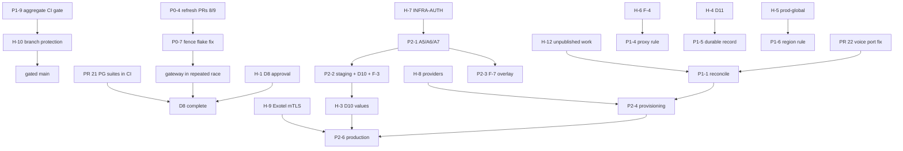

# Phase 15 — Project-Wide Readiness Audit and Execution Plan

**Dates:** 2026-10-17 to 2026-10-18.

**Scope:**
- a read-only audit of `main`, CI and the outstanding blockers;
- small fixes that need no credentials, deployment or external approval
  (§6);
- an inventory of unpublished work and a plan to reconcile it (§9).

**Evidence labels** (as in `docs/telephony/P1-4x`):
- **[V] verified:** observed in this audit through git, the GitHub API, CI logs
  or a local run;
- **[I] inferred:** reasoned from verified evidence; not observed directly;
- **[U] unavailable:** the evidence does not exist in the repository, or could
  not be obtained.

**Status: AUDIT COMPLETE.** Eleven PRs are merged in Phase 15 (#17, #18, #19, #20, #22, #8, #21, #23, #24, #26, #28), including the D8 CI items and the `ci-gate` aggregate check (§10). **D8 is not closed:** the owner's decision on the Go 1.25 criterion and the owner's sign-off remain (§10.2). Open, not authorized for merge: #25, #27 (this record) and #29.

| PR | Change | State |
|---|---|---|
| #17 | Lint: the 15 single-finding modules | **merged** as `731934b` |
| #18 | Gateway startup test: two ports reserved together | **merged** as `a51504a` |
| #19 | Lint: `repository`, `telemetry`, `audiobridge` | **merged** as `d443bea` |
| #21 | D8: gateway real-PostgreSQL suites in CI | **merged** as `1e3b40d` |
| #22 | Voice tests: two ports reserved together (the flake that turned hardening red once on `a51504a`) | **merged** as `fce4e22` |
| #8 (owner's) | Gateway in the repeated race job, with a fence-test flake fix | **merged** as `7b59d25` (refreshed head `a44a41d`) |
| #20, #23 | This audit and its follow-up | **merged** as `9ec0ff6`, `1736d7f` |
| #24 | Lint: media-relay (35 → 0) | **merged** as `5f062bb` |
| #25 | Outbox: doc comments, and `MarkFailed` failures reported (12 → 0) | **open** at `dfd6e57`; not authorized for merge (§10.7) |
| #26 | `ci-gate`: an always-running aggregate check | **merged** as `806e75c`. The security-fix head was `6900db2`; the earlier heads `d8544ec` and `ec6fd57` had reproduced bypasses (§10.6, §10.7). |
| #28 | Lint: platform (16 → 1) | **merged** as `63a80a2` (§10.7) |
| #29 | `gateway-postgres`: print each failing test's complete output | **open** at `e98b134`; not authorized for merge (§10.7) |

- **Lint:** the repository is **not lint-clean**. 22 golangci-lint jobs fail,
  with 983 findings (§4).
- **Readiness:** staging is **NO-GO**, and Exotel AgentStream production media
  is **NO-GO** (§3.12–§3.13).

> **Phase-number collision [V].** "Phase 15" is already used by unpublished work.
> - **Where:** the owner's local `main` (`46d7b51`, `06e276d`) and the remote
>   branch `ci/telephony-integration/p118`.
> - **What it contains:** `docs/phase15/{DEPENDENCY_MAP,RESPONSE_FAILURE_SEMANTICS,SPEECH_COMPLETE_AUDIT}.md`,
>   `docs/phase16/` (13 files) and ADRs 0018–0023.
> - **Also untracked in the primary worktree:** `docs/phase17/` (7 files),
>   `docs/phase18/` (14) and `docs/phase19/` (10).
> - **None of it is on `main`.**
> - **This file:** uses a distinct name, so no path collides.
> - **Open:** the numbering is an owner decision (H-12 in §5.2).

---

## 1. Verified current state [V]

### 1.1 `main` and its CI

| Item | Evidence |
|---|---|
| `origin/main` | `d443bea1bffabdabf546a49362da640ee31fd718`, "chore(lint): … (#19)" |
| CI on `d443bea` | Backend Foundation 39058283525 **pass**; hardening 39058283518 **pass** (6/6 jobs); pr-go 39058283548: 115 jobs pass, **22 golangci-lint jobs fail**, no other failure |
| Hardening allowlist | `.github/workflows/hardening.yml:93` lists `services/go/voice` (17 entries) |
| Coverage floor | `hardening.yml:239`: `floor=60`. No workflow file changed in Phase 15, so the floor and every gate are unchanged. |
| Branch protection | **none.** `GET /branches/main/protection` returns 404, "Branch not protected" (§3.15). |
| Repository visibility | **public**, so standard GitHub-hosted runner minutes are free |

**The one red run in Phase 15 [V]:**
- hardening 39056746543 on `a51504a` (after #18) failed in "Race detector
  (repeated)" with the T9 port collision in §3.16;
- `a51504a` changed nothing hardening tests: `git diff 731934b a51504a`
  touches only the gateway, which is not in `AI_MODULES`;
- re-running the failed jobs passed;
- PR #22 fixes the cause.

### 1.2 Merged PRs

| PR | Head | Merge commit (squash) | Post-merge CI on `main` |
|---|---|---|---|
| #16 (Phase 14 T9 fix) | `33ca2e0` | `800861a` | hardening 39049073209 pass |
| #14 (Phase 14 T13) | `dc80b7e` | `ef2cb7e` | hardening 39050923782 pass (`services/go/voice 80.6%`) |
| #15 (Phase 14 report) | `f673234` | `567dec7` | Backend Foundation 39051981863, hardening 39051981887 pass |
| **#17** (Phase 15) | `4f4f905` | **`731934b`** (2026-10-17T17:59:03Z) | pr-go 39056107802: 112 pass, 25 lint fail, exactly the PR's own set; hardening 39056107780 pass; Backend Foundation 39056107850 pass |
| **#18** (Phase 15) | `c0c0b79` | **`a51504a`** (18:07:50Z) | pr-go 39056746542: 112 pass, 25 lint fail (unchanged); Backend Foundation 39056746587 pass; hardening 39056746543 **failed once, then passed on re-run** (§1.1) |
| **#19** (Phase 15) | `bea5ac3` | **`d443bea`** (18:29:00Z) | pr-go 39058283548: 115 pass, 22 lint fail (exactly the 3 targeted jobs fixed); hardening 39058283518 pass; Backend Foundation 39058283525 pass |

Each merge was pinned with `--match-head-commit`. Each resulting tree matches
its PR head on the PR's files.

### 1.3 Phase 14 report claims checked against evidence

| Claim in `docs/phase14/FINAL_REPORT.md` | Finding |
|---|---|
| Phase 14 COMPLETE; PR #16 → `800861a`, #14 → `ef2cb7e` | **confirmed** |
| Post-merge hardening 39050923782 passed with `services/go/voice` at 80.6% | **confirmed** |
| 40 lint jobs, 1,022 findings, none new | **confirmed** on `ef2cb7e` |
| No provider can be constructed (§9) | **confirmed on `main`.** The unpublished `06e276d` wires a whisper-cli recogniser (§9). |
| T9: "original failure output not retained"; latency-budget mechanism demonstrated; its role in the original failure inferred | **still accurate as written, but superseded in part.** A T9 failure was **retained** in Phase 15 (§3.16). It shows a **different, concrete cause**: a port collision in the test helper. The original unexplained failure could have been either mechanism [I]. PR #16's fix stands, since its mechanism was demonstrated; PR #22 removes the second. |
| §10 blocker list | **partly stale:** D8 has moved (§3.1) |

The Phase 14 report is the historical closure record and is **not edited**.
This section is the correction.

### 1.4 Working trees, branches and committed-content equivalence

- **Primary worktree** (`C:\Users\abhik\OneDrive\Desktop\Calling Agent`):
  - branch `telephony/p1-fence-rds-iam` at `ad4a734`;
  - 415 status entries (205 untracked paths; 360 untracked files when
    expanded), status hash `d4fb9c4206dc2168`. It was unchanged before and
    after every Phase 15 merge.
  - `infra/k8s/base/deployment.yaml` is ` D` (deleted, not restored).
- **#17's overlap with uncommitted edits:** #17 touched 15 files that also
  carry uncommitted edits in the primary worktree. Their SHA-256 hashes were
  recorded before the merge and were byte-identical after it.
- **The primary branch's commits are content-equivalent to `main`'s [V],**
  pair by pair (`git patch-id --stable` is identical, compared at file level
  too):

  | Primary branch | On `main` (via merge `89564e5`) |
  |---|---|
  | `0b6172a` | `75957b3` |
  | `105c2e5` | `0b1a83c` |
  | `3f3e1aa` | `a6e92fe` |
  | `8cbfeda` | `9545660` |
  | `ad4a734` | `cfcc910` |

  - `ad4a734` and `cfcc910` have **byte-identical content** on all 43 paths
    the chain touches.
  - `main` adds exactly one later commit on those paths, `ed99b89` ("fix test
    races and update x/text", 8 files).
  - So nothing the primary branch **committed** is missing from `main`.
- **Worktrees:** 18.
  - The 12 that existed before Phase 15 are all preserved. Three of them
    (`calling-agent-evalsubjects`, `-f11`, `-pr`) hold uncommitted work, whose
    status hashes were unchanged throughout.
  - Six were created for Phase 15: `calling-agent-phase15-lint`,
    `-phase15-ports`, `-phase15-lint2`, `-phase15-audit`, `-phase15-d8pg` and
    `-phase15-voiceports`.
- **Preservation branches (local, non-destructive):**
  - `preserve/unpublished-phase15-16-06e276d` → `06e276d`;
  - `preserve/unpublished-p118-2727df7` → `2727df7`.
- **Open PRs not touched:** #7, #8, #9 and dependabot #2–#5.
  - #8 and #9 merge with `main` without conflict, but their CI is **stale**:
    their bases predate #10–#13.

## 2. Where the blocker identifiers are defined

| ID | Defined in | On `main`? |
|---|---|---|
| D8, D9, D10 | P1-24 §6 (`P1-24_ARCHITECTURE_DECISIONS_REPORT.md:271-273`); restated in P1-27:49-51 and P1-36:26-28 | **No.** Those files are untracked in the primary worktree. `main` has only the statuses (P1-40:17, P1-41:7, :293). |
| D11 | P1-26:89, :178; P1-27:52; P1-36:29 | **No** (untracked) |
| INFRA-AUTH (A7), A5–A9 | P1-36 §3 (untracked); P1-41 §2.2, §4, §6 | P1-41 is on `main` |
| `prod-global` | P1-40:37, :84; ADR-0008:162-163; `docs/architecture/deployment.md:161` | yes |
| F-3, F-4, F-7 | P1-41 §3.3 (`P1-41_INFRA_AUTH_READINESS_AUDIT.md:116-120`) | yes |
| Exotel mTLS NO-GO | ADR-0004 (`0004-media-transport.md:163`); `EXOTEL_CONTRACT_CHECKLIST.md:46` and `EXOTEL_EVIDENCE_REVIEW.md:66` (untracked) | ADR yes; evidence docs no |

**Identifier collision [V].** Untracked Phase 18 documents reuse "D9" and "D11"
for **different** items:
- `docs/phase18/PHASE18_D9_ADAPTIVE_JITTER_FIX.md`: an adaptive-jitter stall;
- `docs/phase18/PHASE18_D11_AUTH_MIDDLEWARE_BLOCKER.md`: an auth-middleware
  blocker.

In this audit, D8–D11 always mean the **telephony** decisions of P1-24 and
P1-26.

**Inventory of the authoritative untracked documents [V]:**
- **39 files** under `docs/telephony/`: P1-10…P1-39, P1-49, P1-51…P1-53,
  `EXOTEL_CONTRACT_CHECKLIST.md`, `EXOTEL_EVIDENCE_REVIEW.md` and
  `CARRIER_MEDIA_STREAMING_CONTRACT.md`.
- **31 files** under `docs/phase17`–`docs/phase19`.
- Names, line counts and SHA-256 hashes were recorded locally at audit time.
- All were read only, never modified.

**Missing from `main` [U]:** a reader of `main` cannot learn what D8–D11 mean.
**Smallest resolution:** the owner commits these documents, or a decision
register summarising them (P1-8).

## 3. Blocker inventory

Each entry gives the requirement, the evidence, its dependencies, its risk, the
smallest safe resolution, acceptance criteria, and whether it can be completed
locally.

### 3.1 D8: CI and `-race` evidence for the gateway — **CI items merged and verified on `main`; not closed (§10.2)**

- **Requirement:** P1-36:26 ("Isolated CI push for `-race` evidence"). Its
  current components are in P1-45:147 and P1-44:185: "`-race` never run;
  real-PG suites not in CI; gateway not in nightly race; lint unknown; Go 1.25
  untested".

| Component | Status | Evidence |
|---|---|---|
| `-race` on the gateway in CI | **met** | pr-go runs `go test -race -count=1` for it (`pr-go.yml:129`); its job passes on every Phase 15 `main` |
| Lint for the gateway | **met** | `golangci-lint (services/go/telephony-gateway)` passes |
| Real-PG suites in CI | **met:** #21 merged | `gateway-postgres` 39094929971 on `main` `1e3b40d`: 127 pass, 0 fail, 0 skip |
| Gateway in the repeated race job | **met:** #8 merged | hardening 39094284808 on `main` `7b59d25`: 18 repeated-race logs, including the gateway (4 packages `ok`) |
| Go 1.25 | **evidenced historically; ongoing testing is an owner decision** | pr-go 38774455177 (2026-10-15, `89564e5`) built and tested the gateway under **go1.25.14** with `-race`: 4 packages `ok`. Gateway and `platform` production code is unchanged since. CI moved to 1.26.x in #12 (§10.2). |

- **PR #21** (`b6b5e7f`, branch `phase15/d8-gateway-postgres-ci`):
  - **What it adds:**
    - `.github/workflows/gateway-postgres.yml`;
    - `tools/scripts/gateway-postgres-tests.sh`, following the pattern of the
      unpublished P1-18 gate (`2727df7`).
  - **How the job works:**
    - `postgres:17.2-alpine`, pinned by digest `7e5df973…c96`;
    - a throwaway container: loopback, random port, `--pull never`, always
      removed;
    - a random one-off password, masked, and checked absent from the output;
    - the whole gateway suite under `-race`;
    - **any skipped test fails the job.**
  - **No secret** and no external endpoint is involved.
  - **Local evidence** (go1.26.9 linux/amd64, `-race`, real PostgreSQL 17.2;
    two runs):
    - **127 pass, 0 fail, 0 skip, 0 data races** each;
    - the script itself on the Windows host: 127 pass, 0 skip;
    - negative controls: a missing image exits 1; with the DSN hidden, 15 tests
      skip and the run exits 1.
  - **CI [V]:** run 39056609470, job "telephony-gateway (real PostgreSQL,
    -race)" **passed**: gcc 13.3, image digest `7e5df973…c96`, PostgreSQL 17.2,
    4 packages `ok`, **127 pass, 0 fail, 0 skip**. This is the first time the
    gateway's real-PostgreSQL suites have run in CI. Backend Foundation passes.
    pr-go and hardening are not triggered by this PR's paths.
  - **Follow-up (2026-10-18) [V]:** #21's CI ran against `731934b`, before #18
    changed the gateway's `buildinfo_test.go`. So #21 was also merged locally
    with `main` `9ec0ff6`, a detached worktree that was never pushed, and run
    again:
    - two Linux `-race` runs against throwaway PostgreSQL 17.2: **127 pass, 0
      fail, 0 skip, 0 data races, no password in output** each;
    - the script itself on the host: 127 pass, 0 skip, exit 0;
    - no container or network left behind.
- **Repeated race, measured on `main`'s gateway code** (go1.26.9, `-race`):
  - `-count=5 -shuffle=on`, three runs: **1 failed**
    (`TestFence_AStuckConfirmationExpiresOwnershipByTheClock`, "timed out
    waiting for the hung confirmation");
  - that test alone, `-count=900`: **5 failures**. That matches PR #8's own
    measurement of 4 in 900, and PR #8 contains an event-driven fix.
  - **Consequence:** adding the gateway to the repeated race job **before** that
    fix would make hardening flaky. PR #8 must be refreshed with `main` and
    re-run first.
- **PR #8 refresh (follow-up, 2026-10-18) [V]:**
  - **Preserved:** the original head `3067dfe` as the local branch
    `preserve/pr8-ci-d8-gateway-race-3067dfe`. The `calling-agent-pr`
    worktree, with its 20 uncommitted paths, was not touched.
  - **Refreshed:** `main` `9ec0ff6` merged in a new worktree with a normal
    merge commit, `a44a41d` (parents `3067dfe`, `9ec0ff6`). It was pushed as a
    fast-forward (`3067dfe..a44a41d`). No rebase, no force-push.
    - `hardening.yml` merged without conflict.
    - **The PR's net diff against `main` is still its 2 original files.**
  - **The fix (test-only):** before making `Holds` hang, the test now waits
    for the fence's sleep request and hands it back.
    - **Why it is correct:** `sleeping` has a buffer of one. Receiving the
      request proves the second confirmation has finished, and handing it back
      cannot block.
    - **Unchanged:** every assertion (`holdsHit == 3`, ownership before and
      after the validity window) and all production code.
  - **The workflow change:**
    - `RACE_EXTRA_MODULES` adds the gateway to the **repeated** race pass
      only, kept out of `AI_MODULES`, so no coverage floor or benchmark claim
      changes;
    - a per-module failure-kind summary runs **after** the existing data-race
      check, so race detection keeps precedence;
    - the single race pass is unchanged.
  - **Local** (go1.26.9 linux/amd64, `-race`):
    - the stuck-confirmation test, three runs of `-count=900`: **2,700/2,700
      pass**, against 5 failures in 900 on `main`'s code in the same
      environment;
    - the gateway, five `-count=5 -shuffle=on` runs: **5/5 pass** (560 pass, 0
      fail, 75 skip each), against 1 failing run in 3 on `main`'s code. The
      skips are the 15 real-PG tests × 5, which this job cannot run; #21 runs
      them.
    - gofmt, gofumpt, vet and gateway lint are clean.
  - **CI on `a44a41d`:**
    - hardening 39091418247: **6/6 pass**. Its repeated race job ran **18**
      module logs including `services_go_telephony-gateway.log` (4 packages
      `ok`); the single job ran 17, without the gateway. No race log has a
      failure or a data race.
    - Backend Foundation 39091418244: pass.
    - pr-go 39091418240: 115 pass, and the 22 failures are exactly `main`'s
      baseline lint set.
  - **Interaction with #21:** independent files. Together they close both
    remaining D8 CI items.
- **Dependencies:** review of #21; the owner's refresh of #8; the owner's D8
  sign-off on CI scope.
- **Acceptance:**
  - `gateway-postgres` passes on `main` with 0 skips;
  - the repeated race job lists the gateway and passes after #8.
- **Local?** Done locally; CI proof is in the PRs.

### 3.2 D9: may a later "Option A" edit the user-dirty `context.go` and `harness.go`? — **unresolved**

- **Requirement:** P1-24:272; P1-36:27 records it as "only relevant with D2
  (outbound)".
- **Evidence:** `packages/go/conversation/context.go` and `harness.go` are
  still ` M` in the primary worktree [V].
- **Dependencies:** an owner decision, and D2.
- **Risk:** low while D2 is not pursued.
- **Smallest resolution:** the owner answers "D9: wait" or "D9: may edit", or
  commits the two files.
- **Acceptance:** the decision is recorded in a committed document.
- **Local?** No; it is a decision about the owner's own uncommitted work.

### 3.3 D10: fence timing values — **unresolved**

- **Requirement:** heartbeat interval and timeout, and the derived grace
  window (P1-24:273; P1-41 §5). They must come from **staging measurements**
  E1–E9, never be guessed.
- **Evidence:** `services/go/telephony-gateway/internal/app/fence.go:41,44`
  declares the variables. P1-30B:141 says no gateway can become ready until
  they are set.
- **Dependencies:** INFRA-AUTH, A5–A9 and a staging run, so an AWS account and
  **spending**.
- **Risk:** guessing values could permit two owners.
- **Smallest resolution:** run the P1-42 runbook in an authorized staging
  environment.
- **Acceptance:** the P1-41 §5 pass criteria: zero overlap intervals, and a
  hand-over gap ≥ 0 at p99.9.
- **Local?** **No.**

### 3.4 D11: a durable record for `reject_unconfirmed` offers — **deferred**

- **Requirement:** P1-26:89, :178. Today the evidence for an unconfirmed
  reject lives only in the result, log, metric and event, so it is lost if the
  log is lost.
- **Dependencies:** an owner decision on the schema or migration.
- **Risk:** medium for auditability; none for call handling.
- **Smallest resolution:** after the decision, a table or outbox record with a
  migration, tested against disposable PostgreSQL. #21's pattern makes that
  testable in CI.
- **Acceptance:** a forced `reject_unconfirmed` leaves a durable row that
  survives a restart; the migration applies and rolls back.
- **Local?** Yes, **after** the decision.

### 3.5 `prod-global` region policy — **unresolved**

- **Requirement:**
  - `prod-global` also runs as `ENVIRONMENT=production`, so the code applies
    `prod-in`'s region list (`ap-south-1`, `ap-south-2`) to it;
  - a distinct policy needs a new decision, such as a deployment-identity
    variable (P1-40:37, :84).
- **Evidence:** `internal/app/iam.go:59-64` states this. ADR-0008:162-163 and
  `deployment.md:161` show `prod-global` is a scaffold only.
- **Dependencies:** an architecture or owner decision.
- **Risk:** none while `prod-global` has no deployment; a wrong-region
  identity once it does.
- **Smallest resolution:** decide the identifier and region list, then
  enforce it in `checkIAMEnvironment`.
- **Acceptance:** tests show a `prod-global` identity is refused outside its
  list, and `prod-in` is unchanged.
- **Local?** Yes, **after** the decision.

### 3.6 INFRA-AUTH (A7) and A5, A6, A8, A9 — **unapproved**

- **Requirement:** P1-41 §2.2, §4 and §6:
  - a separate staging account;
  - EKS with OIDC, IRSA and `rds-db:connect`;
  - Aurora with IAM authentication;
  - VPC endpoints, CloudTrail and ESO;
  - the SEP evidence items.
- **Evidence:** every `infra/terraform/envs/*` directory is empty and untracked
  (P1-41:18).
- **Dependencies:** an AWS account, operator principals, a budget owner,
  **spending**, and the owner's approval of A5–A9.
- **Risk:** high if done wrongly: account separation, cost and data.
- **Smallest resolution:** the owner approves A5 (manifests) and A6 (IaC)
  first. A6 can be written and reviewed before anything is applied.
- **Acceptance:** P1-41 §4.1's eight SEP evidence items; a budget alert in
  place before A7.
- **Local?** **No.** Only authoring the IaC is local, and it is unapproved.

### 3.7 F-3: STS credential early-refresh window — **open, low**

- **Evidence:** P1-41:116. `ExpiryWindow` appears nowhere in the gateway
  (`git grep` on `main`: 0 matches), so the SDK default of 0 applies [V].
- **Dependencies:** D10, with staging measurement E7.
- **Risk:** at worst a fail-closed re-dial blip.
- **Smallest resolution:** decide under D10; **no value is proposed**.
- **Acceptance:** an owner-chosen value, with a test that refresh happens
  that long before expiry.
- **Local?** The code is local; the value is not.

### 3.8 F-4: `HTTPS_PROXY` policy for STS — **open, owner decision**

- **Evidence:** P1-41:117. The gateway on `main` has no proxy handling
  (`git grep` finds no `HTTPS_PROXY`, `NO_PROXY` or `ProxyFromEnvironment`)
  [V].
- **Options:** (a) refuse startup in IAM mode; (b) ignore proxies for STS;
  (c) accept and document. P1-41 recommends (a).
- **Dependencies:** an owner choice only.
- **Risk:** low: TLS to STS stays verified.
- **Smallest resolution (option a):** a static check beside the existing
  static-key rule, which names the variable and never its value.
- **Acceptance:**
  - IAM mode refuses startup when `HTTPS_PROXY`, `HTTP_PROXY`, `NO_PROXY` or
    their lowercase forms are set, naming only the variable;
  - password mode is unaffected;
  - a mutation check shows the rule is load-bearing.
- **Local?** **Yes, once chosen.** It is not implemented here, because it is a
  policy choice.

### 3.9 F-7: the gateway manifest shape differs from the staging design — **open**

- **Evidence:**
  - P1-41:120: `replicas: 2` with RollingUpdate, against the A/B `Recreate`
    design (P1-39 O-1).
  - The gateway manifest `infra/k8s/base/services/telephony-gateway.yaml` is
    **untracked** owner work, with `replicas: 2` at line 58 and
    `type: RollingUpdate` at line 69 [V].
  - On `main`, the tracked `infra/k8s/base/deployment.yaml:7` also says
    `replicas: 2`. The primary worktree deletes that file, and the deletion is
    preserved.
- **Dependencies:** A5, the staging overlay.
- **Risk:** the staging test could not reproduce the designed topology.
- **Smallest resolution:** a staging overlay under A5. The base manifest is
  not changed.
- **Acceptance:** the overlay renders two single-replica `Recreate`
  workloads with anti-affinity.
- **Local?** The authoring is; the approval is not. Whether `deployment.yaml`
  stays on `main` is the owner's call.

### 3.10 The golangci-lint baseline — **open; engineering**

See §4. **Local?** Yes: mechanical classes now, judgment classes per finding.

### 3.11 Provider provisioning — **blocked, external**

- **Requirement:**
  - ADR-0017 §8 and Phase 14 §9: a `voice.Pipeline` needs providers;
  - every shipped provider shells out to an external binary or model.
- **Evidence:** the unpublished Phase 16 T8 audit (`46d7b51`,
  `docs/phase16/PROVIDER_READINESS_AUDIT.md`):
  - Ollama has zero models;
  - Piper is absent;
  - whisper `tiny` is cached locally;
  - no cloud provider exists.
- **Dependencies:** model downloads, choices of local or cloud per stage and of
  licence, and for cloud providers **credentials and spend**.
- **Smallest resolution:** the owner chooses the per-stage providers, then the
  unpublished Phase 16 work is reconciled (§9).
- **Acceptance:** a pipeline built from provisioned providers passes the voice
  end-to-end tests offline.
- **Local?** Not without downloads, which are not authorized.

### 3.12 Staging — **NO-GO**

- **Evidence:** P1-41:7 and P1-50:151.
- **Depends on:** §3.3, §3.6, §3.9 and the SEP evidence.
- **Local?** **No.**

### 3.13 Exotel AgentStream production media — **NO-GO**

- **Requirement:** ADR-0004 (`0004-media-transport.md:163`): "Carrier leg
  WebSocket must be WSS with mutual authentication."
- **Evidence:** the untracked `EXOTEL_CONTRACT_CHECKLIST.md:46`, under C2,
  records "no evidence Exotel supports" client-certificate mTLS.
  `EXOTEL_EVIDENCE_REVIEW.md:66` (Q2) is the question to ask.
- **Dependencies:** a **written carrier answer**: external, no credentials.
- **Smallest resolution:** obtain the answer to Q2. If it is "no", the owner
  decides whether to amend ADR-0004 or choose another carrier.
- **Acceptance:** a documented yes, with a CA chain or pin and a rotation
  notice; or a superseding ADR.
- **Local?** **No.**

### 3.14 Unpublished work — **open, owner work** (see §9 for the plan)

### 3.15 No branch protection on `main` — **open, repository admin**

- **Current state [V]:** `main` is unprotected. Merges need no passing check
  and no review, and CODEOWNERS teams are unresolved.
- **Not changed here:** no repository-admin authority was granted, and no
  branch-protection policy exists in the repository documentation.
- **Recommended policy:**
  1. **Require a pull request** before merging into `main`, with at least one
     approval once CODEOWNERS teams exist. Block force-pushes and deletion.
  2. **Require status checks**, with the branch up to date. These checks run on
     every pull request into `main`:
     - Backend Foundation (`ci.yml` has no path filter):
       **`Build & Test Backend Foundation`**.
     - **Path-filtered workflows.** `pr-go` and `hardening` run only when Go
       paths change, and `gateway-postgres` (after #21) only when gateway or
       platform paths change. A required check that never starts blocks the
       PR. So require them through an **aggregate job** that always runs and
       passes when the underlying workflow was not needed. That job does not
       exist yet; it is follow-up CI work, P1-9.
     - **Not lint:** keep the golangci-lint jobs advisory until the baseline
       reaches zero. Requiring them now would block every Go PR, and
       excluding findings would weaken the gate.
  3. Require conversation resolution.
- **Acceptance:** `GET /branches/main/protection` lists the agreed checks.
- **Local?** **No.** The admin applies it.

### 3.16 Port-collision flakes in service tests — **gateway fixed (#18); voice fix open (#22)**

- **Captured failure [V]:** hardening 39056746543, "Race detector (repeated)",
  `services_go_voice.log`, on `main` `a51504a`:

  ```
  --- FAIL: TestT9_FreshRunningServiceSignatureIsStable (2.31s)
      determinism_test.go:481: config invalid: … HTTP_PORT and HEALTH_PORT must differ, both are 34669
  ```

- **Cause [V]:** the voice test helper `freePort` released each listener
  before the next reservation, so `runningServiceWith` and the T13 SIGTERM
  test could get the same port twice. The T9 fresh-service test starts 20
  services per run (20 pairs), so it was the likeliest to hit it.
  - #18 fixed the same pattern in the gateway. There, a throwaway probe of
    20,000 pairs of the old pattern on Linux gave 1 duplicate.
- **PR #22** (`cd27dbe`):
  - **change:** `freePorts(t, n)` holds every listener until all n are known;
  - **local:** 77/77 under `-race`; the T9 fresh-service test 40/40; T13 10/10;
    two `-count=5 -shuffle=on` runs pass; coverage 80.6%, unchanged; lint
    findings identical to `main`;
  - **CI [V]:** hardening passes (race single and repeated, coverage, release
    gate), `services/go/voice` passes, and Backend Foundation passes. The 22
    failing checks are exactly `main` `d443bea`'s baseline golangci-lint jobs.
- **Follow-up (2026-10-18) [V]:** #22 merged locally with `main` `9ec0ff6`
  (detached, never pushed), go1.26.9, `-race`:
  - `TestT9_FreshRunningServiceSignatureIsStable` ×100: **100/100**;
  - the T9 stall regression test ×10 and all `TestT9_*` ×5: pass (60/60);
  - `TestT13_*` ×20: 60/60;
  - three `-count=5 -shuffle=on` module runs: pass;
  - vet clean.

  #22 changes only `_test.go` files, and no assertion. There is no dedicated
  deterministic regression test: the guarantee (distinct ports within a call)
  is structural, and the old pattern collided about once in 20,000 pairs, too
  rarely for a test to catch it reliably.
- **Relation to Phase 14:** see §1.3.
- **Acceptance:** #22 merged; hardening's repeated race job stays green on
  `main` across scheduled runs.

## 4. CI and lint baseline [V]

**On `main` `d443bea`:** 22 golangci-lint jobs fail with **983 findings**.
- 21 of the 22 modules have findings identical to the `ef2cb7e` baseline.
- The 22nd, `persistence`, differs only by its revive rule label, which
  alternates between `exported` and `var-naming` for the same two identifiers
  in unchanged code.

| State | Failing lint jobs | Findings |
|---|---|---|
| `main` `ef2cb7e` (Phase 14) | 40 | 1,022 |
| after #17 (`731934b`) | 25 | 1,006 |
| after #19 (`d443bea`) | **22** | **983** |

**Newly introduced findings in Phase 15: none.** After each merge, the failing
set on `main` equalled the PR's own failing set.

**By linter (983):**

| Linter | Findings |
|---|---|
| gocritic | 248 |
| revive | 193 |
| godot | 155 |
| errcheck | 123 |
| govet | 95 |
| gosec | 43 |
| errorlint | 43 |
| gocyclo | 39 |
| contextcheck | 16 |
| unused | 11 |
| other (8 linters) | 17 |

**By module:**
- `packages/go/voice` 170
- `audiointel` 114
- `evaluation` 105
- `toolruntime` 82
- `speech` 47
- `integrations` 45
- `runtime` 42
- `telephony` 41
- `governance` 41
- `services/go/identity` 38
- `media` 36
- `services/go/media-relay` 35
- `services/go/voice` 29
- `evalstore` 27
- `evalsubjects` 26
- `memory` 20
- `persistence` 20
- `platform` 16
- `conversation` 15
- `outbox` 12
- `middleware` 11
- `redis` 11

### 4.1 Remaining findings and a plan for small PRs [V]

**Where they are:** 817 of the 983 findings are in non-test files, 166 in
`_test.go`.

**By rule:**

| Rule | Findings | Behaviour risk |
|---|---|---|
| gocritic `rangeValCopy` | 160 | low, but changes aliasing if a loop body mutates its copy; review each |
| revive `exported` | 182 | none (doc comments) |
| revive `package-comments` | 7 | none |
| revive `var-naming` | 4 | **exported API renames** (`integrations`: fields `ApiKey`, `AuthId`). Renaming can change behaviour, such as JSON names without tags, so it needs a decision. |
| godot | 155 | none (151 "capital letter", 4 "end in a period") |
| govet `shadow` | 95 | low; rename or reuse |
| errcheck | 123 | **all in non-test code**: each needs handling or a justified ignore |
| errorlint | 43 | low to medium: `==` and type assertions become `errors.Is` and `errors.As`, which also match wrapped errors |
| gosec G115 (integer conversion) | 41 | medium: needs bounds reasoning per site |
| gocritic `builtinShadow` | 42 | low (renames) |
| other gocritic | 46 | low |
| gocyclo, nestif | 44 | refactor or justified `nolint`, per function |
| contextcheck | 16 | design (cancellation boundaries) |
| other (gosec G404/G304, unused, staticcheck, unconvert, nilerr, ineffassign, rowserrcheck, makezero, copyloopvar) | 25 | mixed |

**Recommended PR groups, smallest and safest first.** Each is one module or a
few. "Jobs → green" counts lint jobs the group would clear completely.

| Group | Modules | Findings | Jobs → green | Change |
|---|---|---|---|---|
| L1 | `redis` (11); `integrations` doc comments (41) | 52 | **1** (`redis`) | revive doc comments only. `integrations` stays red until its 4 `var-naming` renames are decided (L7). |
| L2 | `middleware` (10 + 1 errcheck), `outbox` (11 + 1 errcheck) | 23 | **2** | doc comments plus 2 errcheck decisions |
| L3 | `media-relay` | 35 | **1** | 32 doc comments, 2 errorlint, 1 godot |
| L4 | `identity` | 38 | **1** | 27 doc comments, 9 errcheck, 1 errorlint, 1 godot |
| L5 | `audiointel` godot only | 83 | 0 | comment-only (the job stays red: 31 others remain) |
| L6 | godot only in `packages/go/voice` (32), `runtime` (7), `services/go/voice` (7), `platform` (5), `media` (4) | 55 | 0 | comment-only |
| L7 | `integrations` `var-naming` (4); `persistence` (20) | 24 | 2 | **needs naming decisions first.** `integrations`: rename `ApiKey`/`AuthId`, checking serialisation. `persistence`: its `SqlUnitOfWork`/`NewSqlUnitOfWork` finding alternates between revive `exported` and `var-naming` from run to run, so both a doc comment **and** the naming decision are needed; plus 3 errcheck and 1 rowserrcheck. |
| L8+ | govet `shadow` per module, test files first; then errorlint; then errcheck, G115, `rangeValCopy`, gocyclo and contextcheck | ~673 | — | one module per PR, with that module's tests under `-race` |

**Rules for every group:**
- no formatting outside the flagged lines;
- no `nolint` without a one-line reason tied to the specific finding;
- no rule disabled in `.golangci.yml`;
- the module's tests run under `-race`;
- the failing-job set is compared against `main` before and after.

## 5. Phase 15 plan

### 5.1 Priorities

**P0: correctness, CI reliability and security, verifiable locally**

| ID | Item | State |
|---|---|---|
| P0-1 | Clear the single-finding lint jobs (15 modules) | **done:** #17 → `731934b` |
| P0-2 | Gateway startup-test port collision | **done:** #18 → `a51504a` |
| P0-3 | Clear the `repository`, `telemetry` and `audiobridge` lint jobs | **done:** #19 → `d443bea` |
| P0-4 | Bring PRs #8 and #9 up to date with `main` and re-run CI | #8 **done** (`a44a41d`); #9 not refreshed (out of scope) |
| P0-5 | Branch protection (§3.15) | repository admin |
| P0-6 | Voice service-test port collision, which made hardening red once | **PR #22**, open |
| P0-7 | Gateway fence-test flake, 5 in 900 (§3.1) | PR #8 refreshed (`a44a41d`), CI-verified, awaiting review |

**P1: engineering blockers that need no production access**

| ID | Item | Prerequisite |
|---|---|---|
| P1-1 | Reconcile the unpublished work (§9) | owner decision (H-12) |
| P1-2 | D8: PG suites in CI (**#21**), then the gateway in the repeated race job (#8) | review; P0-4/P0-7 |
| P1-3 | Remaining lint, module by module: mechanical classes first (godot, revive docs, errorlint, shadow), then the judgment classes (gocritic, errcheck, gosec, contextcheck, gocyclo), each fixed or given a justified `nolint` (P1-49 §3.1) | none |
| P1-4 | F-4 option (a) (§3.8) | owner choice |
| P1-5 | D11 durable record (§3.4) | owner decision |
| P1-6 | `prod-global` region enforcement (§3.5) | owner decision |
| P1-7 | Whether the gateway joins hardening's coverage floor (its `cmd/server` coverage is 6.7% in pr-go) | owner decision |
| P1-8 | Commit the D8–D11 and Exotel source documents (§2) | owner |
| P1-9 | An always-running aggregate CI gate job, so path-filtered workflows can be required checks | **PR #26**, open (§10.4) |

**P2: needs external prerequisites (accounts, spend, carriers, models)**

| ID | Item | Prerequisite |
|---|---|---|
| P2-1 | INFRA-AUTH: A5, then A6, then A7 (§3.6) | AWS account, budget, approvals |
| P2-2 | Staging run and D10 measurements; F-3 (§3.3, §3.7) | P2-1, A8, A9 |
| P2-3 | F-7 staging overlay (§3.9) | A5 |
| P2-4 | Provider provisioning (§3.11) | model downloads or cloud credentials |
| P2-5 | Exotel mTLS answer (§3.13) | carrier |
| P2-6 | Any production deployment | all of the above |

### 5.2 Genuine human approvals vs ordinary engineering

**Human approvals (owner, admin or external):**
- **H-1** D8 CI scope: #21; the refresh of #8
- **H-2** D9
- **H-3** D10 values, from staging data
- **H-4** D11
- **H-5** `prod-global` policy
- **H-6** F-4 option
- **H-7** INFRA-AUTH and A5–A9, with spend
- **H-8** provider choices and downloads
- **H-9** the Exotel answer (external)
- **H-10** branch protection (admin)
- **H-11** merging #20, #21 and #22, and the fate of #7, #8 and #9
- **H-12** the unpublished work (§9) and the phase numbering

**Ordinary engineering (normal PR review only):**
- the remaining lint batches (P1-3);
- test flake fixes like #18 and #22;
- the aggregate CI gate (P1-9);
- doc corrections;
- the code for P1-4, P1-5 and P1-6 once their decisions are recorded.

### 5.3 Dependency graph



## 6. Changes made in Phase 15

All local runs used Docker `golang:1.26.9-bookworm`, linux/amd64, with
golangci-lint v1.64.8, the version CI uses. Each change carries a secret scan
of its diff (clean).

| PR | Branch / head | Scope | Result |
|---|---|---|---|
| [#17](https://github.com/123Anujyadav/aegis-voice-agent/pull/17) | `phase15/lint-trivial-baseline` / `4f4f905` | 15 files: comments + 2 test lines | merged as `731934b` (§1.2) |
| [#18](https://github.com/123Anujyadav/aegis-voice-agent/pull/18) | `phase15/gateway-startup-distinct-ports` / `c0c0b79` | 1 test file | merged as `a51504a` |
| [#19](https://github.com/123Anujyadav/aegis-voice-agent/pull/19) | `phase15/lint-doc-comments` / `bea5ac3` | 4 files: comments + `err` reuse in a test | merged as `d443bea` |
| [#20](https://github.com/123Anujyadav/aegis-voice-agent/pull/20) | `docs/phase15-readiness-audit` | this file | this report's own PR; it describes `main` as of `d443bea` |
| [#21](https://github.com/123Anujyadav/aegis-voice-agent/pull/21) | `phase15/d8-gateway-postgres-ci` / `b6b5e7f` | 1 workflow, 1 script | open (§3.1) |
| [#22](https://github.com/123Anujyadav/aegis-voice-agent/pull/22) | `phase15/voice-test-distinct-ports` / `cd27dbe` | 2 test files | open (§3.16) |

**Considered and not implemented:**

| Item | Why not |
|---|---|
| F-4 option (a) | policy choice (H-6) |
| PR #8 / #9 refresh | the owner's PRs |
| The gateway in the repeated race job without #8's fix | it would make hardening flaky (5 in 900, §3.1) |
| Merging or reconciling `06e276d` | semantic conflicts and unreviewed owner work (§9, H-12) |
| Publishing `46d7b51` (docs) alone | it applies cleanly, but its reports and ADRs describe code that exists only in `06e276d`. On `main` they would describe behaviour that is not there. |
| Publishing `2727df7` alone | it applies cleanly, but it is 9,213 lines of unreviewed telephony programme code. 8 of its 36 files have since changed in the owner's working tree, so the commit is not the current version. |
| Lint judgment classes | per-finding review needed; batched as P1-3 |
| Branch protection | admin setting (H-10) |

## 7. NO-GO boundaries and external prerequisites

**Not done in Phase 15, and still not authorized:**
- deployment;
- any staging or production change;
- publicly exposed services;
- live carrier calls;
- AWS calls;
- model downloads;
- provider provisioning;
- spending;
- credential requests.

No secret was requested or used.
- **Fetches:** the Go module fetches were the repository's pinned
  dependencies, through the checksum-verified Go proxy.
- **Database:** the PostgreSQL image was already present locally; nothing was
  pulled.
- **Test passwords:** each was random, generated per run, and destroyed with
  its container.

**External prerequisites, in order:**
1. an AWS staging account and a budget owner (A6/A7);
2. the SEP evidence;
3. EKS OIDC and IRSA, and an Aurora user with `rds_iam`;
4. staging measurements for D10;
5. Exotel's written answer on client-certificate mTLS;
6. provider and model choices.

**The protected file:** `infra/k8s/base/deployment.yaml` stays deleted in the
primary worktree. It was not restored.

## 8. Next actions

1. **Owner:** answer the D8 decision request (§10.7.5).
2. **Owner:** review #25 (outbox, option A implemented) and #29 (gateway-postgres
   failure output). Decide the outbox `FAILED`-entry policy (§10.7.4).
3. **Owner:** decide H-12, the unpublished work (§9).
4. **Admin:** branch protection and review rules (§3.15, §10.7.6). `ci-gate` is on `main` since `806e75c`.
5. **Owner:** answer H-6 (F-4), H-4 (D11) and H-5 (`prod-global`).
6. **Engineering:** continue the P1-3 lint batches in the 21 remaining modules,
   only in files with no overlap with the owner's uncommitted work (§10.6).
7. **External, when authorized:** INFRA-AUTH (A5 → A6 → A7), then the staging
   D10 run; the Exotel Q2 answer.

## 9. Unpublished work: inventory and reconciliation plan

### 9.1 Inventory [V]

| Commit | Where | What | Size | vs `main` `d443bea` |
|---|---|---|---|---|
| `46d7b51` (2026-08-23) | local `main`; `origin/ci/telephony-integration/p118` | docs(phase16): Phase 15/16 audits, ADRs 0018–0023, a speech fixture, `.gitattributes` `*.raw` rule; "no production or test code" | 26 files, +3,842 | applies cleanly |
| `06e276d` (2026-08-23) | same | feat(phase16): `Pipeline.Speak`, barge-in forwarded to the conversation, `EventResponseAbandoned` (a Phase 15 T4 frozen amendment), acoustic gate skipping unmeasured confidence (Phase 16 T14), an internal `CallDriver`, whisper-cli as a development-class provider | 32 files, +10,368/−52 | **4 conflicts**, 4 more files changed on both sides |
| `2727df7` (2026-10-14) | `origin/ci/telephony-integration/p118` only | ci(telephony): the P1-18 integration gate. Callback ingestion and admission, `telephonystore` and `telephonyredis`, the throwaway-container runner and workflow; `go.work` gains 2 modules. | 36 files, +9,213 | applies cleanly; **8 of its files differ** from the owner's current working copies, and 28 are identical |

**Coherence:**
- `46d7b51` and `06e276d` are one feature set: the Phase 15/16 voice
  lifecycle, with the docs describing the code.
- `2727df7` is a separate programme, the Phase 19 / P1-18 telephony gate.

The untracked `docs/phase17`–`phase19` (31 files) show further phases exist
only as uncommitted work.

### 9.2 Both sides preserved

- **Local preservation branches:** `preserve/unpublished-phase15-16-06e276d`
  and `preserve/unpublished-p118-2727df7`. The commits are also on
  `origin/ci/telephony-integration/p118`.
- **Per conflicted file:** base (`beb46df`), `main`, unpublished, and the
  conflicted merge result were copied locally at audit time.

### 9.3 File-by-file: files changed on both sides

| File | `main` change | Merge | Resolution recommended |
|---|---|---|---|
| `packages/go/voice/pipeline.go` | P1-92 (`c294fc6`): `floor` mutex serialising floor decisions; generation read under the lock; `failSynthesis(generation, …)`; `sessionEnding()`; `noteTransition` | **7 conflicts** | **Semantic. Do not guess.** `06e276d` turns the speak path into error-returning `Speak(req)` with `abandon()` + `failTurn()` (EventResponseAbandoned), request-abort handling, and `sttSendClosed`. Hunk 1 (struct fields) is keep-both. Hunks 2–7 need a redesign: keep P1-92's lock discipline and generation capture, and route the unpublished side's abandon and abort outcomes through them. Then re-run P1-92's barge-in race tests (`-race -count=…`) and the Phase 15 T4 tests. |
| `packages/go/voice/bargein.go` | P1-92: `Interrupt` = `take()` under the floor lock, then counters and event | 1 conflict | Keep P1-92's split. Put `06e276d`'s `Planner.Handle(EventInterrupt …)` in `Interrupt` **after** `take()` succeeds, so it runs outside the floor lock: `take` must not wait on anything the turn goroutine holds. Verify `Handle` cannot block on the turn goroutine. |
| `packages/go/voice/pipeline_test.go` | P1-92: fake STT `afterAudio` gate | 2 conflicts | Keep both: `main`'s `afterAudio` and `06e276d`'s `strictSend`/`closeSendErr`, and combine their `Write` logic. Mechanical, but it must be tested. |
| `services/go/voice/cmd/server/main.go` | PR #16: `buildService(…, opts ...voiceintel.Option)` | 1 conflict | Keep `06e276d`'s `...serviceOption`. Add a `serviceOption` that carries `voiceintel` options (for example `withIntelligence(opts ...voiceintel.Option)`), and port T9's `deterministicService` / `runningServiceWith` to it. The frozen engine clock must still be injected through the production path. Re-run T9 (including `TestT9_RealStalls…`), T12 and T13. |
| `packages/go/conversation/engine.go` | gofumpt only (`8941669`) | auto | Review only. The frozen-module amendment in `06e276d` needs its recorded approval. |
| `packages/go/voice/fsm.go` | gofumpt only | auto | review only |
| `packages/go/voice/providers/whispercli/whispercli_test.go` | gofumpt only | auto | review only |
| `packages/go/voice/security_test.go` | gofumpt only | auto | review only |

The other 50 files in `06e276d` are new to `main`: 19 under
`services/go/voice`, 12 under `packages/go/voice`, 3 under
`packages/go/conversation`, and docs.

### 9.4 Branch and PR strategy (for the owner, after H-12)

1. **PR A (voice lifecycle):** a branch from `main` that merges
   `preserve/unpublished-phase15-16-06e276d` (both commits, so the docs stay
   with the code they describe). It resolves §9.3 as recommended.
   - **Evidence it must re-run:** P1-92's barge-in race suites; T9, T12 and
     T13; `-race -count=5 -shuffle=on`; lint compared with the baseline.
   - **Also:** reconcile ADR numbering (0018–0023 are free on `main`) and the
     docs/phase15 name collision.
2. **PR B (telephony gate):** decide whether the **current working copies** or
   `2727df7` are authoritative (8 files differ), then publish one of them.
   - Adding `telephonystore` and `telephonyredis` to `go.work` brings them into
     pr-go, whose lint baseline they would join. Measure that first.
   - #21's gateway job and P1-18's gate share the same pinned image and
     pattern, so they can later be unified.
3. **Untracked Phase 17–19 work:** inventory and commit it under the owner's
   own review. This audit does not touch it.

**Acceptance:** each PR shows only baseline lint failures, the race suites
named above pass repeatedly, and no preserved branch is deleted until its PR
merges.

## 10. Phase 15 closure record (2026-10-18)

### 10.1 Authorized merges [V]

The owner authorized exactly #21, #22, #8 and #23. Each was re-verified first:
- its head was unchanged from the reviewed SHA;
- it was mergeable, with an unchanged file list;
- its checks showed no non-lint failure.

Each was squash-merged with `--match-head-commit`. `main`'s CI was checked after
each merge before the next one.

| Order | PR | Head | Merge commit | CI on `main` after the merge |
|---|---|---|---|---|
| 1 | #22 | `cd27dbe` | `fce4e22` | Backend Foundation 39093315803 pass; hardening 39093315747 6/6 pass; pr-go 39093315743: 115 pass, 22 lint fail (exactly the baseline) |
| 2 | #8 | `a44a41d` | `7b59d25` | Backend Foundation 39094284761 pass; hardening 39094284808 6/6 pass; pr-go 39094284802: 115 pass, 22 lint fail (baseline). The repeated race job ran the gateway; the single job did not. |
| 3 | #21 | `b6b5e7f` | `1e3b40d` | `gateway-postgres` 39094929971 pass (127/0/0); Backend Foundation 39094929991 pass; hardening 39094929986 6/6 pass. pr-go was not triggered by these paths. |
| 4 | #23 | `3cee988` | `1736d7f` | Backend Foundation 39095491601 pass; hardening 39095491498 6/6 pass (docs only, so pr-go was not triggered) |

**New failures: none.** After each merge, `main`'s tree equalled the PR head on
the PR's files.

### 10.2 D8 / H-1 acceptance [V]

**Source of truth:** P1-36:26 (untracked) defines D8 as an approval: "Isolated
CI push for `-race` evidence". Its components:
- P1-45:147: "`-race` never run; real-PG suites not in CI; gateway not in
  nightly race; lint unknown; **Go 1.25 untested**";
- P1-44:185, the same without the last two;
- P1-50:151, the latest record on `main`: "D8 (nightly race, PG-in-CI: P1-49
  §3)".

| Criterion | Satisfied? | Evidence |
|---|---|---|
| `-race` runs on the gateway in CI | **yes** | pr-go runs it under `go test -race` on every gateway change. `gateway-postgres` and the repeated race job also use `-race`. |
| Real-PG suites in CI | **yes** | `gateway-postgres` 39094929971 on `main`: 127 pass, 0 fail, **0 skip**. Any skip fails the job. |
| Gateway in the nightly race | **yes by configuration; no scheduled run observed yet** | `hardening.yml` runs on `schedule: cron "0 3 * * *"` with the same race matrix. The gateway is in its repeated job (`RACE_EXTRA_MODULES`), shown on the push run 39094284808. The first scheduled run after `7b59d25` had not happened at the time of writing. |
| Lint | **yes, for the gateway** | `golangci-lint (services/go/telephony-gateway)` passes |
| Go 1.25 | **evidenced for the current production code; not re-run since; owner decision** | **Correction:** an earlier version of this row said nothing had compiled or tested the gateway with a 1.25 toolchain. That was wrong. **What the criterion meant:** P1-44 OBS-4/:187, P1-45 §3/:154 and P1-46:116/:137 recorded that local verification used go1.26.5 while CI pinned **1.25.x**, so "Go 1.25 untested" meant *compile and test under CI's 1.25 toolchain*, with the first pr-go run as the expected evidence. **That evidence exists:** pr-go 38774455177 (push of `89564e5`, 2026-10-15) ran `go test -race -count=1` on the gateway with **go1.25.14**, and all 4 packages passed. **Since then:** `git diff 89564e5 main` shows **no gateway or `platform` production-code change**, only two test files (#18, #8); #12 moved CI to 1.26.x because go1.25 has unfixed stdlib vulnerabilities (that same run's govulncheck failed). **Not evidenced on 1.25:** those two test edits, and the real-PG suites, which have only run on 1.26. `go 1.25.0` is the module's declared minimum (the `go` directive in 21 `go.mod` files and `go.work`); no document makes it a runtime-support promise. Whether the criterion counts as met by that run, needs a fresh 1.25 run, or should be restated for 1.26 is the **owner's decision**. It is not decided here, and the minimum is not changed. |
| Owner approval (D8 is defined as one) | **not recorded** | Authorizing #21 and #8 to merge is not a recorded D8 sign-off. H-1 remains with the owner. |

**D8 is therefore NOT marked complete.** Four technical criteria are met, the
nightly one has no scheduled run yet, the Go 1.25 criterion has historical
evidence but needs the owner's ruling, and the sign-off is not recorded.

### 10.3 Lint PRs (not merged; outside the authorization) [V]

| Batch | Result |
|---|---|
| `redis` (11 revive) | **not opened.** The owner's uncommitted rewrite of `packages/go/redis/redis.go` (+252/−14) already documents every exported declaration, so a PR from `main` would duplicate it and conflict. |
| `middleware` (10 revive, 1 errcheck) | **not opened.** The owner's uncommitted rewrite of `middleware.go` (+84/−37) would conflict, and the errcheck (`json.Encoder.Encode`) needs a handling decision. |
| `outbox` | **#25** (`0849606`): 11 doc comments; 12 → 1 finding. The remaining `_ = p.store.MarkFailed(...)` needs an **owner decision** (analysis in §10.6). CI: 22 lint jobs fail, the baseline set at the time, with none new. |
| `media-relay` | **#24** (`7739884`): 32 doc comments, 2 test comparisons → `errors.Is`, 1 godot rewording byte-identical to the owner's edit. **35 → 0**, and the job is green in CI (21 lint jobs fail, none new). Found and not fixed (a behaviour change): `RouteFrame`'s gap message reports the wrong "expected" number. |
| `identity` (38) | **not opened.** The owner's uncommitted rewrite of `identity.go` (+1,527/−70) already makes the `rand.Read` failure fatal and changes the flagged code. `main`'s `generateAccessToken` emits an **unsigned** token (`"Bearer_JWT." + hex(json)`), which the owner's untracked Phase 18 D11 report records as an auth-design blocker. Not decided here. |

**Lint on `main` `5f062bb` (after #24) [V]:** 21 failing jobs, **948 findings**,
counted from the 21 job logs. **Current:** see §10.7 (`main` `63a80a2`: 21
jobs, 933 findings).

### 10.4 Aggregate check: PR #26 (`ci-gate`; first version `d8544ec`, see §10.6) [V]

- **Trigger:** every `pull_request`, with no path filter.
- **What it does:**
  - reads each workflow's own `pull_request` branch and path filters from the
    checkout, failing closed on syntax it cannot evaluate;
  - waits for the expected runs on the PR head;
  - passes only if every job passed, with one exception: a `golangci-lint` job
    that also fails on `main`'s latest completed run is advisory. That ratchet
    means the baseline can only shrink.
- **Footprint:** read-only token; `gh` and the Python standard library only.
  No existing workflow changes.
- **Validation:**
  - 25 offline unit tests against the real workflow files, also run inside
    the job;
  - read-only live dry runs: #23, #22, #24 and #21 PASS; stale #9 FAIL, on a
    real test failure and on lint jobs that now pass on `main`;
  - the job's own run on #26 (workflow-only: only `ci.yml` expected): **PASS**,
    alongside Backend Foundation.
- **Making it a required check** is the repository admin's decision (§3.15).
  It was not done.

### 10.5 Second authorized round [V]

The owner authorized merging only #24 and #26, at their reviewed heads.

| PR | Head | Result | CI on `main` |
|---|---|---|---|
| #24 | `7739884` | **merged** as `5f062bb` | Backend Foundation 39096846419 pass; hardening 39096846456 6/6 pass; pr-go 39096846468: 116 pass, 21 lint fail. The only change from the previous baseline is `golangci-lint (services/go/media-relay)`, now passing. |
| #26 | `d8544ec` | **not merged.** Review found two defects (§10.6). The fix is a new head, `ec6fd57`, outside the authorization. | — |

### 10.6 Findings from this round [V]

**#26 review, the defects in `d8544ec`:**
1. **The PR controlled its own verdict.** The job ran `tools/ci/ci_gate.py`,
   and read the other workflows' path filters, from the PR checkout. A PR could
   make the gate pass by editing the script, or by narrowing another
   workflow's `paths`.
2. **The lint exception could mask new findings.** It was per job, so new
   findings in a module whose lint job already failed on `main` passed.

**The attempted fix, `ec6fd57`. Superseded: a later review found two more bypasses in it (§10.7).**
- **Trusted verdict:** the verdict comes from the gate and filters at the PR's
  **base** commit. The PR's own copy is only unit-tested, which can fail the
  job but never pass it. Bootstrap: while the base has no gate, the PR's copy
  is used, with a warning.
- **Finding-level lint comparison:** both job logs are compared, counted per
  (file, linter). A higher count, a new pair, or a failed job with no
  parseable finding blocks.
- **Hardening:**
  - logs are fetched with `gh --allow-escape-sequences`, because gh refuses
    ANSI output; the codes are stripped;
  - `gh` calls are retried, then fail closed;
  - repository and PR number reach the script through `env`.
- **Evidence:**
  - 46 unit tests, including end-to-end simulations;
  - 2 mutation checks, each caught;
  - the parser reproduces `main`'s counts exactly (948);
  - live dry runs: #25, #27 and #21 PASS; stale #22 and #9 FAIL, for the right
    reasons;
  - the job's own bootstrap run on `ec6fd57`: 46 tests OK, **PASS**.
- **Residual:** a PR editing `ci-gate.yml` itself is trusted only through
  review. Requiring review for `.github/**` and `tools/ci/**` is recommended.

**#25, the `outbox` `MarkFailed` discard:**
- **Correction:** the discard is **not documented** anywhere; "deliberate" was
  an inference.
- **When `MarkFailed` succeeds**, the entry becomes `FAILED`.
  `PostgresOutboxStore.FetchPending` selects only `PENDING`, so the entry is
  **never retried**, and nothing on `main` requeues it.
- **Only when `MarkFailed` fails** does the entry stay `PENDING` and get
  re-published, with the error lost.
- `ProcessBatch` has no callers on `main`.
- **Options:**
  - (A) `errors.Join` the errors into the returned value. This is the smallest
    fix; it changes the contract.
  - (B) inject a logger or metric;
  - (C) a justified `nolint`, which is suppression.
- **Separate design gap:** there is no retry or dead-letter path for `FAILED`
  entries.
- **All of these need an owner decision.** #25's description was corrected,
  and its code is unchanged.

**The next lint batch:** #28 (`8871a49`), `platform` 16 → 4.
- **Changes:** 5 godot, and 7 `httpNoBody` in a test.
- **Left for decisions:** gocyclo ×2, errcheck ×1 and contextcheck ×1.
- **Overlap:** none; its files equal `main` in the owner's working tree.
- **Overlap check across all 21 modules:** only `outbox`, `platform`,
  `memory`, `evalstore`, `governance`, `runtime`, `toolruntime` and
  `audiointel` have findings solely in files the owner has not modified.

### 10.7 Third authorized round (2026-10-18) [V]

The owner authorized merging only #26, at exactly `6900db2`, and #28, after
review and passing checks.

#### 10.7.1 Merges and post-merge CI

| PR | Reviewed head | Merge commit | CI on `main` |
|---|---|---|---|
| #26 | `6900db2` | `806e75c` (05:23:44Z) | Backend Foundation 39100396787 pass; hardening 39100396783 6/6 pass. `ci-gate` runs on pull requests only. |
| #28 | `f6216bc` | `63a80a2` (05:41:22Z) | Backend Foundation 39101412503 pass; hardening 39101412427 6/6 pass; pr-go 39101412466: 116 pass, 21 lint jobs fail (baseline). `gateway-postgres` 39101412491 **failed on attempt 1** (one fence test) and **passed on attempt 2** (127/0/0); see §10.7.3. |

**The 11 merged Phase 15 PRs, from the merge records:**

| PR | Merge commit |
|---|---|
| #17 | `731934b` |
| #18 | `a51504a` |
| #19 | `d443bea` |
| #20 | `9ec0ff6` |
| #22 | `fce4e22` |
| #8 | `7b59d25` |
| #21 | `1e3b40d` |
| #23 | `1736d7f` |
| #24 | `5f062bb` |
| #26 | `806e75c` |
| #28 | `63a80a2` |

The nine before this round were counted correctly at `d13ac33`.

#### 10.7.2 #26 security review: the gate that merged

**Two further bypasses in `ec6fd57`**, both reproduced or confirmed, and fixed
in `6900db2`:
1. **The PR's own code ran before the verdict, in the same workspace.**
   - **How:** the PR's gate tests ran before the verdict step, so a PR test
     could overwrite `trusted/tools/ci/ci_gate.py`.
   - **Reproduced locally:** the trusted file's hash changed, and the verdict
     printed `PASS (tampered)` and exited 0.
   - **Fix:** only checkouts precede the verdict, and the PR's tests run last.
2. **`pull_request.base.sha` is stale.** GitHub does not keep it current: #25
   recorded `fce4e22` while `main` was `5f062bb`. Every PR opened before the
   gate merged would have run its own copy through bootstrap.
   - **Fix:** the trusted checkout is `github.base_ref`, the current base
     branch tip.

**Defence in depth:** the report is printed between `::stop-commands::`
markers.

**Evidence at `6900db2`:**
- 53 unit tests, including structural guards on `ci-gate.yml`: `base_ref`;
  only checkouts before the verdict; an early PR checkout only for bootstrap;
  read-only permissions; no `${{ }}` in `run:`; no persisted credentials.
- 5 mutation checks, each caught.
- **Simulation of the fixed order:** the verdict failed for #9 before a
  malicious PR test tampered with the file, and the job still failed.
- **Live dry runs:** #27 and #28 PASS; #25 FAIL, correctly, because it was stale
  against #24.
- **The gate's first trusted (non-bootstrap) run on a PR,** #28: filters read
  from `trusted/`, 21 baseline lint jobs compared finding by finding, PASS.

**Non-blocking observations:**
- Runs are matched by head SHA, not by PR number. That adds no power, since a
  PR author already controls the workflow files that produce those runs.
- The step summary renders PR-controlled names as Markdown, which is cosmetic.

**Residual (unchanged):** GitHub runs a PR's own version of a workflow file, so
a PR editing `ci-gate.yml` or `pr-go.yml` is trusted only through review
(§10.7.6).

#### 10.7.3 #28, and the `gateway-postgres` flake

- **#28 (`f6216bc`):** `platform` 16 → **1**.
  - **Comments and tests:** godot ×5; `httpNoBody` ×7. Go 1.26.9 builds
    identical requests for `nil` and `http.NoBody`, checked empirically.
  - **contextcheck:** `shutdown` derives its budget from `Run`'s context with
    `context.WithTimeout(context.WithoutCancel(ctx), ShutdownTimeout)`. That is
    the same timeout and the same independence from `Run`'s cancellation, and
    the context's values are now kept. A new test pins it; both of its
    mutations fail it.
  - **gocyclo:** `populate` and `assign` split by verbatim moves into
    `populateField` and `assignStringSlice`.
  - **Left for a decision:** the documented `writeJSON` encode discard.
- **The flake:** `TestPostgresFence_ATerminatedOwnerSessionHandsOverWithoutOverlap`
  failed once on `main` `63a80a2` (10.47 s). It is **not a regression from
  #28**:
  - the same code passed on #28's head;
  - it passed 30/30 locally under `-race` with real PostgreSQL on both
    `63a80a2` and the pre-#28 `1e3b40d`;
  - the CI rerun passed.
- **Cause unknown:** the job printed only the last 80 lines, so the message was
  lost. **#29** (`e98b134`) makes the script use `go test -json` and print each
  failing test's complete output. It was validated with an injected failure,
  hidden-DSN skips and a missing image. **Open:** root-cause the flake at its
  next occurrence.

#### 10.7.4 #25: outbox `MarkFailed` (`dfd6e57`; not merged)

- **Implemented, option A:** a `MarkFailed` failure is `errors.Join`ed with the
  publish error that caused it, processing continues, and `ProcessBatch`
  returns the joined error alongside the count.
  - **Unchanged:** the success path, a fetch failure, and a `MarkPublished`
    failure (not counted, not reported).
  - **Callers:** `ProcessBatch` has **no callers on `main`**.
- **Tests:** the new `outbox_test.go` has 6 tests, 30/30 under `-race`, with
  93.8% coverage. Restoring the discard fails 2 of them.
- **Lint and CI:** lint 12 → **0**. CI: 20 lint jobs fail (`main`'s 21 minus
  `outbox`); `ci-gate` PASS.
- **Architecture decision required (ADR-0009): not taken.**
  - **Current state:** entries marked `FAILED` are terminal.
    `PostgresOutboxStore.FetchPending` reads `status = 'PENDING'` only, nothing
    requeues a `FAILED` entry, and `retry_count` is written but never read.
  - **ADR-0009 says** dead-letter topics "must be monitored", and `eventbus`
    defines `DeadLetterTopic()`, but the outbox uses neither.
  - **To decide:**
    - (1) whether `FAILED` entries are retried, and with what bound and
      backoff;
    - (2) whether exhausted entries are published to the topic's `.dlq`;
    - (3) what alerts on `FAILED` and DLQ depth.

#### 10.7.5 D8: three separate questions, and the owner decision request

| Question | Evidence | Status |
|---|---|---|
| **A. Go 1.25 (historical)** | pr-go 38774455177 (push of `89564e5`, 2026-10-15): `go version go1.25.14 linux/amd64`, `go test -race -count=1` on the gateway, 4 packages `ok`. Since then (`git diff 89564e5 63a80a2`): **gateway** production code is **unchanged**. **`platform`** production code **changed in #28**: the `config.go` refactor, the `server.go` shutdown context, and comment rewording in `health.go` and `logging.go`. Those changes have run only on Go 1.26. | **evidenced historically, for the code as of `89564e5`.** It does not prove current behaviour. |
| **A′. Go 1.26 (current)** | pr-go 39101412466 on `63a80a2`: gateway tests, lint and govulncheck pass under go1.26.9. Hardening repeated race passes with the gateway on `7b59d25`, `1e3b40d`, `1736d7f`, `5f062bb`, `806e75c` and `63a80a2`. `gateway-postgres`: 127/0/0 on `1e3b40d` and on the `63a80a2` rerun; one flaky failure on `63a80a2` attempt 1. | **current CI evidence on 1.26** |
| **B. Nightly scheduled race** | The last scheduled hardening runs (10-15 on `beb46df`, 10-16 on `89564e5`, 10-17 on `1f58266`) all **failed**, before #8 and #13. The 10-17 run failed on a speech barge-in flake that #13 later fixed. **No scheduled run has occurred since #8 merged** (checked 2026-10-18 ~06:00Z; the cron is `0 3 * * *`, and runs start late, about 07:30Z). | **pending a scheduled run.** No manual run was dispatched: the push-triggered hardening runs on `main` already run the same matrix, and a manual run is not a scheduled run. |
| **C. Owner sign-off** | none recorded | **pending** |

**Decision request for the owner:**
1. **Go 1.25.** Does run 38774455177 satisfy "Go 1.25 untested" (P1-45:147)?
   - **(a) Yes, as historical evidence.** This is the recommendation: it
     matches the criterion's meaning, "compile and test under CI's 1.25.x"
     (P1-44 OBS-4, P1-45:154).
   - **(b) No: require a fresh 1.25 run**, which needs a CI change to add a
     1.25 job.
   - **(c) Restate the criterion for 1.26**, the CI policy since #12.

   Consequence: (a) closes it now; (b) adds a CI job; (c) is a criterion
   change only the owner can make. **Neither the declared minimum nor the
   criterion is changed here.**
2. **Nightly.** Wait for the first scheduled hardening run on current `main`
   (recommended), or accept the push-triggered runs as equivalent.
3. **Sign-off.** After 1 and 2, approve D8 explicitly. **Until then D8 stays
   open.**

#### 10.7.6 Review policy for `.github/**` and `tools/ci/**` (recommendation; not applied)

- **The gap:** `main` has **no branch protection** (API 404).
- **Why review matters:** GitHub runs a PR's own workflow files, so `ci-gate`'s
  verdict and every other check is only as trustworthy as review of
  `.github/workflows/**` and `tools/ci/**`.
- **Why CODEOWNERS cannot enforce it today:**
  - it assigns `/.github/workflows/` to `@callscreen/platform` and
    `@callscreen/security`, but **those teams do not exist**: the repository is
    user-owned and has **one collaborator** (`123Anujyadav`, admin);
  - `tools/ci/` has no specific entry.
- **Proposed rules:**
  1. add `/tools/ci/  @123Anujyadav` and point `/.github/` and
     `/.github/workflows/` at real accounts;
  2. a branch-protection rule (or ruleset) on `main`: require a pull request;
     require the `ci-gate` and `Build & Test Backend Foundation` checks; block
     force-pushes and deletion;
  3. "require review from code owners" **only once a second reviewer exists**.
     GitHub does not let a PR's author approve it, so with one collaborator it
     would block every merge, or require admin bypass on each one.
- **Permissions:** the account has admin rights, so it *could* apply this.
  **Not applied:** settings changes are not authorized.

#### 10.7.7 Lint baseline, and `SqlUnitOfWork`

- **`main` `63a80a2` [V], counted from the 21 job logs:** 21 failing jobs, **933
  findings**. That is 948 − 15 from #28.

  | Module | Findings |
  |---|---|
  | `voice` | 170 |
  | `audiointel` | 114 |
  | `evaluation` | 105 |
  | `toolruntime` | 82 |
  | `speech` | 47 |
  | `integrations` | 45 |
  | `runtime` | 42 |
  | `telephony` | 41 |
  | `governance` | 41 |
  | `identity` | 38 |
  | `media` | 36 |
  | `services/go/voice` | 29 |
  | `evalstore` | 27 |
  | `evalsubjects` | 26 |
  | `memory` | 20 |
  | `persistence` | 20 |
  | `conversation` | 15 |
  | `outbox` | 12 |
  | `redis` | 11 |
  | `middleware` | 11 |
  | `platform` | 1 |

  With #25: 20 jobs, 921.
- **`SqlUnitOfWork`:**
  - **The evidence:** `.golangci.yml` enables revive `var-naming`, which is
    repository policy. Every other SQL identifier uses the initialism in
    capitals (`upsertSQL`, `SQLSTATE`). It has no callers outside
    `persistence.go`.
  - **The fix it implies:** rename to `SQLUnitOfWork`/`NewSQLUnitOfWork`, plus
    a doc comment (the finding alternates between both labels).
  - **Blocked:** `persistence.go` has uncommitted owner edits that still use
    `Sql…`, so a rename on `main` would collide. Do it when that work lands.

#### 10.7.8 Blocker register

| Item | Owner / dependency | Next action | Readiness |
|---|---|---|---|
| D8 | owner (§10.7.5) | answer the decision request | open |
| Outbox `FAILED` policy | architecture (ADR-0009) | decide retry, DLQ and alerting | — |
| `writeJSON` encode discard | owner | approve a justified `nolint`, or add a logger | lint 1 finding |
| Fence flake | engineering, after #29 | capture the message at its next occurrence, then root-cause it | — |
| `SqlUnitOfWork`; `integrations` `ApiKey`/`AuthId` renames | owner work in progress; naming decision | rename after the owner's persistence work lands | — |
| Unpublished `46d7b51`/`06e276d` (voice) | owner (H-12) | semantic reconciliation of `pipeline.go` per §9.3 | — |
| Unpublished `2727df7` (P1-18) | owner | decide between the working copies and the commit (8 files differ) | — |
| D9, D10, D11, `prod-global`, F-3, F-4, F-7 | owner / architecture; staging for D10 and F-3 | decisions per §3 | staging **NO-GO** |
| D9/D11 identifier collision (Phase 18 docs) | owner | choose authoritative names | — |
| INFRA-AUTH, A5–A9 | owner; AWS account and budget | approvals, then A6 IaC | staging **NO-GO** |
| Provider / model provisioning | owner; downloads or credentials | per-stage choices | — |
| Exotel client-certificate mTLS | Exotel (written answer) | ask Q2 | production media **NO-GO** |
| Branch protection and review | repository admin | §10.7.6 | — |
