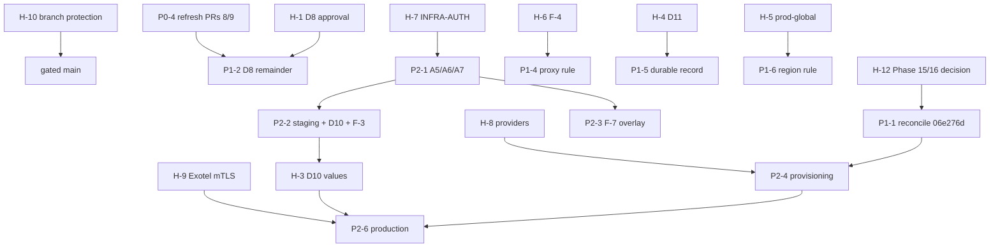

# Phase 15 — Project-Wide Readiness Audit and Execution Plan

**Date:** 2026-10-17. **Scope:** read-only audit of `main`, CI and the
outstanding blockers, plus small fixes that need no credentials, deployment or
external approval (§6).

**Evidence labels** (as in `docs/telephony/P1-4x`):
- **[V] verified:** observed in this audit through git, the GitHub API, CI logs
  or a local run;
- **[I] inferred:** reasoned from verified evidence; not observed directly;
- **[U] unavailable:** the evidence does not exist in the repository, or could
  not be obtained.

**Status: AUDIT COMPLETE.**
- **Fix PRs:** three, opened for review and **not merged**: #17, #18 and #19
  (§6).
- **Readiness:** staging is **NO-GO**, and Exotel AgentStream production media
  is **NO-GO** (§3.12–§3.13).
- **Lint:** the repository is **not lint-clean** (§4).

> **Phase-number collision [V].** "Phase 15" is already used by unpublished work.
> - **Where:** the owner's local `main` (`46d7b51`, `06e276d`) and the remote
>   branch `ci/telephony-integration/p118`.
> - **What it contains:** `docs/phase15/{DEPENDENCY_MAP,RESPONSE_FAILURE_SEMANTICS,SPEECH_COMPLETE_AUDIT}.md`,
>   `docs/phase16/` (13 files) and ADRs 0018–0023. None of it is on `main`.
> - **This file:** uses a distinct name, so no path collides.
> - **Open:** whether this audit or that work keeps the number is an owner
>   decision (H-12 in §5.2).

---

## 1. Verified current state [V]

### 1.1 `main` and its CI

| Item | Evidence |
|---|---|
| `origin/main` | `567dec75c61fb96cf48ff5f410d40a4f0a08b94b`, "docs(phase14): final report — Phase 14 complete (#15)" |
| CI on `567dec7` | Backend Foundation 39051981863 **pass**; hardening 39051981887 **pass** (6/6 jobs). pr-go did not run for this docs-only commit. |
| Latest pr-go on `main` (`ef2cb7e`) | run 39050923779: 97 jobs pass, **40 golangci-lint jobs fail**, no other failure |
| Hardening allowlist | `.github/workflows/hardening.yml:93` lists `services/go/voice` (17 entries) |
| Coverage floor | `hardening.yml:239`: `floor=60`. `git diff c294fc6 567dec7 -- .github/workflows/` adds only the voice entry and its comment, so the floor and every gate are unchanged. |
| Branch protection | **none.** `GET /branches/main/protection` returns 404, "Branch not protected", so no check or review is required to merge (§3.15). |
| Repository visibility | **public**, so standard GitHub-hosted runner minutes are free (relevant to D8). |

### 1.2 Phase 14 PRs

| PR | Head | Merge commit | CI evidence |
|---|---|---|---|
| #16 (T9 fix) | `33ca2e0` | `800861a` (squash, 16:21:44Z) | PR: Backend Foundation 39048351182, hardening 39048351194 pass; `main`: hardening 39049073209 pass |
| #14 (T13) | `dc80b7e` | `ef2cb7e` (squash, 16:47:08Z) | PR: hardening 39049877519 pass; `main`: hardening **39050923782** pass, with `services/go/voice 80.6%` |
| #15 (report) | `f673234` | `567dec7` (squash, 17:02:03Z) | Backend Foundation 39051746964 pass |

### 1.3 Phase 14 report claims checked against evidence

| Claim in `docs/phase14/FINAL_REPORT.md` | Finding |
|---|---|
| Phase 14 COMPLETE; PR #16 → `800861a`, #14 → `ef2cb7e` | **confirmed** (GitHub API) |
| Post-merge hardening 39050923782 passed with `services/go/voice` at 80.6% | **confirmed** (coverage artifact; both race logs `ok`) |
| 40 lint jobs, 1,022 findings, none new | **confirmed** on `ef2cb7e`. The only per-run difference is the `persistence` revive rule label (§4). |
| No provider can be constructed (§9) | **confirmed on `main`.** The unpublished `06e276d` wires a whisper-cli recogniser; that is not on `main` (§3.14). |
| T9: mechanism demonstrated, original cause inferred | consistent with the evidence. Nothing new was found. |
| §10 blocker list | **partly stale**: D8's premise has moved since P1-40…P1-47 were written (§3.1) |

No claim was found to be false. The report stays as the historical closure
record and is **not edited** by this audit.

### 1.4 Working trees, branches and unpublished work

- **Primary worktree** (`C:\Users\abhik\OneDrive\Desktop\Calling Agent`):
  - branch `telephony/p1-fence-rds-iam` at `ad4a734`;
  - 415 status entries, status hash `d4fb9c4206dc2168`, unchanged by this
    audit;
  - `infra/k8s/base/deployment.yaml` is ` D` (deleted, not restored).
- **Its commits** `3f3e1aa`, `8cbfeda` and `ad4a734` are **not** ancestors of
  `main`.
  - The gateway code reached `main` through merge `89564e5`, which brought in
    `a6e92fe`, `9545660`, `cfcc910` and `ed99b89`.
  - Whether the two sets of commits have identical content was not checked [U].
- **Worktrees:** 16. That is the 12 that existed before this audit, all
  preserved, plus 4 created for it: `calling-agent-phase15-lint`,
  `-phase15-ports`, `-phase15-lint2` and `-phase15-audit`.
- **Unpublished local `main`** (`06e276d`, 2 commits ahead of the old base
  `beb46df`, also on `origin/ci/telephony-integration/p118`):
  - 58 files, +14,210/−52;
  - a read-only `git merge-tree` against `origin/main` **conflicts in 4
    files**: `packages/go/voice/{bargein,pipeline,pipeline_test}.go` and
    `services/go/voice/cmd/server/main.go`. These are the areas PR #13
    (P1-92) and PR #16 changed.
- **Open PRs:** #7, #8 and #9, plus dependabot #2–#5, all untouched.
  - #8 and #9 would merge with `main` without conflict. Their CI is **stale**:
    their bases predate PRs #10–#13, and they show 70 and 68 failing checks,
    including 21 govulncheck, gofumpt, `evalsubjects` and race jobs.

## 2. Where the blocker identifiers are defined

| ID | Defined in | On `main`? |
|---|---|---|
| D8, D9, D10 | P1-24 §6 (`P1-24_ARCHITECTURE_DECISIONS_REPORT.md:271-273`); restated in P1-27:49-51 and P1-36:26-28 | **No.** Those files are untracked in the primary worktree. `main` has only the statuses (P1-40:17, P1-41:7, :293). |
| D11 | P1-26:89, :178; P1-27:52; P1-36:29 | **No** (untracked) |
| INFRA-AUTH (A7), A5–A9 | P1-36 §3 (untracked); P1-41 §2.2, §4, §6 | P1-41 is on `main` |
| `prod-global` | P1-40:37, :84; ADR-0008:162-163; `docs/architecture/deployment.md:161` | yes |
| F-3, F-4, F-7 | P1-41 §3.3 (`P1-41_INFRA_AUTH_READINESS_AUDIT.md:116-120`) | yes |
| Exotel mTLS NO-GO | ADR-0004 (`0004-media-transport.md:163`); `EXOTEL_CONTRACT_CHECKLIST.md:46` and `EXOTEL_EVIDENCE_REVIEW.md:66` (untracked) | ADR yes; evidence docs no |

**Missing from `main` [U]:** the D8–D11 definitions and the Exotel evidence
review exist only as uncommitted files. A reader of `main` cannot learn what
D8–D11 mean. **Smallest resolution:** the owner commits P1-24…P1-39 (and the
Exotel documents), or a decision register summarising them.

## 3. Blocker inventory

Each entry gives the requirement, the evidence, its dependencies, its risk, the
smallest safe resolution, acceptance criteria, and whether it can be completed
locally.

### 3.1 D8: CI and `-race` evidence for the gateway — **partly superseded; remainder open**

- **Requirement:** "Isolated CI push for `-race` evidence" (P1-36:26). The
  remainder is listed in P1-44:185 and P1-49 §3:
  - the gateway in the repeated race job;
  - the real-PostgreSQL suites in CI.
- **Evidence:**
  - **Superseded [V]:**
    - the gateway is tracked on `main` (merge `89564e5`);
    - pr-go runs it under `go test -race -count=1` (`pr-go.yml:129`), and in
      job 117449199826 all 4 packages pass;
    - its golangci-lint job passes.
  - **Still open [V]:**
    - the gateway is not in `hardening.yml`'s race lists;
    - no workflow on `main` sets `CS_TELEPHONY_GATEWAY_FENCE_TEST_DSN`, so the
      15 real-PG tests skip (15 skips locally, §6.2);
    - `telephony-integration.yml` exists only on
      `origin/ci/telephony-integration/p118`.
- **Dependencies:**
  - the owner's approval of CI scope;
  - PR #8 (repeated race only), which is stale and needs `main` merged in and
    a fresh run.
  - No credentials or spend: the repository is public, and the PG suite uses a
    disposable container on the runner.
- **Risk:** fence ownership, overlap and timing behaviour against a real
  database is unverified in CI, and races beyond one pass are unexercised.
- **Smallest resolution:**
  1. Update PR #8 with `main` and re-run it.
  2. Add the P1-49 §3.3 pattern: a throwaway PostgreSQL container, with
     `REQUIRE_ALL=1` turning a skip into a failure.
- **Acceptance:**
  - hardening's repeated race job lists the gateway and passes;
  - a CI job runs the 15 real-PG tests with 0 skips and passes.
- **Local?** The workflow edits can be authored locally, but only CI can prove
  them. That needs D8 approval.

### 3.2 D9: may a later "Option A" edit the user-dirty `context.go` and `harness.go`? — **unresolved**

- **Requirement:** P1-24:272; P1-36:27 records it as "only relevant with D2
  (outbound)".
- **Evidence:** `packages/go/conversation/context.go` and `harness.go` are
  still ` M` in the primary worktree [V].
- **Dependencies:** an owner decision, and D2.
- **Risk:** low while D2 is not pursued.
- **Smallest resolution:** the owner answers "D9: wait" or "D9: may edit", or
  commits the two files.
- **Acceptance:** the decision is recorded in a committed document.
- **Local?** No; it is a decision about the owner's own uncommitted work.

### 3.3 D10: fence timing values — **unresolved**

- **Requirement:** heartbeat interval and timeout, and the derived grace
  window (P1-24:273; P1-41 §5). They must come from **staging measurements**
  E1–E9, never be guessed.
- **Evidence:** `services/go/telephony-gateway/internal/app/fence.go:41,44`
  declares the variables. P1-30B:141 says no gateway can become ready until
  they are set. The measurement instrumentation is on `main` (P1-41 §8–§10).
- **Dependencies:** INFRA-AUTH, A5–A9 and a staging run, so an AWS account and
  **spending**.
- **Risk:** guessing values could permit two owners.
- **Smallest resolution:** run the P1-42 runbook in an authorized staging
  environment.
- **Acceptance:** the P1-41 §5 pass criteria: zero overlap intervals, and a
  hand-over gap ≥ 0 at p99.9.
- **Local?** **No.**

### 3.4 D11: a durable record for `reject_unconfirmed` offers — **deferred**

- **Requirement:** P1-26:89, :178. Today the evidence for an unconfirmed
  reject lives only in the result, log, metric and event, so it is lost if the
  log is lost.
- **Dependencies:** an owner decision on the schema or migration.
- **Risk:** medium for auditability; none for call handling.
- **Smallest resolution:** after the decision, a table or outbox record with a
  migration, tested against disposable PostgreSQL.
- **Acceptance:** a forced `reject_unconfirmed` leaves a durable row that
  survives a restart; the migration applies and rolls back.
- **Local?** Yes, **after** the decision.

### 3.5 `prod-global` region policy — **unresolved**

- **Requirement:**
  - `prod-global` also runs as `ENVIRONMENT=production`, so the code applies
    `prod-in`'s region list (`ap-south-1`, `ap-south-2`) to it;
  - a distinct policy needs a new decision, such as a deployment-identity
    variable (P1-40:37, :84).
- **Evidence:** `internal/app/iam.go:59-64` states this. ADR-0008:162-163 and
  `deployment.md:161` show `prod-global` is a scaffold only.
- **Dependencies:** an architecture or owner decision.
- **Risk:** none while `prod-global` has no deployment; a wrong-region
  identity once it does.
- **Smallest resolution:** decide the identifier and region list, then
  enforce it in `checkIAMEnvironment`.
- **Acceptance:** tests show a `prod-global` identity is refused outside its
  list, and `prod-in` is unchanged.
- **Local?** Yes, **after** the decision.

### 3.6 INFRA-AUTH (A7) and A5, A6, A8, A9 — **unapproved**

- **Requirement:** P1-41 §2.2, §4 and §6:
  - a separate staging account;
  - EKS with OIDC, IRSA and `rds-db:connect`;
  - Aurora with IAM authentication;
  - VPC endpoints, CloudTrail and ESO;
  - the SEP evidence items.
- **Evidence:** every `infra/terraform/envs/*` directory is empty and untracked
  (P1-41:18).
- **Dependencies:** an AWS account, operator principals, a budget owner,
  **spending**, and the owner's approval of A5–A9.
- **Risk:** high if done wrongly: account separation, cost and data.
- **Smallest resolution:** the owner approves A5 (manifests) and A6 (IaC)
  first. A6 can be written and reviewed before anything is applied.
- **Acceptance:** P1-41 §4.1's eight SEP evidence items; a budget alert in
  place before A7.
- **Local?** **No.** Only authoring the IaC is local, and it is unapproved.

### 3.7 F-3: STS credential early-refresh window — **open, low**

- **Evidence:** P1-41:116. `ExpiryWindow` appears nowhere in the gateway
  (`git grep` on `main`: 0 matches), so the SDK default of 0 applies [V].
- **Dependencies:** D10, with staging measurement E7.
- **Risk:** at worst a fail-closed re-dial blip.
- **Smallest resolution:** decide under D10; **no value is proposed**.
- **Acceptance:** an owner-chosen value, with a test that refresh happens
  that long before expiry.
- **Local?** The code is local; the value is not.

### 3.8 F-4: `HTTPS_PROXY` policy for STS — **open, owner decision**

- **Evidence:** P1-41:117. The gateway on `main` has no proxy handling
  (`git grep` finds no `HTTPS_PROXY`, `NO_PROXY` or `ProxyFromEnvironment`)
  [V].
- **Options:** (a) refuse startup in IAM mode; (b) ignore proxies for STS;
  (c) accept and document. P1-41 recommends (a).
- **Dependencies:** an owner choice only.
- **Risk:** low: TLS to STS stays verified.
- **Smallest resolution (option a):** a static check beside the existing
  static-key rule, which names the variable and never its value.
- **Acceptance:**
  - IAM mode refuses startup when `HTTPS_PROXY`, `HTTP_PROXY`, `NO_PROXY` or
    their lowercase forms are set, naming only the variable;
  - password mode is unaffected;
  - a mutation check shows the rule is load-bearing.
- **Local?** **Yes, once chosen.** It is not implemented here, because it is a
  policy choice.

### 3.9 F-7: the gateway manifest shape differs from the staging design — **open**

- **Evidence:**
  - P1-41:120: `replicas: 2` with RollingUpdate, against the A/B `Recreate`
    design (P1-39 O-1).
  - The gateway manifest `infra/k8s/base/services/telephony-gateway.yaml` is
    **untracked** owner work, with `replicas: 2` at line 58 and
    `type: RollingUpdate` at line 69 [V].
  - On `main`, the tracked `infra/k8s/base/deployment.yaml:7` also says
    `replicas: 2`. The primary worktree deletes that file, and the deletion is
    preserved.
- **Dependencies:** A5, the staging overlay.
- **Risk:** the staging test could not reproduce the designed topology.
- **Smallest resolution:** a staging overlay under A5. The base manifest is
  not changed.
- **Acceptance:** the overlay renders two single-replica `Recreate`
  workloads with anti-affinity.
- **Local?** The authoring is; the approval is not. Whether `deployment.yaml`
  stays on `main` is the owner's call.

### 3.10 The golangci-lint baseline — **open; engineering**

See §4. **Local?** Yes: mechanical classes now, judgment classes per finding.

### 3.11 Provider provisioning — **blocked, external**

- **Requirement:**
  - ADR-0017 §8 and Phase 14 §9: a `voice.Pipeline` needs providers;
  - every shipped provider shells out to an external binary or model.
- **Evidence:** the unpublished Phase 16 T8 audit (`46d7b51`,
  `docs/phase16/PROVIDER_READINESS_AUDIT.md`):
  - Ollama has zero models;
  - Piper is absent;
  - whisper `tiny` is cached locally;
  - no cloud provider exists.
- **Dependencies:** model downloads, choices of local or cloud per stage and of
  licence, and for cloud providers **credentials and spend**.
- **Smallest resolution:** the owner chooses the per-stage providers; the
  unpublished Phase 16 work is then reconciled with `main` (§3.14).
- **Acceptance:** a pipeline built from provisioned providers passes the voice
  end-to-end tests offline.
- **Local?** Not without downloads, which are not authorized.

### 3.12 Staging — **NO-GO**

- **Evidence:** P1-41:7 and P1-50:151.
- **Depends on:** §3.3, §3.6, §3.9 and the SEP evidence.
- **Local?** **No.**

### 3.13 Exotel AgentStream production media — **NO-GO**

- **Requirement:** ADR-0004 (`0004-media-transport.md:163`): "Carrier leg
  WebSocket must be WSS with mutual authentication."
- **Evidence:** the untracked `EXOTEL_CONTRACT_CHECKLIST.md:46`, under C2,
  records "no evidence Exotel supports" client-certificate mTLS.
  `EXOTEL_EVIDENCE_REVIEW.md:66` (Q2) is the question to ask.
- **Dependencies:** a **written carrier answer**: external, no credentials.
- **Smallest resolution:** obtain the answer to Q2. If it is "no", the owner
  decides whether to amend ADR-0004 or choose another carrier.
- **Acceptance:** a documented yes, with a CA chain or pin and a rotation
  notice; or a superseding ADR.
- **Local?** **No.**

### 3.14 Unpublished Phase 15/16 divergence (new) — **open, owner work**

- **Evidence:** §1.4. 58 files, +14,210/−52; 4 conflicting files [V].
- **Dependencies:** the owner's review. P1-52's blocker B-1 records these two
  commits as unreviewed.
- **Risk:** the longer it waits, the more it conflicts with `main`. Its
  conflicts sit in the barge-in and pipeline code that PR #13 stabilised.
- **Smallest resolution:** the owner decides to publish (merging `main` into
  that work, resolving the 4 conflicts and re-running the P1-92 and T9
  evidence) or to retire it.
- **Acceptance:** a PR from that work with all CI green except the lint
  baseline, and the P1-92 race tests repeated.
- **Local?** The engineering is; the decision is the owner's.

### 3.15 No branch protection on `main` (new) — **open, repository admin**

- **Evidence:** §1.1 [V]. Merges need no passing check and no review.
  CODEOWNERS teams are unresolved.
- **Risk:** a red or unreviewed change can land, and the lint baseline cannot
  be ratcheted.
- **Smallest resolution:** require Backend Foundation, the hardening jobs and
  pr-go's non-lint jobs as status checks. Leave lint out until the baseline
  is cleared.
- **Acceptance:** `GET /branches/main/protection` lists the required checks.
- **Local?** **No.** It is an outward-facing repository setting for the
  admin.

## 4. CI and lint baseline [V]

**On `main` (`ef2cb7e`; `567dec7` changed only docs):** 40 golangci-lint jobs
fail with **1,022 findings**. They are identical to `800861a` except for the
`persistence` revive rule label, which alternates between `exported` and
`var-naming` for the same two identifiers in unchanged code. That is
nondeterminism in the linter, not a new finding.

**By linter:**

| Linter | Findings |
|---|---|
| gocritic | 248 |
| revive | 214 |
| godot | 166 |
| errcheck | 123 |
| govet | 102 |
| gosec | 43 |
| errorlint | 43 |
| gocyclo | 39 |
| contextcheck | 16 |
| unused | 11 |
| other (8 linters) | 17 |

**By module:**
- `packages/go/voice` 170
- `audiointel` 114
- `evaluation` 105
- `toolruntime` 82
- `speech` 47
- `integrations` 45
- `runtime` 42
- `telephony` 41
- `governance` 41
- `services/go/identity` 38
- `media` 36
- `services/go/media-relay` 35
- `services/go/voice` 29
- `evalstore` 27
- `evalsubjects` 26
- `memory`, `persistence` 20 each
- `platform` 16
- `conversation` 15
- `outbox` 12
- `middleware`, `redis` 11 each
- `audiobridge`, `telemetry` 9 each
- `repository` 5
- `correlation` 2
- 14 modules with 1 each

**After the Phase 15 PRs (each verified locally and in CI):**

| State | Failing lint jobs | Findings |
|---|---|---|
| `main` today | 40 | 1,022 |
| with #17 | 25 | 1,006 |
| with #17 and #19 | 22 | 983 |

**Newly introduced findings by Phase 15 work: none.**
- **#17:** its CI fails exactly `main`'s set minus the 15 fixed jobs.
- **#18:** its CI fails exactly `main`'s 40 jobs.
- **#19:** its CI fails exactly `main`'s set minus the 3 fixed jobs.

## 5. Phase 15 plan

### 5.1 Priorities

**P0: correctness, CI reliability and security, verifiable locally**

| ID | Item | State |
|---|---|---|
| P0-1 | Clear the single-finding lint jobs (15 modules) | **PR #17**, CI-verified |
| P0-2 | Gateway startup-test port collision (P1-40 §4) | **PR #18**, CI-verified |
| P0-3 | Clear the `repository`, `telemetry` and `audiobridge` lint jobs | **PR #19**, CI-verified |
| P0-4 | Bring PRs #8 and #9 up to date with `main` and re-run CI | owner (their PRs) |
| P0-5 | Branch protection with required non-lint checks (§3.15) | repository admin |

**P1: engineering blockers that need no production access**

| ID | Item | Prerequisite |
|---|---|---|
| P1-1 | Reconcile or retire unpublished Phase 15/16 (§3.14) | owner decision |
| P1-2 | D8 remainder: gateway in the repeated race job, PG suites in CI (§3.1) | D8 approval, then P0-4 |
| P1-3 | Remaining lint, module by module: the mechanical classes first (godot, revive docs, errorlint, shadow), then gocritic, errcheck, gosec, contextcheck and gocyclo, each fixed or given a justified `nolint` (P1-49 §3.1) | none |
| P1-4 | F-4 option (a) (§3.8) | owner choice |
| P1-5 | D11 durable record (§3.4) | owner decision |
| P1-6 | `prod-global` region enforcement (§3.5) | owner decision |
| P1-7 | Whether the gateway joins hardening's coverage floor. Its `cmd/server` coverage is 6.7% in pr-go. This is a policy question like T13. | owner decision |
| P1-8 | Commit the D8–D11 and Exotel source documents (§2) | owner |

**P2: needs external prerequisites (accounts, spend, carriers, models)**

| ID | Item | Prerequisite |
|---|---|---|
| P2-1 | INFRA-AUTH: A5, then A6, then A7 (§3.6) | AWS account, budget, approvals |
| P2-2 | Staging run and D10 measurements; F-3 (§3.3, §3.7) | P2-1, A8, A9 |
| P2-3 | F-7 staging overlay (§3.9) | A5 |
| P2-4 | Provider provisioning (§3.11) | model downloads or cloud credentials |
| P2-5 | Exotel mTLS answer (§3.13) | carrier |
| P2-6 | Any production deployment | all of the above |

### 5.2 Genuine human approvals vs ordinary engineering

**Human approvals (owner, admin or external):**
- **H-1** D8 CI scope
- **H-2** D9
- **H-3** D10 values, from staging data
- **H-4** D11
- **H-5** `prod-global` policy
- **H-6** F-4 option
- **H-7** INFRA-AUTH and A5–A9, with spend
- **H-8** provider choices and downloads
- **H-9** the Exotel answer (external)
- **H-10** branch protection (admin)
- **H-11** merging #17–#19, and the fate of #7, #8 and #9
- **H-12** Phase 15/16 numbering, and the fate of local `main` `06e276d`

**Ordinary engineering (normal PR review only):**
- the remaining lint batches (P1-3);
- test flake fixes like #18;
- doc corrections;
- the code for P1-4, P1-5 and P1-6 once their decisions are recorded.

### 5.3 Dependency graph

## 6. Safe fixes implemented in Phase 15

None of these is merged. Each is open for review (H-11), because this is newly
discovered Phase 15 work. All local runs used Docker `golang:1.26.9-bookworm`
with golangci-lint v1.64.8, the version CI uses.

### 6.1 PR #17: single-finding lint baselines (15 modules)

- **PR:** https://github.com/123Anujyadav/aegis-voice-agent/pull/17,
  branch `phase15/lint-trivial-baseline`, commit
  `4f4f905218dc68c331dbe1dc77674c7f8a2637d6`.
- **Change:** comments plus a 2-line test change; 15 files.
  - The godot and shadow hunks match the owner's uncommitted working-tree
    edits byte for byte.
  - The 7 package comments leave out that working tree's sentence about a
    `service version` subcommand, which is not on `main`. They may give the
    owner a trivial comment-only conflict.
- **Local:** all 15 modules lint with exit 0. gofmt, gofumpt and vet are clean,
  and `-race` tests pass. The secret scan is clean.
- **CI:** 25 checks fail, **all golangci-lint**. That is exactly `main`'s 40
  minus the 15 targeted jobs; nothing new fails.

### 6.2 PR #18: gateway startup-test port collision

- **PR:** https://github.com/123Anujyadav/aegis-voice-agent/pull/18,
  branch `phase15/gateway-startup-distinct-ports`, commit
  `c0c0b792bfbf7998aceac0db4bd50df717561f3b`.
- **Defect:** `TestStartup_MalformedMetadataDoesNotStopTheService` picked two
  ports one at a time, closing each listener first, so they could collide. The
  fix reuses the package's `freePorts(t, 2)`. It is test-only.
- **Probe** (throwaway, not committed; 20,000 pairs each way on Linux): the old
  pattern gave **1 duplicate pair**; `freePorts` gave 0.
- **Local:**
  - the changed test passes 20/20 under `-race`;
  - the gateway gives 112 pass, 0 fail, 15 skip (the real-PG tests);
  - vet (also `GOOS=windows`), gofmt, gofumpt and lint are clean.
- **CI:** 104 checks pass, including the gateway test job. 40 fail, **all golangci-lint**: exactly `main`'s baseline set, with none new.

### 6.3 PR #19: `repository`, `telemetry` and `audiobridge` lint

- **PR:** https://github.com/123Anujyadav/aegis-voice-agent/pull/19,
  branch `phase15/lint-doc-comments`, commit
  `bea5ac3d11239dcca1dc8fc390c5c2cc704da213`.
- **Change:** 23 findings across 4 files; doc comments plus test-only `err`
  reuse.
  - `InitializeOpenTelemetry`'s comment states that it configures nothing,
    and its behaviour is unchanged.
  - The owner's copies of these files equal `main`.
- **Local:**
  - all 3 modules lint with exit 0;
  - gofmt, gofumpt and vet are clean;
  - audiobridge passes `-race -count=3`; the other two modules have no test
    files.
- **CI:** 107 checks pass. 37 fail, **all golangci-lint**: `main`'s 40 minus exactly the 3 targeted jobs, with none new.

### 6.4 Considered and not implemented

| Item | Why not |
|---|---|
| F-4 option (a) | policy choice (H-6) |
| PR #8 / #9 refresh | the owner's PRs; out of scope for unrelated PRs |
| Merging `06e276d` | owner work, 4 conflicts, unreviewed (H-12) |
| Lint classes needing judgment (errcheck, gosec, contextcheck, gocyclo) | each needs per-finding review; batched as P1-3 |
| Branch protection | repository admin setting (H-10) |

## 7. NO-GO boundaries and external prerequisites

**Not done in Phase 15, and still not authorized:**
- deployment;
- any staging or production change;
- publicly exposed services;
- live carrier calls;
- AWS calls;
- model downloads;
- provider provisioning;
- spending;
- credential requests.

No secret was requested or used. The Go module fetches during validation were
the repository's pinned dependencies, through the checksum-verified Go proxy.

**External prerequisites, in order:**
1. an AWS staging account and a budget owner (A6/A7);
2. the SEP evidence;
3. EKS OIDC and IRSA, and an Aurora user with `rds_iam`;
4. staging measurements for D10;
5. Exotel's written answer on client-certificate mTLS;
6. provider and model choices.

**The protected file:** `infra/k8s/base/deployment.yaml` stays deleted in the
primary worktree. It was not restored.

## 8. Next actions

1. **Owner:** review and merge #17, #19 and #18, in any order; they are
   independent.
2. **Owner:** decide H-12 (unpublished Phase 15/16) and H-1 (D8). Then refresh
   PR #8 with `main`.
3. **Admin:** enable branch protection with the non-lint required checks
   (H-10).
4. **Owner:** answer H-6 (F-4), H-4 (D11) and H-5 (`prod-global`). Each
   unblocks a local code change.
5. **Engineering:** continue P1-3 lint batches, starting with the mechanical
   godot, revive and errorlint findings in the 22 remaining modules.
6. **External, when authorized:** INFRA-AUTH (A5 → A6 → A7), then the staging
   D10 run; the Exotel Q2 answer.
