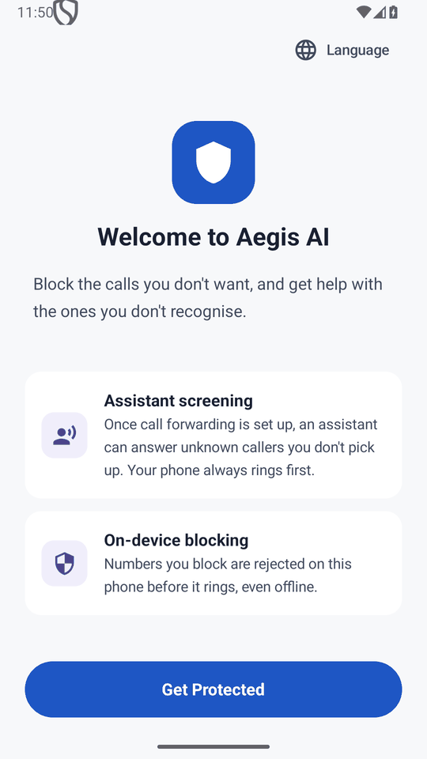
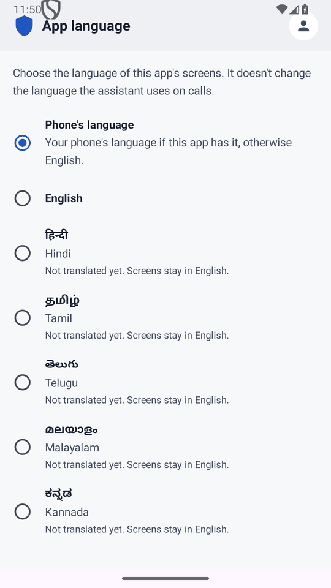
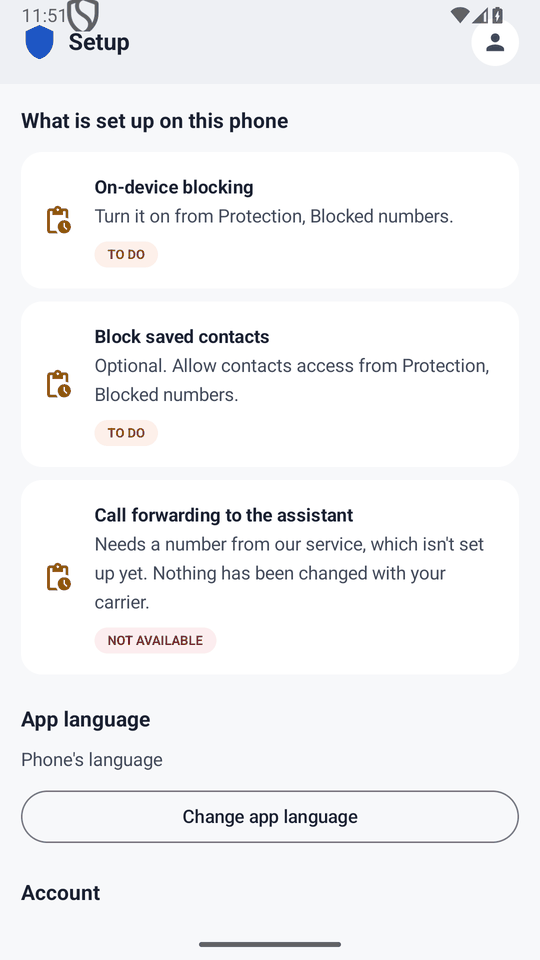
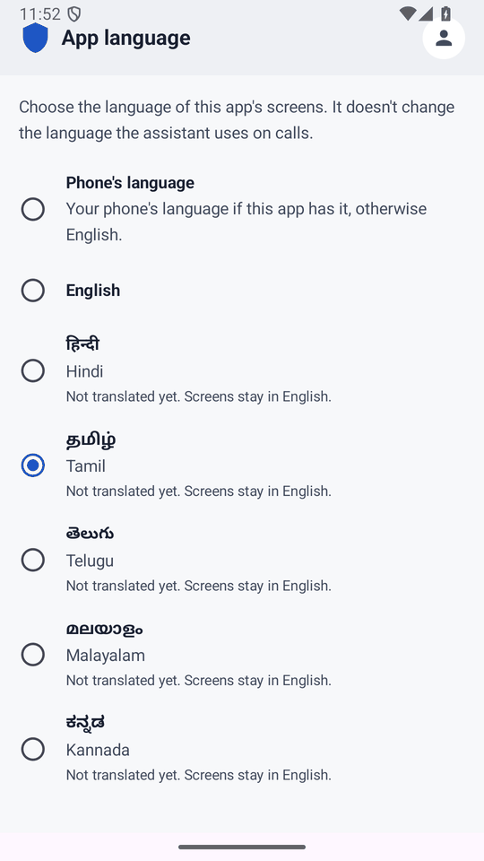
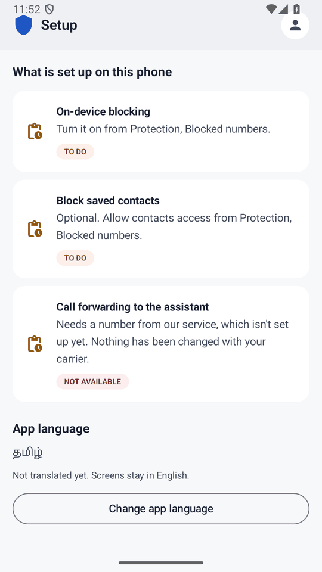
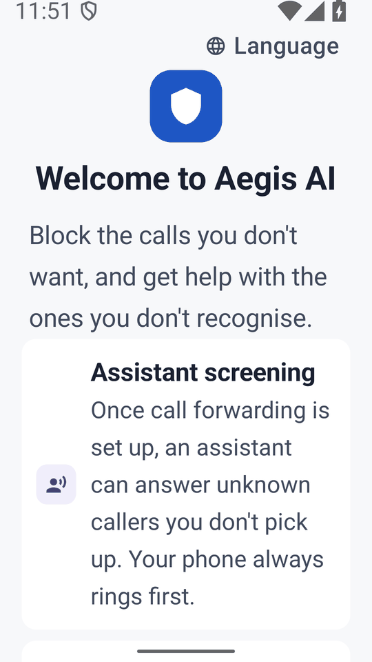
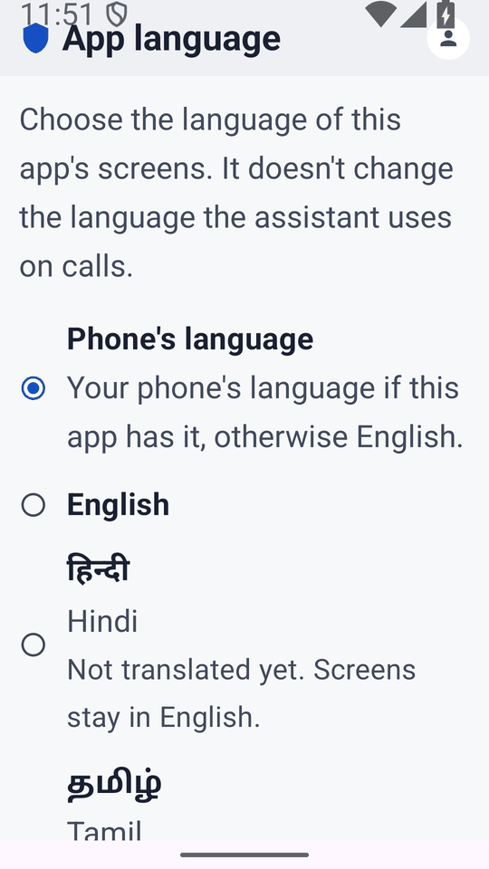
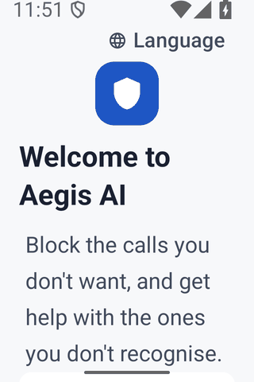
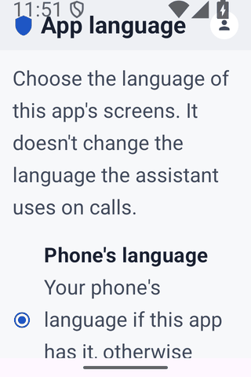

# Design review packet: choosing the app's language (A58l, and A01's Language control)

- **Status: awaiting design review.** **Nothing here is approved.** This packet does not approve either change; the owner and a design reviewer decide.
- **Prepared:** 2026-11-04, on main `592e588`, by Claude Code. AI-prepared material for a human review (`ARCHITECTURE_FREEZE.md` §6.1 rule 9).

**Why a review:**
- A58l is a new screen and A01 gained a control.
- Both changes are to frozen UX. `UX_FREEZE.md` §7 says such a change is written into `docs/ux/` in the same PR, then goes through "design + eng review".
- The docs were written (#222, #225), and engineering checks passed. **The design review has not happened.**

| Change | PR, merge | UX spec |
|---|---|---|
| A58l App language: a new screen, opened from Settings | #222, `be04450` | [`07` A58l](../07-screens-settings-premium-business.md); [`02`](../02-navigation-graph.md); [`03`](../03-screen-inventory.md) |
| A01 Welcome: a **Language** control that opens A58l before sign-in | #225, `592e588` | [`06` A01](../06-screens-onboarding-auth-permissions.md) (Outputs and Accessibility amended) |

## 1. The specification as written

**A58l · App language** (`07`, abridged):
- **Purpose:**
  - the language of the app's screens, **not** the language the assistant speaks and understands on calls (A43);
  - choosing one never changes the other;
  - the screen says so in its first line.
- **Structure:**
  - one choice among seven rows: **Phone's language** (the default), then English, Hindi, Tamil, Telugu, Malayalam, Kannada;
  - each language is named in its own script, with its name in the screens' language beneath;
  - a language without a reviewed translation says "**Not translated yet. Screens stay in English.**" and can still be chosen.
- **Behaviour:**
  - a choice applies at once, and the screens are re-created in it;
  - on Android 13 and later it is Android's per-app language: it survives restarts and updates, and it is the same setting as the system's App languages page;
  - on Android 8 to 12 the app keeps it;
  - the place in the app, its state and the session are kept;
  - any word a language lacks is shown in English.
- **As built:**
  - the Settings tab (today the setup checklist) has an **App language** section, above Account, which shows the current choice and opens A58l;
  - before sign-in, Welcome (A01) has a **Language** control that opens it.
- **Accessibility:**
  - the rows are radio buttons in one group;
  - each language's own name is marked as that language, so a screen reader uses the right voice.

**A01 · Welcome, amended** (`06`):
- **Outputs:** "… open `A58l` App language."
- **Accessibility:** "A secondary **Language** control (a globe and the word, top end; added 2026-11-03) opens `A58l`, so someone who cannot read the phone's language can change the app's before anything else is asked of them."

## 2. Emulator captures

**Setup:**
- Android 15 emulator (API 35, `Pixel_9_API_35`, Google APIs image), debug build of main `592e588`;
- the debug build's start-destination extra opens each screen directly; the release build ignores it;
- downscaled to half size;
- these are images of the build, not mock-ups.

| | |
|---|---|
|  **1. A01 Welcome.** The Language control is top end |  **2. A58l.** Phone's language (selected), then the six. Five say "Not translated yet" |
|  **3. Settings tab.** The App language section with the current choice and the button |  **4. A58l after choosing Tamil.** The screen is re-created; the words stay English because no translation exists |
|  **5. Settings with Tamil chosen.** It shows the native name and the note |  **6. A01 at twice the text size** (font scale 2.0) |
|  **7. A58l at twice the text size.** The title runs into the status bar (issue U1) |  **8. A01 on a 320 × 480 dp screen at twice the text size** |
|  **9. A58l on a 320 × 480 dp screen at twice the text size** | |

**Not captured:**
- **Welcome with Tamil chosen.** It is pixel-identical to capture 1 below the status bar, because no translation exists.
- **Android 8 and 9.** Their behaviour is covered by the device tests in §5.
- **A real translation.** None exists.
- **TalkBack's speech.** TalkBack is installed on the emulator, but its speech was not recorded. §4 gives the accessibility tree instead.

## 3. Navigation

```
A01 Welcome ──(Language)──▶ A58l ──(Back)──▶ A01
Settings tab ──(Change app language)──▶ A58l ──(Back)──▶ Settings tab
A58l: tap a language ─▶ applied at once; the screen is re-created in place; Back still returns
```

- **A choice applies on tap.** There is no Save and no confirmation. The person **stays on A58l**, re-created in the new language, so a wrong tap can be corrected at once.
- **Back** returns to where A58l was opened. That is tested on a device after the re-creation (`AppLanguageOnDeviceTest`).
- **The top bar has no Up arrow.** That is true of every screen using `AegisTopAppBar`. Return is by Android's Back gesture or button (issue U2).
- **The session survives a change.** The stored session record is checked byte for byte across it (`AppLanguageOnDeviceTest`).
- **Spec vs build:**
  - **Spec (`02`):** A58l sits under A58 Appearance, in Settings.
  - **Build:** A58 is not built. A58l is reached from the Settings tab's App language section instead (decision D5).

## 4. Accessibility

**The accessibility tree** (`uiautomator dump` on the emulator, A58l with nothing chosen):
- **Order:** intro text, then seven rows, then the top bar's logo ("Aegis Shield Logo") and title.
- **Each row** is one checkable node: the radio button's own semantics are merged into the row.
- **Phone's language** is checked. Its text is "Phone's language" plus its detail.
- **Each language row** reads its native name ("தமிழ்"), its name in the screens' language ("Tamil"), and "Not translated yet. Screens stay in English."
- **A01:** the Language control is one clickable node with the text "Language". The globe is decorative, with no description, so the control is announced once. **Its touch target is 48 dp high.**

**Held by tests (Robolectric, run in CI):**
- **`AppLanguageScreenTest`:**
  - the radio group: one choice of seven;
  - each native name carries a locale span for screen readers (`readIn`), so TalkBack reads "தமிழ்" with a Tamil voice where the phone has one;
  - no language's name is shown in an untranslated language.
- **`SettingsLargeTextTest`, `SettingsTranslationLayoutTest`, `OnboardingTranslationLayoutTest`:** A58l, the Settings section and A01's Language control can be brought fully into view at twice the font scale in 320 × 480 dp, in each of the six language configurations, with stand-in text 50% longer in each script.

**Not verified:**
- TalkBack's actual speech on a device, in any language;
- the Tamil, Telugu, Malayalam and Kannada voices depend on the phone's text-to-speech engine having them.

## 5. Large text and small screens

- **Captures 6–9:** at twice the text size, both screens reflow and scroll, and nothing is cut off. On a 320 × 480 dp screen, Welcome's Language control still fits on one line.
- **The exception is the top bar (U1):** at twice the text size its title draws into the status bar (captures 7, 9).

**Device tests:**
- **`AppLanguageOnDeviceTest`:** API 26, 28 and 35 emulators, CI runs on #222's head `0ff1d11`: 41509328543, 41509334002 and 41509335478. It covers choose, re-create, Back, persistence, and the session being kept.
- **`MinifiedAppTest`** (the R8 build): Welcome → A58l → Back, run 41520633662. It also checks that an untranslated per-app language starts in English.

## 6. Usability issues found

| # | Issue | Where | Severity | Owner of the fix |
|---|---|---|---|---|
| **U1** | **The top bar draws under the status bar.** At normal text size the title sits close to the clock; at twice the size they overlap (captures 7 and 9). `AegisTopAppBar` adds no status-bar inset, and its fixed 64 dp height cuts off a title that wraps. **Every screen with a top bar is affected, not only A58l** | All top-bar screens | High at large text | Engineering: an implementation defect, not a design choice. **The cut-off title is fixed (#228). The status-bar overlap is still open:** padding the bar for the status bar broke a caller-list test on Android 15 in CI, for a reason not yet found |
| **U2** | **No visible Up or Back control** on A58l (or any top-bar screen). A person who doesn't use the Back gesture may not find the way out | A58l, app-wide | Medium | **Design decision D6** |
| **U3** | Five rows repeat "Not translated yet. Screens stay in English." Choosing one changes nothing visible, which may read as broken | A58l | Medium while there are no translations | **Design decision D3** |
| **U4** | "Phone's language" doesn't say which language that is. On an English phone it looks like a duplicate of "English" | A58l, Settings section | Low | **Design decision D7** |
| **U5** | **Welcome's control says "Language" in the language the app is showing.** It is the way out for someone who can't read that language. Once translations exist, the word will be in a script that person may not read | A01 | Medium once translations exist | **Design decision D4**; `docs/translation/QUESTIONS.md` Q10 |
| **U6** | **The Settings section shows only the native name of the choice** ("தமிழ்"), while A58l's rows also show the name in the screens' language ("Tamil") | Settings section | Low | Design: D7 covers it |
| **U7** | **A choice gives no confirmation:** the screen re-creates in place. That is intended (a wrong tap is easy to undo), but with no translation nothing visibly changes | A58l | Low | **Design decision D9** |
| **U8** | Not a language issue, found during the review: **each Welcome feature icon's description repeats its title**, so TalkBack reads "Assistant screening" twice | A01 | Low | Engineering or design: the icon could be decorative |

## 7. Decisions for the owner and design reviewer

**None of these has been decided by Claude Code.** Each recommendation is only a recommendation.

| # | Decision | Options | Recommendation |
|---|---|---|---|
| **D1** | Accept **A58l** as specified (`07`) | Accept · change · reject | Accept, subject to D3–D9 |
| **D2** | Accept **A01's Language control** (top end, globe and word) | Accept · move (for example below the primary action) · reject | Accept; its form depends on D4 |
| **D3** | **Untranslated languages:** listed with a note (as built) · hidden until translated · listed but disabled | | **Keep as built.** It is your instruction that any of the six can be chosen. Review again when the first translation lands |
| **D4** | **The Welcome control's label** | The screens' language (as built) · always bilingual, e.g. "भाषा · Language" · a globe with the six native names | **Bilingual:** the screens' word plus "Language" in English. Translators then need to know (Q10) |
| **D5** | **Where A58l lives in Settings** | The Settings tab's section (as built) · under A58 Appearance once A58 is built (`02`) | **Keep as built until A58 exists**, then move it and keep the section as a shortcut |
| **D6** | **An Up arrow in the top bar** of screens opened from another (A58l, deletion, lists) | Add app-wide · rely on system Back (as built) | Add app-wide. This is a shared-component change across many screens: **design's decision** |
| **D7** | **Name the phone's language** in its row and in Settings, e.g. "Phone's language (English)" | Name it · leave generic (as built) | Name it, using the language the app actually resolves to |
| **D8** | **Premium:** `07`'s premium strategy lists "multiple languages" as a premium feature | Confirm it means the **assistant's voice languages** and that the app's screen language is free · otherwise | **Confirm the screen language is free.** A58l is built as free |
| **D9** | **After a choice:** stay on A58l (as built) · return to where it was opened | | **Stay** (a wrong tap is easy to undo), and consider a short confirmation in the new language once translations exist |

**What happens after review:**
- **Accepted decisions** are written into `docs/ux/` and built in the same PR, as `UX_FREEZE.md` §7 requires.
- **U1** is an engineering defect and is fixed without waiting for this review, because it changes no design.
- **U8** is fixed only if design agrees.
